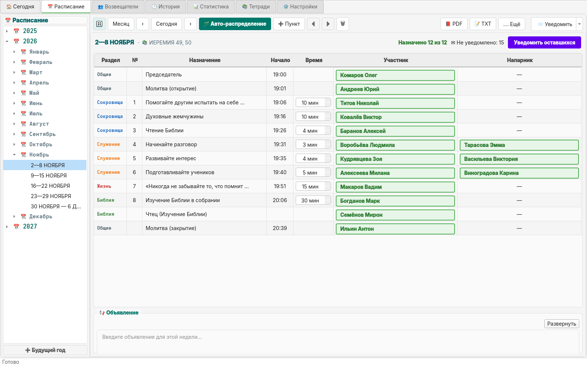
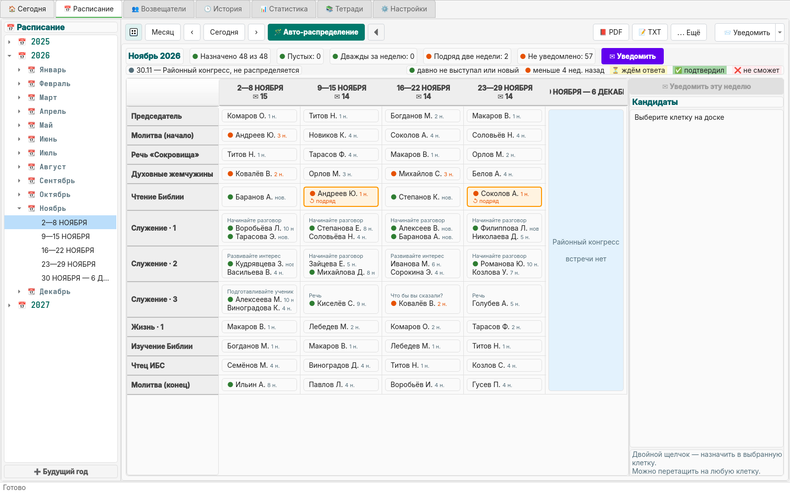

# Cerastilo

Планировщик встреч «Жизнь и служение»: одно приложение на PySide6 для компьютера (Linux) и Android-планшета.

## Что умеет

* **«🏠 Сегодня»** — пульт руководителя встречи: список неотложных дел (отказы, пустые пункты, неотправленные уведомления) и карточка ближайшей встречи с ответами участников.
* **«📅 Расписание»** — дерево дат (Год → Месяц → Неделя), таблица недели и доска месяца; ручной выбор и замена участников, подсказки о конфликтах, правка длительности, сортировка строк перетаскиванием, внеочередные пункты.
* **Авто-распределение** недели и месяца («🪄 Авто») с учётом квалификаций, духовного статуса, пола, интервалов отдыха, отпусков и сменного графика; для месяца — с автоматическим снимком базы и откатом.
* **«👥 Возвещатели»** — база участников с поиском, сортировкой и цветовой индикацией; карточка с квалификациями, семьёй, личным интервалом, отпуском, сменным графиком, email и телефоном.
* **«🕒 История»** и **«📊 Статистика»** — хронология назначений возвещателя, тепловая карта выступлений и графики нагрузки по категориям заданий.
* **«📚 Тетради»** — импорт программы встреч из рабочих тетрадей (EPUB) с автоматической раскладкой по неделям.
* **Email-уведомления** — массовая и индивидуальная рассылка с шаблонами и предпросмотром, журнал отправки, экспорт заданий в календарь (.ics), автоматическая проверка ответов «Подтвердил» / «Не сможет».
* **Экспорт и печать** — расписание в PDF, TXT и Word (.docx); генерация бланков S-89 по неделям и на весь месяц.
* **Особые события недели** — «🍷 Вечеря Господня», «🏟️ Районный конгресс», «🌍 Региональный конгресс», «👔 Посещение районного старейшины (РС)».
* **Отмена и возврат** — Undo/Redo в неделе, откат пакетного распределения месяца к снимку базы.
* **«⚙️ Настройки»** — параметры собрания, тема оформления, модули, импорт истории из NW Scheduler и контактов из Excel, резервное копирование, синхронизация ПК ↔ планшет по Wi-Fi.

## Скриншоты





Остальные экраны — в [руководстве пользователя](docs/help/ru/guide.md). На снимках демо-база с выдуманными именами.

## Быстрый старт на Linux

```bash
python3 -m venv .venv
.venv/bin/pip install -r requirements.txt
./start.sh
```


## Android

Сборка APK для arm64-планшетов, установка и особенности работы — в [`docs/INSTALL.md`](docs/INSTALL.md).

## Документация

* [`docs/help/ru/guide.md`](docs/help/ru/guide.md) — полное руководство пользователя: каждая функция, шаги и правила.
* [`docs/INSTALL.md`](docs/INSTALL.md) — установка, в том числе на Android-планшет.
* [`CONTRIBUTING.md`](CONTRIBUTING.md) — как участвовать в разработке.
* [`docs/ARCHITECTURE.md`](docs/ARCHITECTURE.md) — устройство программы для разработчиков.

## Технологии

| Компонент | Технология |
|---|---|
| Язык | Python 3 |
| Интерфейс | PySide6 6.12 (Qt 6) |
| База данных | SQLite |
| ORM и миграции | SQLAlchemy 2.x + Alembic |
| Импорт тетрадей | zipfile + BeautifulSoup, lxml |
| Экспорт в Word | python-docx |
| Платформы | Linux (десктоп), Android-планшеты (arm64) |

## Лицензия

Код открыт только для просмотра (source-available), это не open source. Официальные сборки можно бесплатно скачивать и использовать, в том числе собраниям. Изменять, распространять, перепаковывать и продавать без письменного разрешения автора нельзя. Полный текст — в [`LICENSE`](LICENSE).

## In English

Cerastilo is a desktop and Android tablet scheduler for the "Life and Ministry" meeting, built with Python 3 and PySide6 (Qt 6), with SQLite via SQLAlchemy and Alembic. It covers the whole scheduling workflow: participant database, EPUB workbook import, rule-based auto-assignment for a week or a month, manual edits, email notifications and reply tracking, PDF/TXT/DOCX export and S-89 forms, plus Wi-Fi sync between PC and tablet. The source code is available for viewing only (source-available, not open source); official builds are free to use, everything else requires the author's written permission — see [`LICENSE`](LICENSE).

### Installation

* **AUR (Arch Linux).** Run `yay -S cerastilo`.
* **AppImage (Linux).** Run `chmod +x Cerastilo-*.AppImage`, then double-click the file to launch it. Data is stored in `~/.local/share/cerastilo` by default.
* **Windows.** Extract the ZIP and launch `cerastilo.exe`; keep the other files in that folder together and do not delete them. Data is stored in `%LOCALAPPDATA%\Cerastilo`.

PC–tablet Wi-Fi sync is unencrypted. Use it only on a trusted home network.

[User guide](docs/help/en/guide.md) · [Quick start](docs/help/en/quick_start.md) · [Installation notes, including Android (Russian)](docs/INSTALL.md)
