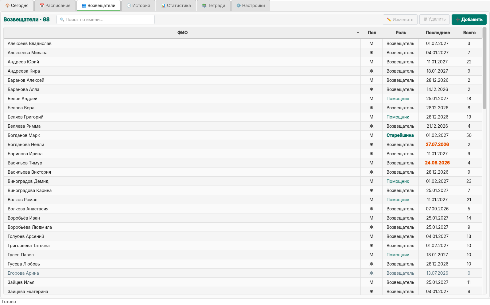

<a href="#ru">Русский</a> | <a href="#en">English</a>

  
  <h1>Cerastilo</h1>
  
Бесплатный планировщик встречи «Христианская жизнь и служение» для компьютера и Android-планшета.

  

    
    
    
    
  

  
<a href="https://cerastilo.com">Сайт</a> · <a href="https://github.com/pioner14/Cerastilo/releases/latest">Скачать</a> · <a href="docs/help/ru/guide.md">Руководство</a>

## О программе

Cerastilo — неофициальное приложение для планирования встречи «Христианская жизнь и служение». Версии для компьютера и Android-планшета работают самостоятельно. Расписание доступно офлайн, данные хранятся в локальной базе SQLite, а синхронизацию по Wi-Fi можно использовать по желанию. Интерфейс доступен на русском и английском.

## Возможности

- **Доска месяца и автораспределение.** Учитывает квалификацию, пол, интервалы между назначениями и отпуска. Заполняет только пустые пункты. Результат можно отменить одним нажатием.
- **Экран «Сегодня».** Ближайшая встреча, срочные дела и список тех, кто ещё не получил уведомление или не ответил.
- **Возвещатели и история.** Карточки с контактами, квалификацией, сведениями о семье и отпусках. Видно, кто с кем уже выступал в паре.
- **Статистика нагрузки.** Графики по категориям показывают, кто часто получает назначения и кто давно не участвовал.
- **Рабочие тетради.** Импорт скачанного вами EPUB из официального источника с автоматической разбивкой программы по неделям.
- **Печать, экспорт и уведомления.** Расписание в PDF и Word, бланки S-89, письма участникам с календарным файлом `.ics`.

## Скриншоты

<table>
  <tr>
    <td width="50%"> Доска месяца</td>
    <td width="50%"> Экран «Сегодня»</td>
  </tr>
  <tr>
    <td> Возвещатели</td>
    <td> Статистика нагрузки</td>
  </tr>
</table>

## Установка из готовых сборок

ZIP, AppImage и APK ищите на странице [последнего релиза](https://github.com/pioner14/Cerastilo/releases/latest).

- **Linux.** На Arch Linux установите пакет из AUR командой `yay -S cerastilo`. Для AppImage выполните в папке загрузки `chmod +x Cerastilo-*.AppImage`, затем откройте файл двойным щелчком.
- **Windows.** Распакуйте ZIP целиком и запустите `cerastilo.exe`. Остальные файлы в распакованной папке не перемещайте и не удаляйте. Данные хранятся в `%LOCALAPPDATA%\Cerastilo`.
- **Android-планшеты (arm64).** Установите APK.

## Синхронизация ПК ↔ планшет

Подключите оба устройства к одной сети Wi-Fi. Откройте синхронизацию на планшете и введите на компьютере показанные планшетом адрес и шестисимвольный код. При объединении баз сохраняется более свежая правка. Перед слиянием приложение сохраняет резервную копию.

**Данные передаются без шифрования. Синхронизируйте устройства только в доверенной домашней сети.**

## Документация

- [Руководство](docs/help/ru/guide.md)
- [Быстрый старт](docs/help/ru/quick_start.md)
- [Установка](docs/INSTALL.md)

## Планы

Cerastilo уже работает на Linux, Windows и Android. Версии для Mac (macOS), iPhone и iPad (iOS) тоже в планах, но для разработки и проверки под них нужны устройства Apple, которых у автора пока нет. Пожертвования помогут их приобрести и ускорят появление этих версий.

## Поддержать проект

Cerastilo делает один человек в свободное время. Приложение бесплатное. Если оно вам помогает, вы можете поддержать разработку добровольным пожертвованием.

PayPal · [5 €](https://paypal.me/NikolaiGolotaistrov/5EUR) · [Своя сумма](https://paypal.me/NikolaiGolotaistrov)

## Лицензия

Cerastilo распространяется по лицензии source-available. Исходный код доступен для ознакомления, а официальными сборками можно пользоваться бесплатно. Условия использования и распространения описаны в [LICENSE](LICENSE).

Для разработчиков

Инструкции по сборке из исходников · [docs/INSTALL.md](docs/INSTALL.md)

### Технологии

- Python 3.11+ и PySide6 6.12.0 (Qt 6.12).
- SQLite через SQLAlchemy (`>=2.0.0,<3.0`, в APK — `2.1.5`) и Alembic (`>=1.13.0,<2.0`).
- python-docx (`>=1.1.0,<2.0`), lxml (`>=5.0.0,<7.0`), BeautifulSoup (`beautifulsoup4>=4.12.0,<5.0`), openpyxl (`>=3.1.0,<4.0`).
- Pillow (`>=10.0.0,<13.0`) и requests (`>=2.31.0,<3.0`).
- PyInstaller для Windows и Linux AppImage, pyside6-android-deploy и python-for-android для APK, GitHub Actions для проверок и сборок Windows и AppImage.

**Архитектура**

- **Ядро (`core/`).** Логика приложения и правила распределения заданий.
- **Интерфейс (`ui/`).** Общие виджеты Qt для ПК и планшета.
- **База.** SQLite с миграциями Alembic на ПК и отдельными миграциями на Android.
- **Синхронизация.** Планшет запускает HTTP-сервер в локальной сети, ПК подключается как клиент. При слиянии участников и назначений учитывается время последней правки.
- **Экспорт.** PDF через Qt, DOCX, бланки S-89, письма с календарём `.ics`.

© 2026 Николай Голотайстров · Cerastilo

---

  <h2>Cerastilo</h2>
  
A free scheduler for the Christian Life &amp; Ministry meeting on computers and Android tablets.

  
<a href="https://cerastilo.com">Website</a> · <a href="https://github.com/pioner14/Cerastilo/releases/latest">Download</a> · <a href="docs/help/en/guide.md">User guide</a>

## About

Cerastilo is an unofficial app for planning the Christian Life & Ministry meeting. The computer and Android tablet versions work independently. Your schedule is available offline, your data is stored in a local SQLite database, and Wi-Fi sync is optional. The interface is available in English and Russian.

## Features

- **Monthly board and auto-assignment.** Takes qualifications, gender, rest intervals, and vacations into account. Fills only empty items and can be undone with one click.
- **Today screen.** See the upcoming meeting, urgent tasks, and who still needs to be notified or has yet to reply.
- **Publishers and assignment history.** View profiles with contact details, qualifications, family information, and vacations. See who has already worked together as a pair.
- **Workload statistics.** Charts by assignment category show who gets frequent assignments and who has gone a while without one.
- **Workbooks.** Import an EPUB you downloaded from the official source. The app organizes the program by week.
- **Printing, export, and notifications.** Export schedules to PDF and Word, print S-89 forms, and email participants an `.ics` calendar file.

## Screenshots

<table>
  <tr>
    <td width="50%"> Monthly board</td>
    <td width="50%"> Today screen</td>
  </tr>
  <tr>
    <td> Publishers</td>
    <td> Workload statistics</td>
  </tr>
</table>

## Installing official builds

Look for the ZIP, AppImage, and APK on the [latest release page](https://github.com/pioner14/Cerastilo/releases/latest).

- **Linux.** On Arch Linux, install the AUR package with `yay -S cerastilo`. For the AppImage, run `chmod +x Cerastilo-*.AppImage` in your download folder, then double-click the file to launch it.
- **Windows.** Extract the entire ZIP and launch `cerastilo.exe`. Keep the other files in the extracted folder and do not move or delete them. Data is stored in `%LOCALAPPDATA%\Cerastilo`.
- **Android tablets (arm64).** Install the APK.

## Computer ↔ tablet sync

Connect both devices to the same Wi-Fi network. Open the sync dialog on the tablet, then enter its address and six-character code on the computer. The most recent edit wins when the databases are merged. The app saves a backup before merging.

**Data is transferred without encryption. Sync only on a trusted home network.**

## Documentation

- [User guide](docs/help/en/guide.md)
- [Quick start](docs/help/en/quick_start.md)
- [Installation](docs/INSTALL.md)

## Plans

Cerastilo already runs on Linux, Windows, and Android. Versions for Mac (macOS), iPhone, and iPad (iOS) are planned. The developer needs Apple devices to develop and test these versions and does not have them yet. Donations will help purchase the devices and release those versions sooner.

## Support the project

Cerastilo is developed by one person in their spare time. The app is free. If it helps you, you can support development with an optional donation.

PayPal · [€5](https://paypal.me/NikolaiGolotaistrov/5EUR) · [Custom amount](https://paypal.me/NikolaiGolotaistrov)

## License

Cerastilo uses a source-available license. You can review the source code and use official builds free of charge. See [LICENSE](LICENSE) for the terms of use and redistribution.

For developers

Build instructions · [docs/INSTALL.md](docs/INSTALL.md)

### Tech stack

- Python 3.11+ and PySide6 6.12.0 (Qt 6.12).
- SQLite via SQLAlchemy (`>=2.0.0,<3.0`, pinned to `2.1.5` for the APK) and Alembic (`>=1.13.0,<2.0`).
- python-docx (`>=1.1.0,<2.0`), lxml (`>=5.0.0,<7.0`), BeautifulSoup (`beautifulsoup4>=4.12.0,<5.0`), openpyxl (`>=3.1.0,<4.0`).
- Pillow (`>=10.0.0,<13.0`) and requests (`>=2.31.0,<3.0`).
- PyInstaller for Windows and Linux AppImage, pyside6-android-deploy and python-for-android for APKs, GitHub Actions for CI and Windows and AppImage builds.

**Architecture**

- **Core (`core/`).** Application logic and assignment rules.
- **Interface (`ui/`).** Shared Qt widgets for desktop and tablet.
- **Database.** SQLite with Alembic migrations on desktop and separate migrations on Android.
- **Sync.** The tablet runs an HTTP server on the local network, and the desktop connects as a client. Publisher and assignment merges use the last edit time.
- **Export.** PDF via Qt, DOCX, S-89 forms, and emails with `.ics` calendar attachments.

© 2026 Nikolai Golotaistrov · Cerastilo

