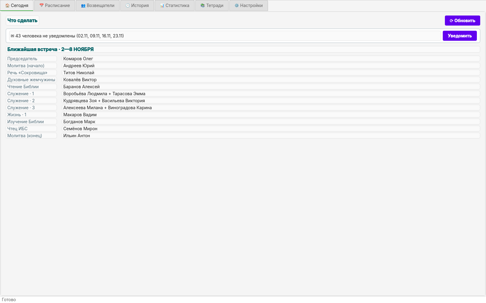
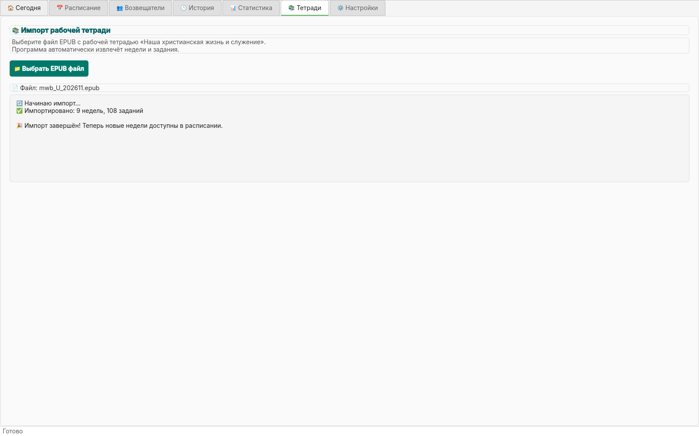
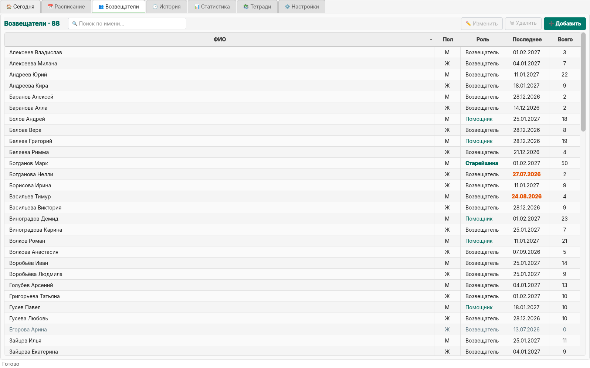
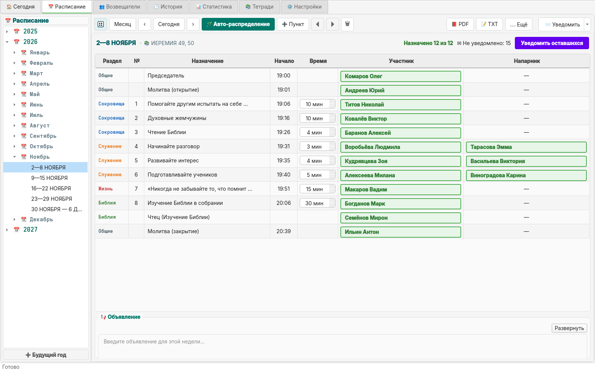
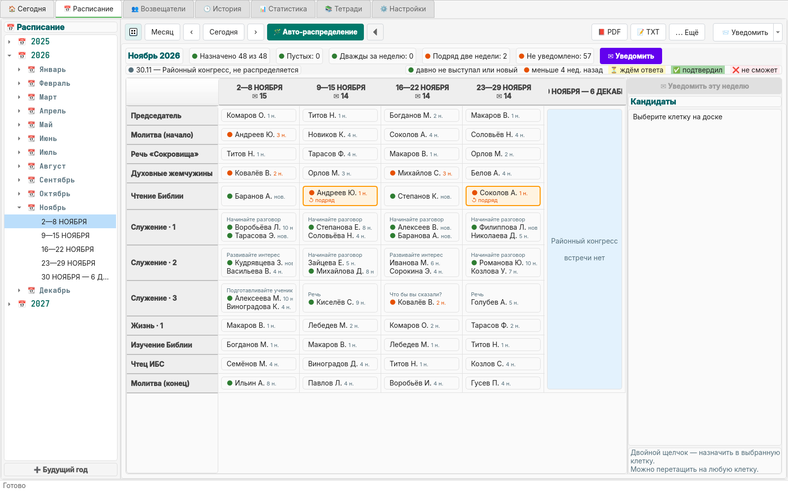
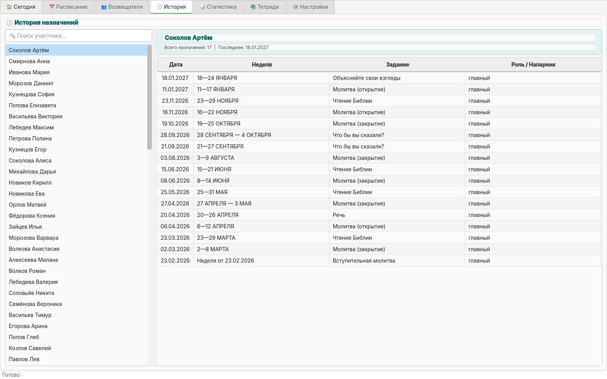
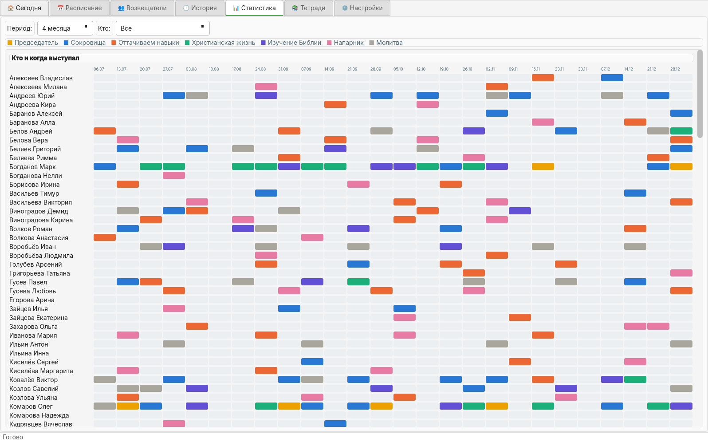
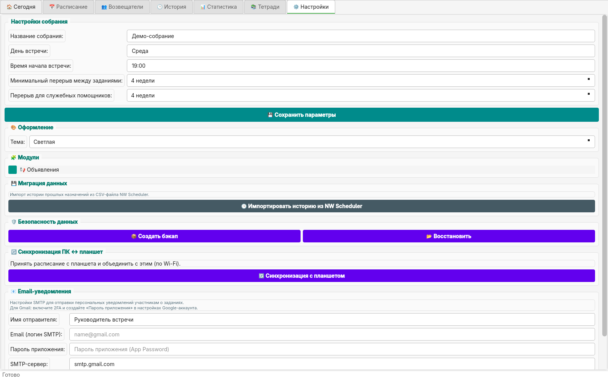

# Cerastilo User Guide

Cerastilo schedules the “Our Christian Life and Ministry” meeting on desktop computers and Android tablets.

## Contents

- 1. Introduction and purpose
  - 1.1. Overview
  - 1.2. Supported platforms (desktop and Android tablets)
- 2. Interface and navigation
  - 2.1. Main tabs
  - 2.2. Navigating dates (date tree and “‹”, “Today”, “›” buttons)
  - 2.3. Switching between the weekly schedule and month board
  - 2.4. Appearance themes (“System default”, “Light”, “Dark”)
- 3. Meeting dashboard (“🏠 Today”)
  - 3.0. First steps (empty database)
  - 3.1. Action list (“What to do”)
  - 3.2. Next meeting card and quick actions
- 4. Importing the meeting program (“⚙️ Settings” → “📚 Workbooks”)
  - 4.1. Importing workbook EPUB files
  - 4.2. Adding blank weeks for a future year (“➕ Future year”)
  - 4.3. Marking special events (Memorial, assemblies, conventions, and Circuit Overseer visits)
- 5. Managing the publisher list (“👥 Publishers”)
  - 5.1. Searching, sorting, and highlights in the publisher list
  - 5.2. Publisher profile
- 6. Creating and maintaining the schedule (“📅 Schedule”)
  - 6.1. Automatically assigning a week or month (“🪄 Auto”)
  - 6.2. Choosing and replacing publishers manually (tooltips, filters, and conflicts)
  - 6.3. Using the weekly table (duration, start time, and drag-and-drop order)
  - 6.4. Extra parts (adding, editing, duplicating, and deleting)
  - 6.5. Month board (drag-and-drop assignments and schedule checks)
  - 6.6. Weekly announcements (“📢 Announcement”)
  - 6.7. Undo and redo
- 7. How the app assigns parts
  - 7.1. Assignment intervals
  - 7.2. Spiritual status and role qualifications
  - 7.3. Student assignment and assistant rules (gender and family)
  - 7.4. The Circuit Overseer's visit
- 8. Assignment history and workload (“📊 History and statistics”)
  - 8.1. Publisher assignment history
  - 8.2. Heatmap (“Who gave parts and when”)
  - 8.3. Workload charts by assignment category
- 9. Email notifications and replies
  - 9.1. Mail settings (SMTP)
  - 9.2. Sending assignment notifications in bulk
  - 9.3. Individual emails (templates, personal notes, and preview)
  - 9.4. Exporting assignments to a calendar (.ics) for sharing in messaging apps
  - 9.5. Notification log and resending
  - 9.6. Checking replies automatically (“✅ Confirmed” / “❌ Cannot make it”)
- 10. Exporting and printing
  - 10.1. Printing and quick export to PDF and TXT
  - 10.2. Exporting the schedule to Word (.docx)
  - 10.3. S-89 slips for selected weeks or a full month
- 11. Settings, data safety, and sync (“⚙️ Settings”)
  - 11.1. Congregation settings (day, time, and name)
  - 11.2. Managing modules
  - 11.3. Importing from NW Scheduler and Excel
  - 11.4. Backing up and restoring the database
  - 11.5. Syncing a computer and tablet over Wi-Fi
  - 11.6. Checking for updates
- 12. Using Cerastilo on Android tablets
  - 12.1. Touch input and scrolling
  - 12.2. Adaptive toolbar (“📤 Export”)

## 1. Introduction and purpose

### 1.1. Overview

The window title is “Cerastilo - Meeting Scheduler”.

What the app does

* Keeps publisher records with qualifications, family details, contact information, and periods of absence.
* Assigns parts by week, taking into account assignment intervals, gender, spiritual status, qualifications, safeguards for minors, and rotation of roles.
* Shows conflicts when you replace or clear assignments manually.
* Imports meeting programs from Life and Ministry Meeting Workbook EPUB files and organizes them by week.
* Emails publishers their assignments and collects their replies (“I confirm” / “I can't make it”).
* Creates S-89 slips, exports schedules to PDF, TXT, and Word, and exports assignments to calendar files (.ics).
* Shows assignment history and workload statistics.
* Syncs a computer and an Android tablet over Wi-Fi.
* Backs up and restores the database.

The app stores publisher records, schedules, settings, and notification history on the device. The Android APK ships without a database. The publisher list and schedule are empty on first launch. To transfer data from a computer, sync over Wi-Fi (chapter 11.5).

On startup the app

* Applies the saved theme, following the device theme if “System default” is selected.
* Tracks system theme changes while open if “System default” is selected.
* Updates the database structure as needed for the current version.
* Shows “Startup error” with details and closes if a serious error prevents startup.
* Shows an error dialog if something fails during use, with a title of “Error: [context]” when context is available or “Error” otherwise.

The crash log (`crash.log`) is written to the application folder on a computer or the app data folder on Android. You can send it to the developer for troubleshooting.

### 1.2. Supported platforms (desktop and Android tablets)

Computer (Windows, Linux, macOS). The desktop version includes all tabs. The window opens maximized except on macOS, where it opens at its normal size. The minimum size is 1000×700 pixels, suitable for a typical monitor or laptop. The status bar shows “Done” when the app starts.

On Windows there are two options. The `Cerastilo-<version>-Setup.exe` installer installs the app and adds it to the Start menu; remove it in Settings → Apps. The portable version is a ZIP that needs no installation: extract the entire ZIP and launch `cerastilo.exe`. Both versions store data in `%LOCALAPPDATA%\Cerastilo`, and uninstalling keeps it. If Windows shows “Windows protected your PC”, click “More info” → “Run anyway”: the warning appears because the app is not digitally signed yet. The installer also asks to allow changes from an “Unknown publisher”; click “Yes”.

Android tablet. Android uses the same main window and tabs, with adaptations for touch.

* Scroll lists and tables by dragging anywhere in the scroll area.
* The tablet interface uses a scale of 0.85. For example, on a 1920×1200 screen the app has about 1280 logical pixels of width.
* The window opens maximized.
* The app keeps data in a persistent folder so updates preserve the schedule.
* The schedule toolbar changes on narrow screens (chapter 12.2).

Computer and tablet sync. The computer's “⚙️ Settings” tab has a “🔄 PC ↔ tablet sync” section. The tablet shows an address and confirmation code, which you use to connect from the computer over Wi-Fi. The transfer is encrypted. See section 11.5.

Back up regularly, especially before an app update or before assigning a whole month. See section 11.4.

## 2. Interface and navigation

### 2.1. Main tabs

Click a tab at the top of the main window, or tap it on a tablet. From left to right:

1. “🏠 Today” shows urgent tasks and the next meeting at a glance. See chapter 3.
2. “📅 Schedule” is the main work area. The date tree on the left is organized by year, month, and week. On the right is either the selected week's schedule or the month board. See chapter 6.
3. “👥 Publishers” lists publishers in a searchable, sortable, color-coded table. Open a publisher's profile here. See chapter 5.
4. “📊 History and statistics” has two pages. “🕒 History” lists the selected publisher’s assignments, and “📊 Statistics” shows a heatmap and workload charts. See chapter 8.
5. “⚙️ Settings” includes workbook import (chapter 4), congregation settings, appearance, modules, data migration, backups, sync, and email settings. See chapter 11.

The publisher list and assignment history refresh when you open the “🕒 History” page.

In “📊 History and statistics”, the Help button or F1 opens the section for the current page: 8.1 for “🕒 History” or 8.2 for “📊 Statistics”.

The status bar at the bottom briefly shows the results of actions, for example “Part duration updated” or “Auto-assign: N assignments”.

### 2.2. Navigating dates (date tree and “‹”, “Today”, “›” buttons)

Select a week in the date tree on the left to open its schedule. Click the list icon to make room for the table. Its tooltip reads “Show or hide the week list”.

Navigation buttons. The following buttons are above the schedule:

* “‹” goes to the previous week.
* “Today” returns to the current week.
* “›” goes to the next week.

Keyboard shortcuts are Alt+← to go back and Alt+→ to go forward. On the month board, these controls move between months.

For blank weeks in a future year, see chapter 4.2.

Special events. Right-click a week to choose its type:

* “Regular week” for the usual program.
* “🍷 Memorial”
* “🏟️ Circuit assembly”
* “🌍 Regional convention”
* “👔 Circuit overseer visit (CO)”

A check mark indicates the current type. The app saves your selection and refreshes the open week immediately. The type affects auto-assignment and how the schedule appears. For example, a CO visit adds a badge to the week header.

Create S-89 slips for a month. Right-click the month and choose **“🎟️ S-89 slips for [month]…”** to create slips for all weeks in that month. See section 10.3.

### 2.3. Switching between the weekly schedule and month board

1. Select a week in the date tree on the left. Its table opens on the right with columns for “Section”, “№”, “Assignment”, “Start”, “Time”, “Participant”, and “Assistant” (chapter 6).
2. Click **“Month”** to open the month board (chapter 6.5).
3. To return to the weekly schedule, select a week in the tree or switch to week view.

For announcements below the weekly table, see chapter 6.6.

### 2.4. Appearance themes (“System default”, “Light”, “Dark”)

In “⚙️ Settings”, open **“🎨 Appearance”** and use the “Theme:” list.

* “System default” follows the operating system theme (such as KDE or GNOME) and updates the app as soon as the system theme changes.
* “Light” uses a light theme.
* “Dark” uses a dark theme.

The setting takes effect immediately in all open windows and is saved for the next launch. With “System default” selected, the app checks the system theme again each time it starts.

The default is “System default”.

## 3. Meeting dashboard (“🏠 Today”)

“🏠 Today” shows urgent tasks and the next meeting, including replies from assigned publishers.

If more content is available than fits on screen, scroll with your finger or the mouse wheel.

Beside “What to do”, click **“🔄 Refresh”** to reload the task list and meeting card. Switching to this tab also refreshes the data.

If the app cannot load the data, it shows “Failed to build the to-do list: …” and hides the meeting card. Once the issue is resolved, click **“🔄 Refresh”**.

### 3.0. First steps (empty database)

When the database is empty, “🏠 Today” shows “First steps”. Set the congregation name, day, and time, add publishers and their qualifications, import the meeting program (EPUB in “⚙️ Settings” → “📚 Workbooks”), and assign the first week. Completed steps show a ✓. Click **“Go”** beside a remaining step to open the appropriate tab. The checklist disappears when all steps are complete.

### 3.1. Action list (“What to do”)

Each outstanding item appears on a separate row, with an icon and description on the left and an action button on the right.

Items and their icons

| Icon | Item | What it means | Action button |
|---|---|---|---|
| ❌ | Declined | A publisher replied that they cannot handle their assignment | “Find replacement” |
| 📭 | Empty part | A part still needs someone | “Fill” |
| ⏳ | Awaiting confirmation | Publishers have yet to reply | “Remind” |
| ✉️ | Not notified | The week begins within seven days and some publishers have yet to be emailed. Since slips are often used for assignments, this item is listed last | “Notify” |
| 📚 | No program | The meeting program for the week has yet to be imported | “Import workbook” |
| 🪄 | Unassigned | Some parts still need to be assigned | “Open month” |

Declines and empty parts appear in red.

What the buttons do

* “Find replacement” and “Fill” open the month board in “📅 Schedule” for the first week affected. Use the board to find a replacement or fill the empty part.
* “Notify” and “Remind” open the bulk email dialog with the affected weeks and publishers already selected. After you close the dialog, the list refreshes. The item disappears once all the messages are sent.
* “Import workbook” opens “⚙️ Settings” → “📚 Workbooks” so you can import the meeting program (chapter 4).
* “Open month” opens the month board in “📅 Schedule”, where you can assign parts automatically or manually.

How the list updates

* Once everything is ready, the list gives way to “✓ All set” in green.
* An item may cover several weeks. Its button takes you to the first one.
* The list updates automatically when you open the tab or click **“🔄 Refresh”**.

### 3.2. Next meeting card and quick actions

The card below the action list is titled “Next meeting · [week name]”. A CO visit adds “ · CO visit” to the title.

Each row shows the part on the left and the names on the right. Hover over a reply marker or touch and hold it to read the status.

* Filled parts show the participant and any assistant, joined by “+”, with their reply status.
* Empty parts show a red “— empty”.

Quick actions

* Use the card to see who is missing or has yet to reply. To make changes, open **“📅 Schedule”** (chapter 6) or use the corresponding action in “What to do” (section 3.1).
* Click **“🔄 Refresh”** at the top after dealing with replies or editing the schedule elsewhere. Both the action list and card update.
* An action in the list opens the relevant week or month in “📅 Schedule” (section 3.1). Returning to “🏠 Today” refreshes the data.

If there is no upcoming meeting to show, the tab displays just the action list.

## 4. Importing the meeting program (“⚙️ Settings” → “📚 Workbooks”)

Open **“📚 Workbooks”**, the first section in “⚙️ Settings”, to load weeks and parts into “📅 Schedule”.

If “🏠 Today” shows a missing program, click **“Import workbook”** to open this section. See sections 4.2 and 4.3 for future weeks and special events.

### 4.1. Importing workbook EPUB files

The instructions in “📚 Workbooks” ask for the Life and Ministry Meeting Workbook EPUB. English workbooks (`mwb_E_….epub`) are supported.

1. Open **“⚙️ Settings”** and choose **“📚 Workbooks”** on the left.
2. Click **“📁 Select EPUB file”** and select the workbook file ending in `.epub`.
3. The import runs in the background. The log below the button first shows “🔄 Starting import...”, then “✅ Imported: N weeks, M assignments”. If the import filled any weeks created with “➕ Future year”, the log also shows “📅 Previously created empty weeks filled: K”. “🎉 Import complete! The new weeks are now available in the schedule.” appears when the date tree refreshes.
4. Open **“📅 Schedule”**. The imported weeks appear in the date tree under their year and month.

What the app imports

* Weeks and dates. The app identifies each week's start date and groups weeks by month and year.
* Assignments. These include the part title, program section (such as Treasures From God's Word, Apply Yourself to the Field Ministry, and Living as Christians), part number, and source material (scriptures or subject).
* Weekly Bible reading. Look for “📚” in the week header on “📅 Schedule”.
* Student assignments. The schedule has slots for a student and an assistant where the part calls for them.

How the import works

* You can continue working in other tabs while the file is being read.
* When the import finishes, the app rebuilds the date tree in “📅 Schedule”. The new weeks are immediately available for scheduling.
* If the file is damaged or is a different kind of EPUB, the log shows “❌ Error: …” and an “Import error” dialog shows “Failed to import file:” followed by the reason.

### 4.2. Adding blank weeks for a future year (“➕ Future year”)

When you reach the end of the current year's program, you can prepare empty weeks for next year's assignments.

“➕ Future year” is below the week tree on the left of “📅 Schedule”.

1. Open **“📅 Schedule”**.
2. Click **“➕ Future year”**.
3. The confirmation asks “Create blank weeks for [year] ([count])?” and adds “Existing weeks will not change.”
4. Click **“Yes”**. The app creates the weeks in the background, displays “[year]: blank weeks added — N.” in a “Done” dialog, and updates the date tree.

How the app chooses the year and week count

* The app looks for the first incomplete year after the current one. For example, if only January and February have been imported for that year, it offers to add weeks through December.
* If all years in the schedule are complete, the app uses the year after the last scheduled year.
* The app counts the missing weeks and leaves existing weeks untouched.

Using blank weeks

* Blank templates are ready to receive parts. Import a workbook (section 4.1) or add extra items manually (section 6.4).
* To cancel, close the confirmation without clicking “Yes”.

### 4.3. Marking special events (Memorial, assemblies, conventions, and Circuit Overseer visits)

Use the date tree in “📅 Schedule” to mark weeks with a canceled meeting or a special program.

1. Open **“📅 Schedule”**.
2. Find the week under its year and month in the left pane.
3. Right-click the week or touch and hold on a tablet.
4. Choose the week type. A check mark shows the current type.

Week types

* “Regular week” uses the standard meeting program.
* “🍷 Memorial” replaces the schedule table with the notice “No regular meeting this week.”
* “🏟️ Circuit assembly” replaces the table with “Meeting canceled due to the convention.”
* “🌍 Regional convention” also replaces the table with “Meeting canceled due to the convention.”
* “👔 Circuit overseer visit (CO)” keeps the meeting scheduled and replaces Congregation Bible Study with “Service Talk by Circuit Overseer (30 min.)”. The week header shows “👔 CO visit”, with the tooltip “Circuit overseer visit (CO): Congregation Bible Study replaced by a service talk”.

What updates

* The app saves the week type to the database and refreshes the right pane immediately if that week is open.
* Besides the CO visit badge, the week header shows “Assigned X of Y”, “✉️ Notify the rest” if some people have yet to be emailed (hover to see the count), and the counters “❌ Cannot make it: N”, “⏳ Not confirmed: N”, and “⚠️ Conflicts: N”.

Correcting a week type

* Right-click the week and select **“Regular week”** to restore the standard table and see any earlier assignments.
* The status bar briefly shows “Week type updated”. If the change fails, the app displays “Failed to save the week type” in an “Error” dialog.

For monthly S-89 slips, right-click a month in the date tree and select **“🎟️ S-89 slips for [month]…”**.

## 5. Managing the publisher list (“👥 Publishers”)

Accurate profiles in “👥 Publishers” help the app determine who qualifies for each role, who can partner with a minor, and who should be excluded while away. Changes here take effect immediately in “📅 Schedule”.

### 5.1. Searching, sorting, and highlights in the publisher list

Click **“👥 Publishers”** in the tab bar. Above the table are “Publishers · N”, where N is the total number of publishers, a search box, and the action buttons.

Columns

| Column | What it shows |
|---|---|
| “Full name” | The publisher's full name |
| “Gender” | “M” for a brother or “F” for a sister |
| “Role” | “Publisher”, “Ministerial servant”, or “Elder” |
| “Last” | Date of the last assignment in DD.MM.YYYY format, or “—” for someone with no assignments |
| “Total” | Number of assignments |

Search. Type part of a name in “🔍 Search by name…” to filter the list immediately. Capitalization does not matter. For example, ‘ivan’ finds ‘Ivanov’. Clear the field with its × button or erase the text to show everyone again.

Sorting. Click a column heading to sort by it. Click again to reverse the order.

* “Last” sorts by date. In ascending order, publishers with “—” come first.
* “Total” sorts by count, so 2 comes before 14.
* “Full name”, “Gender”, and “Role” sort alphabetically.

The table starts in ascending order by full name and returns to that order when refreshed.

Colors and tooltips

* Dimmed rows identify publishers with no qualifications. They are excluded from assignment. Hover to see “No roles — excluded from assignment”.
* Italic names indicate that today falls within a publisher's “Temporary exclusion from the schedule”, for example during a vacation or illness. Hover to see “Unavailable until DD.MM.YYYY”.
* Bold dates highlighted in yellow in “Last” indicate qualified publishers with no assignments in more than 60 days, or no assignments yet. The tooltip reads “Has roles but no assignments yet” or “Has roles but no assignments for a while: N days ago”. Consider them for an upcoming part.
* “Elder” is bold in the accent color. “Ministerial servant” uses the accent color in regular weight.

The colors update when you switch between “Light” and “Dark” to keep the table readable.

Buttons above the table

* “➕ Add” opens a new profile (section 5.2).
* “✏️ Edit” opens the selected publisher's profile. Double-click the row or press Enter or Return for the same action.
* “🗑️ Delete” asks “Are you sure you want to delete publisher [name]?” and explains “Their assignment history will be kept.” Confirm to remove the publisher while retaining their assignment history. Delete does the same thing.

Context menu. Right-click a row, or touch and hold, to use “✏️ Edit” or “🗑️ Delete”.

Selection. Select one row at a time. The edit and delete buttons are available while a row is selected.

### 5.2. Publisher profile

Use “➕ Add” or “✏️ Edit”, double-click a row, press Enter/Return, or use the context menu. The dialog title is “Add publisher” or “Edit publisher”. It has three tabs with “Save” and “Cancel” at the bottom.

Basic information and contacts

In “General”, under “Basic information”, fill in these fields:

* “Full name:” is required. Leaving it blank shows “The 'Full name' field cannot be empty.” A duplicate name may trigger “Failed to add publisher. That name may already exist.”
* “Email:” stores the address used for individual assignment notices (chapter 9). The placeholder is `example@gmail.com`.
* “Phone:” stores a number for reference. The placeholder is `+7 (999) 000-00-00`. Email notifications do not use this number.
* “Gender:” is “Brother” or “Sister”. The app reserves roles such as Chairman, prayer, and Bible Reading for brothers.
* “Spiritual status:” is “Publisher”, “Ministerial servant”, or “Elder”. It affects eligibility and priority for certain roles (section 7.2).

Family and safeguards for minors

In the same group:

* “Family (Head):” lists brothers eligible to be selected as the family head, excluding the person being edited. Choose **“— No family / Head —”** if the publisher is a family head or has no family link. Family links help apply rules for minors and determine when a sister can be paired with a male relative (section 7.3).
* “Minor:” enables safeguards for children and teenagers. The tooltip explains that a minor can be the student or assistant with another minor, or serve as assistant with an adult member of their own family.

Personal assignment interval

Use “Personal interval:” to override the general assignment frequency for this publisher.

* “Auto (by type of service)” uses the congregation interval for the publisher's spiritual status. This is the default.
* “Always available (0 wk)” allows assignments every week, as with elders, regardless of spiritual status.
* “1 week”, “2 weeks”, “3 weeks”, “4 weeks”, “5 weeks”, “6 weeks”, “8 weeks”, “10 weeks”, and “12 weeks” set a fixed minimum interval. For example, select six weeks if a brother asks for fewer assignments because of his health.

Auto-assignment uses personal intervals when set and general intervals otherwise.

Temporary absence (vacation or illness)

For trips, vacations, or illness, use the checkable “Temporary exclusion from the schedule” group on “General”. The publisher and their qualifications remain on file.

1. Open the publisher's profile.
2. Check “Temporary exclusion from the schedule”.
3. Set “From:” and “To:”. Both fields include a calendar.
4. Click **“Save”**.

How it works. If the meeting date falls within those dates, auto-assignment excludes the publisher that week. Manual assignment shows a conflict warning (section 6.2). While the absence is in effect, the table shows the name in italics with “Unavailable until DD.MM.YYYY”.

Uncheck the group and save to clear the absence.

Find replacements in one dialog. If a publisher still has assignments during an absence or an excluded week in “Shift schedule”, saving opens “Assignments during absence” and offers these options:

* “Remove and find replacements” removes the publisher and uses auto-assignment to fill the newly vacant slots, preserving other assignments. The app shows the replacements. Any part with no replacement stays empty.
* “Only remove” clears the assignments so you can find replacements yourself, for example on the month board.
* “Leave as is” keeps the assignments. The month board marks those slots in red as needing replacements.

Manage all absences. “🏖️ Absences” above the publisher list opens a table of publishers on leave with “From” and “To” columns. Use “➕ Add” to enter several absences or use the trash button to remove one. After “Save”, the app lists affected assignments together and offers to remove them and find replacements as above.

Shift schedules and recurring exclusions

Use “Shift schedule” for alternating or flexible work schedules, such as every other week, and for one-off absences. It excludes specific weeks individually.

“Excluded weeks (Mondays):” on the left lists the Mondays of excluded weeks. Select one or more rows and click **“🗑️ Delete selected”** to remove them.

The right pane offers two ways to add weeks.

Method 1. Date range. “Unavailable (vacation, illness)” has calendar fields “from” and “to” and an “➕ Add” button.

1. Select the first date in “from”.
2. Select the last date in “to”. The default is the same as “from”, which selects one week.
3. Click **“➕ Add”**.
4. The app adds the Monday of the starting week and each Monday through the end date. If the dates are reversed, the app swaps them. Existing entries are preserved. If there are no new entries, it shows “These weeks are already in the list.”

Use this approach for several consecutive weeks of vacation, illness, or travel.

Method 2. Recurring pattern. Use “Add by template (shift schedule)”.

1. In “Start:”, select any date in the first week to exclude.
2. In “Frequency:”, choose **“Every week”**, “Every other week (once per 2 wk)”, “Once per 3 weeks”, “Once per 4 weeks”, “Once per 5 weeks”, or “Once per 6 weeks”. The default is “Every other week (once per 2 wk)”.
3. In “Number of weeks:”, enter how many exclusions to generate (1 to 52, default 10).
4. Click **“⚙️ Generate template”**.

How it works. The app starts with the Monday of the selected week and adds every Nth week for the requested number of occurrences. Existing entries are preserved. The app shows “Generated and added N weeks to the list.” or “All generated weeks are already in the list.”

Remove a week added by mistake. Select one or more rows on the left using Ctrl or Shift and click **“🗑️ Delete selected”**.

How exclusions affect assignments. Auto-assignment skips the publisher for every listed week. A manual assignment during an excluded week triggers a conflict warning.

Click **“Save”** to keep changes to the list with the profile, or “Cancel” to discard them.

Qualifications for meeting parts

The “Qualifications” tab has a group called “Qualifications (available assignments)”. Check the parts a publisher qualifies for so the app can suggest them for those roles.

Available qualifications

* “Chairman” for chairing the meeting.
* “Prayer” for offering prayers.
* “Treasures (10 min)” for the opening talk in Treasures From God's Word.
* “Spiritual Gems (10 min)” for the “Spiritual Gems” part.
* “Bible Reading (4 min)” for the Bible reading.
* “Student assignments” for the student in a conversation, return visit, or Bible study demonstration.
* “Talk” for a talk in Apply Yourself to the Field Ministry.
* “Assistant” for the assistant on student assignments.
* “Living part” for a part in Living as Christians.
* “Bible Study — Conductor” for the Congregation Bible Study Conductor.
* “Bible Study — Reader” for the Congregation Bible Study Reader.

Qualifications appear two per row. Publishers with no qualifications are dimmed in the table and excluded from auto-assignment (section 5.1).

Saving a profile. “Save” checks that the full name is filled in and stores the name, email, phone, gender, status, family, personal interval, minor flag, absence dates, qualifications, and excluded weeks. A failed update shows “Error” with “Failed to update publisher.” “Cancel” closes the profile without saving.

After you save, the list refreshes. When you edit an existing publisher, the table scrolls to their row and selects it.

## 6. Creating and maintaining the schedule (“📅 Schedule”)

“📅 Schedule” is the main work area. The date tree on the left is grouped by year, month, and week. The right pane displays a weekly table or the month board (section 2.3). Use it to make assignments, change durations, add extra parts, and undo changes.

Unsaved changes. If you edit a publisher's profile and close it with “Cancel”, Esc, or the close button, the app offers “Save”, “Discard”, or “Cancel” to return to the profile.

No qualifications selected. “General” shows “⚠️ No qualifications are checked — this person will not be assigned.” with a “Check qualifications” link. The tab itself reads “⚠️ Qualifications”.

### 6.1. Automatically assigning a week or month (“🪄 Auto”)

Auto-assignment fills empty parts and finds missing assistants. It keeps manual assignments and replacements. The same rules apply to weeks and months (chapter 7).

Fill one week

1. Select a week on the left to open its table.
2. Click **“🪄 Auto-assign”** on the toolbar (“🪄 Auto” on narrow screens).
3. The “Auto-assign” confirmation asks “Fill the empty parts of the week automatically?” and adds “Existing assignments stay as they are.” Click **“Yes”**. To start the week over, first click **“🗑️ Clear”**.
4. Auto-assignment runs in the background. The app shows “✅ Assigned: N assignments” or “ℹ️ All assignments are already filled” if it made no new assignments. Empty slots can still remain. The status bar shows “Auto-assign: N assignments”.

How the app picks publishers

For each part, the app checks qualifications, gender, spiritual status, and whether the part needs an assistant. For example, it considers elders before ministerial servants for the opening talk.

The app checks existing assignments, vacations, sick leave in “Temporary exclusion from the schedule”, and shift schedules. It takes general, ministerial servant, and personal intervals into account and rotates student and assistant roles. It narrows the list based on past assignments, then makes a weighted random choice. Publishers who have gone longer without a part have a better chance of being chosen.

Fill a month. In “Month”, “🪄 Auto-assign” (“🪄 Auto” on narrow screens) works across the month.

1. Click **“🪄 Auto”**. The app finds weeks with at least one empty slot, including weeks where someone withdrew or went on vacation. It skips assemblies, conventions, and the Memorial and preserves existing assignments.
2. The “Auto-assign month” confirmation lists the weeks in “Fill empty parts in weeks (N): [dates]?” and says “Existing assignments stay as they are.” Click **“Yes”**.
3. The app saves a database snapshot first. If that fails, for example because of disk space or permissions, it stops and shows “Failed to save a database snapshot, auto-assign canceled:” followed by the reason.
4. The board, “🪄 Auto”, and the undo button are disabled while it works. The result appears as “✅ Weeks assigned: N, assignments: M”.
5. If a failure occurs partway through, the app shows “Weeks assigned: N, then an error:” followed by details. Completed weeks remain assigned until you undo them with the undo button (section 6.7).

### 6.2. Choosing and replacing publishers manually (tooltips, filters, and conflicts)

Choose from the weekly table

1. Click the appropriate “Participant” or “Assistant” cell. An empty cell opens the selection dialog directly. If the cell already has an assignment, choose **“👤 Select / replace…”** from the action menu.
2. “Select participant” or “Select assistant” lists eligible publishers.
3. Each candidate shows “N in six months · X wk ago (date)”, or “has not given a part”. Other notes include
   * “unavailable this week (vacation, schedule)” for an absence or excluded shift week
   * “already busy this week” for someone with another part
   * “elder: student assignments are usually not given” for student parts
   * “paired N time(s), last DD.MM.YYYY” for previous pairings with the student.
4. A green dot means the last assignment was at least eight weeks ago or the publisher is new. Orange means less than four weeks ago. A secondary color means the person is already busy that week.
5. The list is ordered to help share assignments fairly.
   * Available publishers come first, with those who have waited longest at the top and those with no assignments first of all.
   * Publishers already assigned that week come next.
   * Elders on student parts appear at the end.
6. Select a publisher and confirm. The cell and table refresh.

Who appears in the dialog

* Gender. Parts reserved for brothers list only brothers. Where the pairing rules allow it, a sister's assistant can be another sister or a male family member (section 7.3).
* Qualifications. Where a part requires a qualification, the list includes publishers who have it.
* Spiritual status. Some roles are restricted to elders. Assistants have no status filter.
* Student. The student is excluded from the list of assistants.

Manual assignment conflicts. The app warns you about conflicts such as another assignment that week, an absence, or a missing qualification. If you confirm anyway, it saves the assignment and highlights the row.

Elder on a student assignment. “Elder on a student assignment” shows “[name] is an elder. Student assignments are usually not given to elders (acceptable in small congregations).” Click **“Yes”** at “Assign anyway?” to continue.

Replace or remove a publisher. Click, right-click, or touch and hold an assigned cell for these actions:

* “👤 Select / replace…” opens the list of replacements.
* “✅ Confirmed” / “❌ Cannot make it” records the publisher's reply manually.
* “🗑️ Clear” clears that assignment directly.
* “✉️ Write / send email...” opens the email preview (section 9.3).
* “📋 Open notification log” shows email history (section 9.5).

Choose from the month board. Right-click a cell for its menu or double-click it to open the usual selection dialog. See section 6.5.

### 6.3. Using the weekly table (duration, start time, and drag-and-drop order)

The weekly table has columns for “Section”, “№”, “Assignment”, “Start”, “Time”, “Participant”, and “Assistant”.

Week header. The line above the table shows

* Week title.
* “· 📚 [scriptures]” for the weekly Bible reading.
* “👔 CO visit” during the Circuit Overseer's visit. Its tooltip explains that a service talk replaces the Congregation Bible Study.
* “Assigned X of Y”, green when all parts are filled and highlighted when vacancies remain.
* “✉️ Notify the rest” for publishers who have yet to be emailed about this week. It opens the mailing dialog with just those publishers selected. Printed slips are the usual way to notify publishers. Email is available when needed.
* “❌ Cannot make it: N”, with names in the tooltip.
* “⏳ Not confirmed: N”, for publishers who have received a notice and have yet to reply. The tooltip points to ‘Replies from email: “Notify” ▾ → “Check replies”’.
* “⚠️ Conflicts: N” when someone is assigned more than once that week.

Start time. The app calculates it from “Meeting start time:” in “⚙️ Settings” (section 11.1). The Congregation Bible Study Reader shares the Conductor's time, so the Reader's start time is blank.

Changing duration. The “Time” column contains a field in “min”, with “—” if no duration is set.

1. Set the number of minutes (0–180) using the arrows or keyboard.
2. Press `Enter` or move focus out of the field to save. The status bar shows “Part duration updated”.
3. If the save fails, “Error” shows “Failed to change the part duration” and the table reloads.

Assigning and replacing participants and assistants. See section 6.2.

Conflict rows. The first four columns are highlighted if the participant or assistant already has an assignment that week. The tooltip reads “Conflict: participant is already assigned this week”. The Congregation Bible Study Conductor and Reader can work on the study together without triggering a conflict.

Reordering rows. Drag a row by its vertical header to move it. The status bar shows “Part order saved”. If the save fails, “Error” shows “Failed to save part order” and the table reverts to the previous order.

Keyboard and mouse

* Enter / Return opens the selection dialog for a selected “Participant” or “Assistant” cell, or the edit dialog for an extra part.
* Delete removes a selected extra part after confirmation.
* F2 edits the selected extra part.
* Right-click an extra part to open its context menu (section 6.4).

Clearing the whole week. The trash button in week view asks “Are you sure you want to delete ALL assignments for this week?” and displays “This action cannot be undone.” After confirmation, the status bar shows “Assignments deleted” and a message shows “🗑️ Assignments cleared”. The app saves the week's previous state, so the undo button can restore the assignments.

### 6.4. Extra parts (adding, editing, duplicating, and deleting)

An extra part is a manually added item such as an announcement, talk, or special segment.

Add a part

1. Click **“➕ Part”** on the weekly toolbar. This button is available in week view.
2. If no week is selected, “Attention” shows “Select a week first”.
3. Enter a title, section, and duration. You can also select a publisher.
4. Click **“Add”**. The app inserts the part with the next number in that section and shows “➕ Part added to the schedule”.

Edit a part

* Right-click the row and choose **“Edit”**.
* Or select the row and press F2.
* Enter/Return also opens the selected extra part.
* Update the fields and confirm. The app shows “✏️ Part updated” on success or “Edit error” on failure.

Duplicate a part

1. Right-click the row and choose **“Duplicate”**.
2. The app copies all fields and shows “📋 Part duplicated”.

Delete a part

1. Right-click the row and choose **“Delete”**.
2. Or select the row and press Delete.
3. When asked “Delete this special part from the schedule?”, click **“Yes”**.
4. The app shows “🗑️ Part deleted”.

Availability. The “Edit”, “Duplicate”, and “Delete” actions and the F2/Delete and Enter/Return editing shortcuts apply to extra parts only.

All changes to extra parts are recorded in the undo history (section 6.7).

### 6.5. Month board (drag-and-drop assignments and schedule checks)

Click **“Month”** on the schedule toolbar to see the whole month on the right, with one column per week and one row per part. You can fill the month without switching between weeks.

Week headers. Each column shows the week date, “CO visit” if applicable, and “❌ N” for declines and “⏳ N” for outstanding replies. Publishers usually receive paper slips at the meeting, so the header leaves out the count of people who have yet to be emailed. Click a header to open the weekly table.

Cells

* Each publisher is shown by a short name, with the time since their last assignment, for example “8 wk”, or “new”. Email markers are ⏳ for awaiting reply, ✅ for confirmed, ❌ for declined, and ⚠✉ for a send error.
* Elders often have assignments every week, so their cells omit the time-since-assignment dot.
* Problem cells are highlighted:
  * “— empty” for an unfilled slot (red background).
  * “2× in a row” for the same role as last week (yellow border).
  * “⚠️ twice in a week” for two assignments in the same week (red background).
  * “⚠️ elder on a student assignment” for an allowed assignment flagged for review (yellow border).
  * “❌ cannot make it — replacement needed” for a decline (red background).
  * “🏖️ on vacation — replacement needed” for an assignee away that week (red background).
* Cells use different background colors for awaiting replies and confirmed assignments.
* Hover or touch and hold to see the full name, time since the last assignment, and reply status.
* Memorial, assembly, and convention weeks occupy one merged column with the event name and “no meeting”. These weeks are skipped for assignment.

Candidate panel. Select a cell to see eligible publishers on the right, with the same history, availability, and conflict hints as in the selection dialog. Above the list are “🔍 Check the month” and the week notification button (“✉️ Notify this week” or “✉️ Notify week [date]”). It addresses people still awaiting an email. If everyone has already received one, it opens with all assignees available for a repeat email.

Check the month before printing. “🔍 Check the month” lists empty slots, absences and excluded weeks, assignments twice in a week or in consecutive weeks, elders on student parts, mismatches in gender, qualifications, or status, and declines. Entries are grouped by week. Select one to highlight its cell and see candidates. Keep the window open while making changes and click **“Refresh”** afterward.

Keyboard controls. Use the arrow keys to move, Enter to choose a publisher, and Delete to clear a cell after confirmation. The right-click menu offers “⏳ Remind those who have not replied” when anyone that week is still awaiting a reply. It sends a repeat email to those publishers only.

Swap two publishers. Select a cell and click **“⇄ Swap”** on the right or “⇄ Swap [name]…” in the cell menu. Select the second cell in the same week or another week. With the keyboard, use the arrow keys and Enter. The app asks for confirmation and warns if either person fails the new part's gender, qualification, or status rules. While choosing the second cell, click **“✕ Cancel swap”** or press Esc to cancel.

Make assignments on the board

* Double-click a candidate to assign them to the selected cell.
* Drag a candidate onto any cell to assign them there. If gender or qualifications make them ineligible, “Not suitable” explains the problem and prompts you to select that cell to see its candidates.
* Double-click a cell to open the standard selection dialog.
* Right-click a cell for its menu:
  * “Select participant…”
  * “Select assistant…” if the part calls for an assistant.
  * For a decline, choose **“❌ [name] cannot make it — find replacement…”**. For an absence, choose **“🏖️ [name] on vacation — find replacement…”**. Choose someone new and answer “Send notification: [name]?” to email the replacement immediately.
  * “Clear” removes the participant and any assistant.
  * “✉️ Notify this week”
  * “Open week” switches to the weekly table.

After an assignment, the board refreshes and keeps the current cell selected with an updated candidate list.

A week counts as completely empty when none of its parts have a participant or assistant. To fill open slots on the board, see chapter 6.1.

“🧾 Slip handed out”. After distributing paper slips, right-click a cell and choose **“🧾 Slip handed out”**. Choose it again to remove the mark, or choose **“🧾 Week slips handed out — mark all (N)”** for the whole week. The cell shows 🧾 and the week header shows how many slips were handed out out of the total. Replacing either publisher clears the mark because the new person needs their own slip. The mark syncs to the tablet.

### 6.6. Weekly announcements (“📢 Announcement”)

“📢 Announcement” below the weekly table stores announcements for that week. It starts a few lines high. Click **“Expand”** to open it or “Collapse” to shrink it again.

Toggle “📢 Announcements” in “⚙️ Settings” → “🧩 Modules” to show or hide the block (section 11.2).

### 6.7. Undo and redo

Undo and redo in week view. Use the undo and redo icons on the toolbar (“Undo the last schedule change (Ctrl+Z)” and “Redo the undone change (Ctrl+Shift+Z)”) or the keyboard shortcuts:

* Ctrl+Z undoes the last change.
* Ctrl+Shift+Z or Ctrl+Y redoes it.

You can undo assigning, replacing, or removing publishers, changing durations, adding, editing, duplicating, or deleting extra parts, clearing the week, reordering rows, and auto-assigning the week. The history holds the last 30 changes. A new action clears the redo history.

The buttons are disabled when their histories are empty.

Undo edits on the month board. In “Month”, the undo button, the redo button, and Ctrl+Z / Ctrl+Y undo and redo board edits one at a time. These include assignments made by double-click, drag-and-drop, or the selection dialog, clearing a cell, and swapping people. The undo tooltip reads “Undo the last change on the board (Ctrl+Z)”. The board remembers the last 30 changes and clears the history when you switch months.

Undo a month auto-assignment. Once the board's undo history is empty, the undo button in “Month” restores the entire database snapshot from just before the last monthly “🪄 Auto” run.

1. The undo button is available when a snapshot exists. The tooltip reads “Undo month auto-assign (snapshot from HH:MM)” or “Nothing to undo”. Any pre-run board edits are handled through the snapshot.
2. Click the undo button. The app asks “Revert the schedule to its state as of HH:MM, before the month auto-assign?” and adds “All changes made after that will also be lost.”
3. Click **“Yes”**. The snapshot replaces the database, the previous weekly undo history clears, and the board and open week reload. The app shows “↶ Month auto-assign undone”.

Restoring the snapshot removes all changes made after it was taken. To run month auto-assignment, see chapter 6.1.

## 7. How the app assigns parts

The app's assignment rules are based on the meeting instructions (S-38) and practical scheduling needs. They govern auto-assignment and filter the manual candidate list. Conflicts are shown as warnings.

### 7.1. Assignment intervals

The interval depends on the publisher's spiritual status and profile settings.

General interval. In “⚙️ Settings” → “Congregation settings”, set “Minimum interval between assignments:” to one to four weeks. The default is two weeks. This applies to publishers who are neither elders nor ministerial servants.

Interval for ministerial servants. Use “Interval for ministerial servants:” in the same group to set a separate interval of one to four weeks for ministerial servants. The tooltip says “Individual brothers may have their own interval (in the participant record).”

Personal interval. Open **“👥 Publishers”** → “✏️ Edit” → “General” and set “Personal interval:” (section 5.2). Choose **“Auto (by type of service)”**, “Always available (0 wk)”, “1 week”, “2 weeks”, “3 weeks”, “4 weeks”, “5 weeks”, “6 weeks”, “8 weeks”, “10 weeks”, or “12 weeks”. A personal interval takes precedence over the general and ministerial servant intervals.

Weekly availability. “Always available (0 wk)” makes a person eligible every week. Elders have a zero interval by default. The rules about repeating the same role still apply.

Publishers who have waited longer or had fewer recent assignments have a better chance of being chosen. If too few candidates qualify, the app may shorten the interval for the main role. See section 6.2 for the order of the manual list.

### 7.2. Spiritual status and role qualifications

Qualifications. Each part requires a qualification selected in the publisher's “Qualifications” tab (section 5.2). Auto-assignment and the manual candidate list use those checkboxes. For example, a brother needs the Bible Reading qualification to appear for that part.

Gender. The app lists only brothers for reserved parts such as a talk in Apply Yourself to the Field Ministry, the opening talk, Spiritual Gems, chairing, prayer, and Bible Reading. Brothers and sisters can be students. For assistants, the same-gender or family rules in section 7.3 apply.

Spiritual status. Some parts have status requirements.

* Elders only for Chairman, Congregation Bible Study Conductor, and Local Needs in Living as Christians.
* Elders or ministerial servants for:
  * The opening talk and “Spiritual Gems” (parts 1 and 2 of Treasures From God's Word).
  * Parts in Living as Christians, subject to the elders-only rule above.
  * “What Would You Say?” and discussion parts with audience participation.

  Auto-assignment gives priority to elders and uses ministerial servants when no elder is free. These parts require one of those two statuses.

  A ministerial servant gives the opening talk twice a month, usually in weeks 2 and 4, or in a neighboring week if necessary. Elders cover the other weeks.

“What Would You Say?” and discussions. One elder or ministerial servant handles these parts. The app provides no assistant slot and applies the discussion rules.

A talk and a student assignment in the same position. Part 4 in Apply Yourself to the Field Ministry is configured as a talk for brothers. When the actual workbook part is a student assignment, the app allows brothers and sisters, provides an assistant slot, and requires “Student assignments”.

Talks assigned by responsibility. Some workbook parts are assigned to the Chairman, service overseer, secretary, or coordinator of the body of elders. The app recognizes these instructions on the first line of the part during import. Reimporting updates already loaded weeks.

* The Chairman's talk goes to that week's Chairman as soon as he is assigned. Changing the Chairman transfers the talk to the new Chairman.
* Talks for the service overseer, secretary, and coordinator go to the brother selected under “⚙️ Settings” → “👥 Congregation responsibilities” (section 11.1). This happens on import or when running “🪄 Auto” for already loaded weeks. Manual assignments are preserved. If no brother is selected, the app uses the usual pool of elders. In the selection dialog, the appropriate brother is first, with “chairman of this week” or the name of his responsibility.
* These talks do not count toward fairness calculations for other assignments and do not produce S-89 slips (section 10.3).

Elders on student assignments. These assignments are allowed in small congregations. The manual picker displays “[name] is an elder. Student assignments are usually not given to elders (acceptable in small congregations).” and asks “Assign anyway?” Elders appear last with “elder: student assignments are usually not given”. Auto-assignment excludes them from student parts, and the assistant list omits them.

### 7.3. Student assignment and assistant rules (gender and family)

Student assignments. These include Apply Yourself to the Field Ministry parts other than discussions and Bible Reading in Treasures From God's Word. The relevant assistant rules and elder warning apply.

Assistant qualification. The app lists only publishers with “Assistant” checked in their profile, excluding the student.

Assistant gender rules (S-38, paragraphs 7–11)

* For Starting a Conversation and Explaining Your Beliefs, an assistant can be someone of the same gender or a family member of either gender.
* For Following Up and Making Disciples, formerly Return Visit and Bible Study, the assistant must be of the same gender, including when the publishers are relatives.

A sister can work with another sister. For Starting a Conversation and Explaining Your Beliefs, she can also work with a male member of her family. An unrelated brother is excluded.

What counts as one family. A publisher with a family head selected in “Family (Head):” belongs to that household. The head also belongs to it. Two people are treated as relatives if they share a family head or one is the other's family head.

Previous pairings. The assistant picker shows how often the two publishers have worked together and when they last did, to help vary pairings. The student picker shows the same information when an assistant is already assigned.

Last assignment. The list shows the number of assignments in six months and the age and date of the latest one or “has not given a part”. A dot indicates eight weeks or more without an assignment, fewer than four weeks, or “already busy this week”. The busy marker follows the theme's secondary color.

Minors. Checking “Minor:” in the publisher's profile applies these safeguards:

* A minor can be the student or the assistant with another minor.
* With an adult, the minor can serve only as the assistant, and the adult must be a member of the minor's family.

Avoiding repeats. The app avoids giving the same part to the same person in consecutive weeks. For elders and publishers set to “Always available (0 wk)”, the same part must be at least four weeks apart. The app tries to alternate student and assistant roles. Publishers with “Assistant” but without “Student assignments” remain in the assistant rotation and receive assignments alongside the others. The month board flags “2× in a row” and “⚠️ twice in a week”. The weekly table highlights conflicts.

Conflicts within a week. The usual rule is one part per person per meeting. Exceptions include an assistant paired with a family member, the Reader and Conductor of the Congregation Bible Study, and an additional student assignment for someone whose only other part is prayer or Bible Reading. The month board can flag “⚠️ twice in a week”.

### 7.4. The Circuit Overseer's visit

Right-click the week in the date tree and choose **“👔 Circuit overseer visit (CO)”** (section 4.3).

What you see

* The week header shows “👔 CO visit” with a tooltip explaining that a service talk replaces Congregation Bible Study.
* The month board adds “CO visit” without an emoji to the column header.
* The weekly schedule shows “Service Talk by Circuit Overseer (30 min.)” in place of Congregation Bible Study.

How assignments work

* The CO visit week follows the usual assignment rules, including automatic and manual assignment and assistant selection. The service talk takes the place of the study.
* The Memorial, circuit assembly, and regional convention weeks have no regular meeting. Their assignment tables and counters give way to a notice that the regular meeting will not be held or was canceled for the event. Assignments are unavailable on those weeks.

Fill the CO visit week on its own or along with the other weeks in the month (chapter 6.1).

Notification counts. Regular weeks and CO visit weeks show “Assigned X of Y”, “✉️ Notify the rest”, “❌ Cannot make it: N”, “⏳ Not confirmed: N”, and “⚠️ Conflicts: N” when applicable. Memorial, assembly, and convention weeks show the event notice.

## 8. Assignment history and workload (“📊 History and statistics”)

The “📊 History and statistics” tab contains the “🕒 History” and “📊 Statistics” pages. They show how many assignments each publisher has received, which ones they had, and when. Use them to share assignments fairly or look up someone’s history on request.

### 8.1. Publisher assignment history

The “🕒 History” page shows the selected publisher's assignments by date under “🕒 Assignment history”.

Left pane: publishers

* “🔍 Search participant...” filters by part of a name, regardless of capitalization. Clear it to see everyone.
* Click a name or use the arrow keys to show that publisher's history on the right.
* The app remembers the selected publisher and search filter when you return to this tab. The first time, it selects the first publisher.
* With no selection, the right pane shows “Select a participant on the left”.

Right pane: assignment history

* Name and summary. Below the selected name, the app shows “Total assignments: X  |  Last: DD.MM.YYYY” or “never” in place of the date.
* History table columns:

  | Column | What it shows |
  |---|---|
  | “Date” | DD.MM.YYYY, centered |
  | “Week” | Week name |
  | “Assignment” | Name of the meeting part |
  | “Role / Assistant” | The publisher's role |

* Rows appear in the order returned by the assignment history.
* Opening “🕒 History” refreshes the list and history, reflecting any edits in “📅 Schedule”.

1. Open **“📊 History and statistics”**, then select the **“🕒 History”** page.
2. Find the publisher in the list, using search if needed.
3. Click the name for their statistics and full history.
4. Click a different name to switch to that publisher.

### 8.2. Heatmap (“Who gave parts and when”)

The “📊 Statistics” page shows the congregation's workload. Filters appear above a legend and two charts. The first is “Who gave parts and when”, a heatmap.

Filters at the top

* “Period:” gives “3 months”, “4 months” (the default), “6 months”, and “12 months”. It controls how far back to look.
* “Who:” selects groups of publishers. Without a filter, the app shows everyone.

Changing either filter updates both charts. The date range starts at the selected period in the past and extends eight weeks into the future to include assignments already scheduled. Past months are counted as 30.5 days each.

Legend. Colored squares identify “Chairman”, “Treasures”, “Apply Yourself”, “Living as Christians”, “Bible Study”, “Assistant”, and “Prayer”. The same colors identify categories in both charts and update with the theme.

Heatmap

* Rows show one publisher each.
* Columns show weeks.
* Cells take the color of the category assigned that week. Several categories in one week appear as stacked horizontal strips.
* Empty cells on a light background indicate a week without assignments for that publisher.
* Week labels at the top use DD.MM. On wider ranges, labels appear every two, three, or five columns to avoid overlap. The cells also get narrower when more weeks are shown.

Tooltips. Hover or touch and hold a cell to see the publisher's name above the date and assignment categories, or a note that there were no assignments that week.

Order. The heatmap displays publishers in the order provided by the app.

### 8.3. Workload charts by assignment category

The second chart on the “📊 Statistics” page, “Participant workload”, shows the total and mix of each publisher's assignments.

Reading the chart

* Rows are sorted by total assignments, highest first. Ties are sorted by name.
* Bars contain colored segments, one per category, matching the legend. Each segment's length is proportional to that publisher's count in the category.
* Overall bar length is relative to the highest total in the selected period.
* The number at the right gives the publisher's total for the period.
* The left column shows the name. Long names are shortened with an ellipsis.

Tooltips. Hover over a segment to see the person's name and “[category]: N”, the exact count for that category.

Filters and period. “Period:” and “Who:” update both charts together so they show the same publishers and time range.

Scrolling. Scroll both charts with the mouse wheel or your finger when the list is taller than the tab. The colors update automatically when the theme changes.

## 9. Email notifications and replies

The app can email each publisher a list of their assignments and record replies of “I confirm” or “I can't make it” in the schedule. Each publisher needs an email address in their profile, and you need to configure the mail server (SMTP). Generated assignment emails use the interface language.

### 9.1. Mail settings (SMTP)

Open **“📧 Email notifications”** in the scrollable “⚙️ Settings” tab.

1. Open **“⚙️ Settings”** and scroll to “📧 Email notifications”. For Gmail, the instructions say to enable two-factor authentication and create an “App Password” in your Google Account.
2. Fill in these fields:

   | Field | What to enter | Example |
   |---|---|---|
   | “Sender name:” | Name recipients will see | Ivan Petrov |
   | “Email (SMTP login):” | Your email address | `name@gmail.com` |
   | “App password:” | The app password from your mail account. The field hides the characters | App password from your Google Account |
   | “SMTP server:” | Mail server address | `smtp.gmail.com` |
   | “SMTP port:” | Mail server port | `465` |

3. Click **“💾 Save email settings”**. The app saves all fields and shows “Email settings saved!” in a “Success” dialog.
4. Click **“🔌 Test connection”**. It saves the current fields again and tries the server with those settings.
   * On success, “✅ Connection” shows the server's response.
   * On failure, “❌ Error” gives a reason, such as incorrect credentials or an unavailable connection.
5. Use “📋 Import email from Excel” to fill in several addresses at once. The tooltip reads ‘Import emails and phones from “Publisher list.xlsx”’. Select an `.xlsx` or `.xls` publisher list. The app matches names and copies email addresses and phone numbers into their profiles. The report shows “✅ Participants updated: N”, “⚠️  Without email in file: N”, “❓ Not found in DB: N”, and “❓ Not in file: N”. On failure, “Error” shows “Failed to import:” and the reason.

How it works. Until you enter an SMTP login, “📨 Send now” in the individual email dialog is disabled and shows “Set up email in Settings → Email notifications”. The app stores the SMTP password in a separate file next to the database. After restoring a backup on another device, enter the password again (chapter 11.4). “🔌 Test connection” opens and closes a connection without sending a message.

Other settings. “⚙️ Settings” also contains appearance, modules, backups, and sync (chapter 11).

### 9.2. Sending assignment notifications in bulk

Use “📨 Notify” on the “📅 Schedule” toolbar. You can also start from unsent notifications or outstanding replies on “🏠 Today” (section 3.1), or from “✉️ Notify the rest” in a week header.

1. Click **“📨 Notify”**. “Select weeks for notifications” lists weeks by year and month, with the current week already checked.
2. Check one or more weeks and click **“Next →”**.
3. “📨 Notify participants” lists assigned publishers with checkboxes, email addresses, and send status. The send button asks “Send emails to N selected participants?” and starts the mailing in the background.
4. The dialog shows “Sending N/M: Name...” and a progress bar. If you try to close it during sending, “Sending in progress” displays “Emails are still being sent — wait until it finishes.”
5. When sending finishes:
   * “✅ Sending complete” shows a summary on success.
   * “⚠️ Sending complete with errors” summarizes how many were sent, skipped, or failed.
   The list refreshes the statuses.

Who receives emails

* For each selected week, the app emails only publishers who have assignments that week.
* Publishers without email addresses are skipped and counted separately.
* To send again, click **“🔁 Retry”** beside an entry in the notification log (section 9.5).
* Paired assignments identify both publishers. The student sees the assistant's name and the assistant sees the student's name, following the roles in S-38. For example, the student sees “Starting a Conversation (3 min.) — assistant: [name]”. The assistant sees “Starting a Conversation (3 min.) (assistant) — student: [name]”. A part with no partner assigned shows only the assignment itself. The same applies to individual and monthly emails.

How sending works. The app sends each personalized email separately through SMTP. It logs the result, subject, error details, date, and time. You can switch tabs during background sending. The sending dialog can be closed when the operation finishes.

Notify only those still waiting for an email. “✉️ Notify the rest” in the week header opens the same dialog with only publishers who have yet to receive a successful message for that week already checked. Use it after adding assignments or replacements.

Notify one week from the month board. On the right, click **“✉️ Notify this week”**, which includes the date when a week is selected, for example “✉️ Notify week 15.05”. It selects publishers who have yet to receive an email. If everyone has been emailed, it opens with the week's publishers available for a repeat mailing.

Notify the whole month. Right-click a cell and choose **“✉️ Notify the month (not yet emailed)”** to reach anyone with an assignment that month who has yet to receive a notice.

One email per publisher for the month. Right-click a cell and choose **“📅 Month assignments — one email each…”**. The dialog selects all assigned publishers, including those already notified. Each receives one email with all their assignments for the month, the times, and an .ics file. The default subject is “Your assignments for [month]”. You can customize the subject for an individual publisher.

### 9.3. Individual emails (templates, personal notes, and preview)

Open an individual email for a specific publisher.

Where to open it

* Right-click a publisher's cell in the weekly table and choose **“✉️ Write / send email...”**.
* On the month board, use the same cell menu action when available.
* In the bulk sending dialog, use the individual email editing action when available.

Email dialog

* The title is “✉️ Sending notification — [name]” when “📨 Send now” is available. In edit mode, it reads “✏️ Email setup — [name]”.
* Top pane. “Recipient:” and “Email:” show the name and address. An empty email address shows “not specified”.
* Weeks to include. If the publisher has assignments in several upcoming weeks (up to four including the current one), “📅 Which weeks will be included in the email:” lists them with checkboxes. The first week is selected by default. Only checked weeks appear in the email and notification log. When there is only one week, the dialog shows “📅 The email will include assignments from the current week”. It can also show “📅 The email will include assignments from N weeks with assignments for this participant”.
* Subject. “Email subject:” starts with “Your meeting assignments”. You can edit it.
* Message format. Choose one of two options:
  * “Standard template + note” is the default. Your note is appended to the standard message.
  * “Fully custom email text” lets you write the entire message.
* Personal note. In “Standard template + note”, use “💬 Personal note for the email:”. For example, ‘Brother Andrew, please remember that you also have microphone 1...’
* Full message. In “Fully custom email text”, use “📝 Full email text:”, with the placeholder “Enter any message text...”.
* Preview. “👁️ Preview (as the recipient will see it):” updates 0.2 seconds after you stop typing. If the publisher has no assignments in the selected weeks, the preview says “Preview is empty: there are no assignments for the recipient in the selected weeks.” If the preview fails, it shows “Failed to build preview: …”.

Buttons at the bottom

* “Reset to standard” asks “Reset the subject and email text to the standard template?” and restores the default subject, clears the note and custom text, and selects “Standard template + note”.
* “📅 Calendar (.ics)” saves assignments from the checked weeks as a calendar file (section 9.4).
* “📨 Send now” emails this publisher immediately. It is disabled with “The participant has no email” if their address is missing or “Set up email in Settings → Email notifications” if SMTP is unconfigured. While sending, the button reads “⏳ Sending...”.
* “💾 Apply changes” is available in setup mode. It saves the subject, note, and text for the next mailing.
* “Close” / “Cancel” closes the dialog.

What happens when you click **“📨 Send now”**

1. If the publisher has no email address, “Error” shows “The participant has no email address!” and sending stops.
2. If no week is selected, “Error” shows “Check at least one week.”
3. Sending runs in the background. The result is either:
   * “Notification sent successfully to:” followed by the recipient’s name and address.
   * “Send error” with “Failed to send notification to [name]:” and the error details.
4. If you try to close the dialog with its close button or Esc while sending, “Sending in progress” shows “Emails are still being sent — wait until it finishes.”
5. After sending, the weekly cells reload and the table and board update their notification markers (⏳, ✅, ❌, ⚠).

### 9.4. Exporting assignments to a calendar (.ics) for sharing in messaging apps

Share an `.ics` file through a messaging app, for example with someone without email. Opening it lets them add the assignments to their phone calendar.

1. Open the publisher's email dialog (section 9.3).
2. Check the weeks to export or use the one already selected.
3. Click **“📅 Calendar (.ics)”**. Its tooltip reads “Save a calendar file with assignments for the checked weeks — for example, to forward to a participant without email”.
4. Choose where to save the file. The app suggests `Assignments [name].ics`.
5. “Calendar” shows “Calendar file saved. You can forward it to the participant — the assignments will be added to their phone calendar.”

Calendar file details

* If the publisher has no assignments in the selected weeks, “Calendar” shows “There are no assignments for the selected weeks.” and no file is created.
* Canceling the file chooser ends the export.
* The app appends `.ics` if you leave off the extension.
* The file contains the same assignments as the email attachment and opens in a calendar on a phone or computer.

### 9.5. Notification log and resending

The log shows successful and failed deliveries.

Where to open it

* Choose **“📋 Notification log”** from “📨 Notify” in “📅 Schedule”.
* For a log filtered to one publisher, right-click their cell and choose **“📋 Open notification log”**.

The window title is “📋 Notification log”.

Filters

* “🔍 Search by name, email, or subject...” searches the name, address, week name, subject, and error message, regardless of case. Use the clear button to reset it.
* “Week:” lists each week with log entries and “All weeks”.
* “Status:” offers “All statuses”, “✉️ Success”, and “⚠️ Error”.
* “✕ Show all participants” clears a filter applied by opening the log for a single publisher.
* “🔄 Refresh” reloads the log.

If you opened the log for one publisher, “Filtered by participant: [name]” appears below the filters.

Log table

| Column | What it shows |
|---|---|
| “Date / Time” | When the email was sent (DD.MM.YYYY HH:MM) |
| “Participant” | Recipient name |
| “Email” | Recipient address |
| “Week” | Week the email covers |
| “Status” | “✉️ Sent” in green or “⚠️ Error” in red |
| “Error / Subject” | Error text in red with a tooltip, or the email subject when sent |
| “Action” | “🔁 Retry” for each entry |

Summary. “Shown: N (of M)  |  ✉️ Sent: X  |  ⚠️ Errors: Y” updates whenever you change a filter.

Send again

1. Click **“🔁 Retry”** in the relevant row.
2. At “Send the email notification to [name] again?”, click **“Yes”**.
3. The app sends in the background. The result is one of the following:
   * “Success” with “Notification sent successfully to [name]!”
   * “Email not specified” with “Participant [name] has no email in the publisher record.”
   * “Send error” with “Failed to send notification to [name].” and the last error from the log.
   * “No assignments” with “Participant [name] has no assignments for this week in the schedule.”
4. The log reloads and shows the new attempt as a separate entry.

How the log works. It holds up to 1,000 recent entries. Status filters the database query. Week and search filter the loaded rows. A retry sends one email over SMTP and logs its result.

### 9.6. Checking replies automatically (“✅ Confirmed” / “❌ Cannot make it”)

Publishers can reply to their assignment emails. The app reads those replies and updates the schedule.

Check replies

1. Open **“📅 Schedule”**.
2. From “📨 Notify”, choose **“📥 Check replies”**. The week header tooltip reads ‘Replies from email: “Notify” ▾ → “Check replies”’.
3. The check runs in the background while you continue working.
4. On completion:
   * “📥 New replies: N” shows the reply count. If some replies could not be interpreted, the message adds “, unclear: M — check your email”.
   * On failure, “Notification replies” shows “Failed to read email:” with the reason, for example if mail settings have yet to be configured.

What the app recognizes

* Replies of “I confirm” and “I can't make it” to assignment emails.
* The app records each reply for the publisher and the week covered by the email.
* The weekly table and month board show these marks:
  * ✅ for confirmed
  * ❌ for declined
  * ⏳ for notified and awaiting a reply
  * ⚠✉ for a send error.

Counts in the week header and month board update automatically.

* “❌ Cannot make it: N” counts declines. Hover to see the names.
* “⏳ Not confirmed: N” counts notified publishers who have yet to reply. Hover to see the names.

The month board's column headers show the same counts as “❌ N” and “⏳ N”.

Record a reply manually. If a publisher confirms or declines in person or by phone, set the status yourself.

1. Right-click their cell in the weekly table.
2. Choose **“✅ Confirmed”** or “❌ Cannot make it”.
3. The app saves the status and updates the mark and counts.

Replace a publisher who declined. On the month board, use “❌ [name] cannot make it — find replacement…” in the cell menu.

1. Choose the action to open the standard publisher selection dialog.
2. Select the replacement.
3. At “Send notification: [name]?”, confirm to email the replacement immediately.

How checking works. The app reads replies in the background, matches each recognized message to a publisher and week, and saves the reply to the database. The counts update in the week header, month board, and “🏠 Today”. Ambiguous messages are left for you to review in the mailbox and are counted in the completion message.

## 10. Exporting and printing

Open “📤 Export” on the “📅 Schedule” toolbar. The menu offers “📕 PDF…”, “📄 Word (DOCX)…”, “📝 TXT…”, and, after a separator, “🎟️ S-89 slips…”. The button tooltip reads “Save the schedule to a file: PDF, Word, TXT or S-89 slips”. Exports that take time run in the background. You can switch tabs and see a result when the export finishes. Printouts and S-89 slips use the interface language.

“Select weeks for export” lists weeks by year and month, with the open week already checked. Check one or more weeks and click the format or confirmation button to choose a filename and location. An empty selection prompts “Select at least one week!” in an “Attention” dialog.

### 10.1. Printing and quick export to PDF and TXT

To print on a computer, click **“🖨️ Print”** or press **Ctrl+P**. In a narrow window, choose **“🖨️ Print…”** from **“📤 Export”**. Check the weeks to print. Choose a printer in the system dialog and click **“Print”**. On a tablet, save the schedule as a PDF and print that file.

1. On the “📅 Schedule” toolbar, open **“📤 Export”** and choose **“📕 PDF…”** or **“📝 TXT…”**. “Select weeks for export” opens.
2. Check the weeks to export.
3. Click **“📕 PDF”** or **“📝 Text (TXT)”**. The dialog shows the button for the format you chose.
4. Choose a filename and folder.
5. Click **“Save”**. The app shows “File saved!” in a “Success” dialog or tells you where it saved the file.

Default filename. PDF, TXT, and Word filenames include the selected month and year, “Life and Ministry Meeting schedule”, and the export date. For example, `December 2026 Life and Ministry Meeting schedule 13.11.2026.pdf`. Month ranges appear as ‘November–December 2026’ or ‘December 2026–January 2027’. If the dates are unavailable, the name uses the meeting title and export date. The date makes it easy to find the latest file.

Weekly layout. PDF, Word, and print use the same S-140-style layout, including PDF on a tablet. There are two weeks per A4 page. The part number and title are on the left and the names on the right. Names follow the part title directly, and the student and assistant usually fit on one line. The name column is 6 to 10.4 cm wide based on the longest name across both weeks on the page. The remaining width goes to the titles. Part titles are 11 pt, names 12 pt, and section headings 10.5 pt.

The save dialog offers “PDF document (*.pdf)” or “Text file (*.txt)”. If the app cannot save the file, it shows an error.

### 10.2. Exporting the schedule to Word (.docx)

Choose **“📄 Word (DOCX)…”** from “📤 Export” on the schedule toolbar.

1. Open **“📤 Export”** → “📄 Word (DOCX)…” to select weeks.
2. Check the weeks.
3. Click **“📄 Word (DOCX)”**.
4. Review the filename and location and click **“Save”**. The name follows the PDF pattern, for example `December 2026 Life and Ministry Meeting schedule 13.11.2026.docx` (section 10.1).
5. The app shows “Success” with “File saved!”

The save dialog offers “Word (*.docx)” and adds `.docx` automatically.

Open the `.docx` file in a word processor to edit the schedule before printing.

### 10.3. S-89 slips for selected weeks or a full month

Which parts get slips. The S-89 form is for student assignments. The app excludes talks assigned by responsibility (the Chairman's talk and talks for the service overseer, secretary, and coordinator, section 7.2), “What Would You Say?”, and discussions in Apply Yourself to the Field Ministry.

Selected weeks

1. On the schedule toolbar, open **“📤 Export”** → “🎟️ S-89 slips…”.
2. In “S-89 slips — select weeks”, check one or more weeks.
3. Click **“🎟️ Generate S-89”**.
4. Review the filename and location and click **“Save”**. The default is `S-89_DD.MM-DD.MM.docx`, from the first selected week's start to the last selected week's end.
5. The app shows “Success” with “S-89 generated!”

Full month

1. In the “📅 Schedule” date tree, right-click a month.
2. Choose **“🎟️ S-89 slips for [month]…”**.
3. Choose a filename and location. The file includes every week in the month, so the app goes directly to the save dialog.
4. The app shows “Success” with “S-89 generated!”

Default filename

* For selected weeks, `S-89_DD.MM-DD.MM.docx` uses the first and last dates, for example `S-89_01.05-28.05.docx`.
* If the dates are unavailable, the app uses `S-89.docx`.

How generation works

* Generation runs in the background while you work in other tabs.
* The save dialog offers “Word (*.docx)” and adds the extension automatically.
* The month menu is available for months with scheduled weeks. Years and empty months have no S-89 action.

When generating again

* Choose a different filename to keep both versions of the slips.

## 11. Settings, data safety, and sync (“⚙️ Settings”)

Click an entry on the left to jump to congregation settings, appearance, modules, data migration, backups, sync, or email.

Use “⚙️ Settings” to set the meeting day and time, assignment intervals, and appearance, toggle modules, import history, back up data, and set up tablet sync.

If some groups are below the visible area, scroll with the mouse wheel or your finger.

### 11.1. Congregation settings (day, time, and name)

“Congregation settings” is at the top of “⚙️ Settings”.

Fields

| Field | What to enter | Example |
|---|---|---|
| “Congregation name:” | The name of your congregation | Central |
| “Meeting day:” | The day of the week when you meet | “Thursday” |
| “Meeting start time:” | The time your meeting begins | 18:30 |
| “Minimum interval between assignments:” | How many weeks to leave between assignments for a publisher who is neither an elder nor a ministerial servant (1–4) | “2 weeks” |
| “Interval for ministerial servants:” | How many weeks to leave between assignments for a ministerial servant (1–4) | “2 weeks” |

1. Fill in the fields.
2. Click **“💾 Save settings”** below the group.
3. The app saves the settings and shows “Settings saved successfully!” in a “Success” dialog.

How the app uses the settings

* “Meeting start time:” determines the “Start” time of each part in the weekly table (section 6.3). Opening the week again recalculates the times.
* “Minimum interval between assignments:” and “Interval for ministerial servants:” set the intervals in section 7.1. Auto-assignment and the candidate list use them unless a publisher's profile specifies a personal interval (section 5.2).
* “Congregation name:” and “Meeting day:” appear in the interface and on printed forms.

Click the save button before closing the app to keep the changes. Open tabs use the new settings when they next load a week or read the settings.

“👥 Congregation responsibilities”. This group is below “Congregation settings” and uses the same “💾 Save settings” button. Its three lists are “Coordinator of the body of elders”, “Secretary”, and “Service overseer”. Each lists elders and “— not selected —”. When a workbook includes a part such as a service overseer's talk, import assigns it to the selected brother. “🪄 Auto” fills such parts if they are still empty, and the brother appears first in manual selection (section 7.2). Set the brothers before importing. For previously loaded weeks, use auto-assignment or manual selection. The week's Chairman automatically receives the Chairman's talk.

### 11.2. Managing modules

“🧩 Modules” lists extra features. Use the checkbox next to each module to enable or disable it independently.

1. Find “🧩 Modules” in “⚙️ Settings”.
2. Uncheck a module to disable it immediately.
3. Check it again to enable it.

Example. Turning off “📢 Announcements” hides the “📢 Announcement” block beneath the weekly table in “📅 Schedule” (section 6.6). Checking it again restores the block.

How it works. The app saves each change immediately and uses the saved state on the next launch. It lists the modules installed in the app.

### 11.3. Importing from NW Scheduler and Excel

You can import assignment history from NW Scheduler and publisher contact information from Excel.

Import NW Scheduler history. In “💾 Data migration”, use “🕒 Import history from NW Scheduler”. The description reads “Import past assignment history from an NW Scheduler CSV file.”

1. Click **“🕒 Import history from NW Scheduler”**.
2. Select the CSV exported from NW Scheduler using “CSV Files (*.csv)”.
3. Wait for the “Success” report, which includes:
   * “📅 Weeks added: N”
   * “📝 Assignments imported: M”
   * “⚠️ Skipped (not found in the database): K” for assignments the app could not link to a publisher.
4. If import fails, “Error” shows “Failed to import:” and the reason.

How it works. The app adds weeks and assignments and links them to existing publishers by name. Assignments without a matching profile count as skipped. Canceling the file chooser ends the import.

Import email addresses and phone numbers from Excel. In “📧 Email notifications”, use “📋 Import email from Excel”. The tooltip reads ‘Import emails and phones from “Publisher list.xlsx”’.

1. Click **“📋 Import email from Excel”**.
2. Select an Excel file using “Excel Files (*.xlsx *.xls)”.
3. The “Success” report shows:
   * “✅ Participants updated: N”
   * “⚠️  Without email in file: N”
   * “❓ Not found in DB: N” for names in the file missing from the app.
   * “❓ Not in file: N” for publishers in the app missing from the file.
4. If import fails, “Error” shows “Failed to import:” and the reason.

How it works. The app matches names in the file to existing profiles and fills in or updates their email addresses and phone numbers. Canceling the file chooser ends the import.

### 11.4. Backing up and restoring the database

“🛡️ Data safety” in “⚙️ Settings” has “📦 Create backup” and “📂 Restore”.

Create a backup

1. Click **“📦 Create backup”**.
2. Review the default name, `NHJS_Backup_YYYY-MM-DD_HH-MM.zip`, and choose a location such as an external drive or cloud folders.
3. Click **“Save”**. A “Success” dialog shows “Backup created:” and the path.
4. On failure, “Error” shows “Failed to create backup:” and the reason.

The ZIP archive contains publisher records, schedules, settings, and notification history. The SMTP password is stored separately and stays outside the archive. Enter it again after restoring the backup on another device (chapter 9.1).

Restore from a backup

1. Click **“📂 Restore”**.
2. The app warns “Restoring will replace the CURRENT database.” and asks “Are you sure?” Click **“Yes”** to proceed or “No” to cancel.
3. Choose the backup using “ZIP Files (*.zip)”.
4. “Success” shows “Database restored successfully!” and “Restart the program to apply the changes.”
5. Close and reopen the app to apply the change.
6. If the file is unsuitable or the restore fails, “Error” shows “Failed to restore:” and the reason. The existing database stays in place.

Important

* Restoring replaces the entire current database. Changes made since the backup will be lost. Use it to move the database to another computer or to recover a saved version after a problem.
* Back up regularly, for example monthly, and before updating. Store backups on external media or in cloud storage.
* The app takes an additional snapshot before month auto-assignment (section 6.1). You can also make a regular backup after a successful run.
* You can make a separate backup before syncing (section 11.5), because sync replaces the tablet database with the merged copy.

### 11.5. Syncing a computer and tablet over Wi-Fi

“🔄 PC ↔ tablet sync” merges schedules from a computer and tablet, for example after editing the schedule on the tablet while away.

What you need. Both devices must be on the same Wi-Fi network.

Step 1. Open the sync dialog on the tablet

1. Go to “⚙️ Settings” → “🔄 PC ↔ tablet sync” → “🔄 Sync with PC”. The section says “Show the address and code for the PC: the PC fetches the schedule, merges it and sends it back (over Wi-Fi).”
2. “Sync with PC” displays “Address:” (for example, `192.168.1.20`), “Code:” (for example, `ABCD-EFGH-JKMN`), and “Waiting for the PC…”. Leave the dialog open.

Step 2. Connect to the tablet from the computer

1. Go to “⚙️ Settings” → “🔄 PC ↔ tablet sync” → “🔄 Sync with tablet”. The section says “Fetch the schedule from the tablet, merge it with this one and send it back (over Wi-Fi).”
2. In “Sync with tablet”, enter the information from the tablet screen into “Tablet address:” and “Code:”. You can type the code with or without dashes; after the first successful sync the computer remembers it. Click **“🔄 Sync”** or press Enter.
3. “Fetching the database from the tablet and merging…” appears while the computer retrieves the tablet database, merges both copies, and sends the result back.

Step 3. Finish

* The computer shows “Sync with tablet complete.” in a “Done” dialog. The schedule refreshes in open tabs automatically.
* On the tablet, “Done” shows “Sync complete. The app will close — open it again to see the merged schedule.” The app then closes to reload the replaced database on startup. Reopen Cerastilo to see the merged schedule.

How sync works

* The tablet runs the server and the computer connects to it. There is no need to configure the computer's firewall.
* The port is always 8765 and is filled in internally. If a sync dialog is already open or the port is in use, the tablet shows “Sync is already running: port 8765 is busy. Close the other sync window and try again.”
* The transfer is encrypted (TLS 1.3). The code is the encryption key and is never sent over the network, so others on the network cannot read or change the data.
* The tablet keeps the same code until you tap **“New code”** in the sync dialog. After a new code, enter it on the computer once.
* Five incorrect attempts stop the sync. Close and reopen the tablet window to try again.
* Only version 0.1.1 or newer can sync. If the computer says “The tablet is running an older version of Cerastilo”, update the app on both devices.
* The computer remembers the tablet's address for next time.
* The computer saves a pre-merge copy (`…pre-sync-…bak`) and keeps the last five. The tablet saves a copy before replacement.
* If Wi-Fi drops after the computer has merged the databases but before the tablet receives the result, the computer reports it. You can safely repeat the sync.
* The computer's dialog stays open while the transfer is in progress.
* “unknown — check Wi-Fi” in place of the address means the tablet is disconnected from the network.

Before syncing. Sync includes tablet edits in the merged database and overwrites the tablet's local copy with the result. For a separate copy of each device's starting data, make a normal backup on both devices first (section 11.4).

### 11.6. Checking for updates

On the “⚙️ Settings” tab, the “⬆️ Updates” block shows the installed version.

1. Click “Check for updates”. The program asks GitHub whether a new version has been released.
2. If a new version is available, a “Download” link to the release page appears. The program does not install anything itself: download and install the new version manually.

The “Check automatically at startup (at most once a day)” checkbox starts a background check at startup, no more than once a day. If a new version is available, a window with a link appears. If there is no internet, the automatic check stays silent.

The checkbox is saved on this device and is not synchronized. In the AUR package, automatic checks are off by default (updates come through AUR); you can turn them on.

On a tablet, an APK update is installed over the existing app only with the same signature. Only a request to GitHub is sent; no meeting data is sent.

## 12. Using Cerastilo on Android tablets

Cerastilo uses the same main window and tabs on a tablet and computer. It adapts scrolling, interface scale, and the toolbar for touch and narrow screens.

### 12.1. Touch input and scrolling

Finger scrolling. Drag the content directly in lists, tables, and scrollable areas. This works in:

* The date tree in “📅 Schedule”.
* The weekly schedule table.
* The month board.
* The “👥 Publishers” table and the publisher list on the “🕒 History” page.
* The scrollable areas of the “📊 Statistics” page, “⚙️ Settings”, and “🏠 Today”.
* Dialogs with lists, such as participant selection and notifications.

The app treats a finger drag like a left-button drag. Areas that scroll with the mouse wheel on a computer can be scrolled with a finger on a tablet.

Touch instead of mouse clicks

* Tap a week in the tree to select it.
* Tap a participant cell to open the selection dialog.
* Touch and hold a row or cell to open its context menu. Use this for “Edit”, “Duplicate”, or “Delete” on extra parts, “✉️ Write / send email...”, “✅ Confirmed”, or “❌ Cannot make it” on publisher cells, and the week type menu in the tree.
* Drag a row by its vertical header with your finger to reorder it.

Interface scaling. Android scales elements according to display density. On a 1920×1200 tablet the app gets about 1280 logical pixels of width. Cerastilo applies a scale of 0.85 so more buttons and columns fit.

Maximized window. The tablet version opens maximized to use as much screen space as possible.

The same assignment rules (chapter 7), conflict warnings (chapter 6.2), and reply markers (chapter 9.6) apply on tablets.

### 12.2. Adaptive toolbar (“📤 Export”)

On narrow screens, “🪄 Auto-assign” is shortened to “🪄 Auto”, and “🖨️ Print…” moves into the **“📤 Export”** menu. The separate “🖨️ Print” button returns when the toolbar has room. See chapter 10.1 for selecting weeks and saving the file.

In “Month” view, “➕ Part” and “🗑️ Clear” are hidden. See chapter 6.7 for undo and redo. The toolbar tooltips change with the view. For example, “‹” shows “Previous week (Alt+←)” in week view and “Previous month (Alt+←)” in month view. On a tablet, tap **“‹”** or “›” to move between weeks or months.

Open **“📨 Notify”** with the arrow next to the button. The menu includes “📋 Notification log” and “📥 Check replies”.

Scroll “🏠 Today”, “⚙️ Settings”, and the “📊 Statistics” page with your finger (chapter 12.1). For computer sync, see chapter 11.5.
