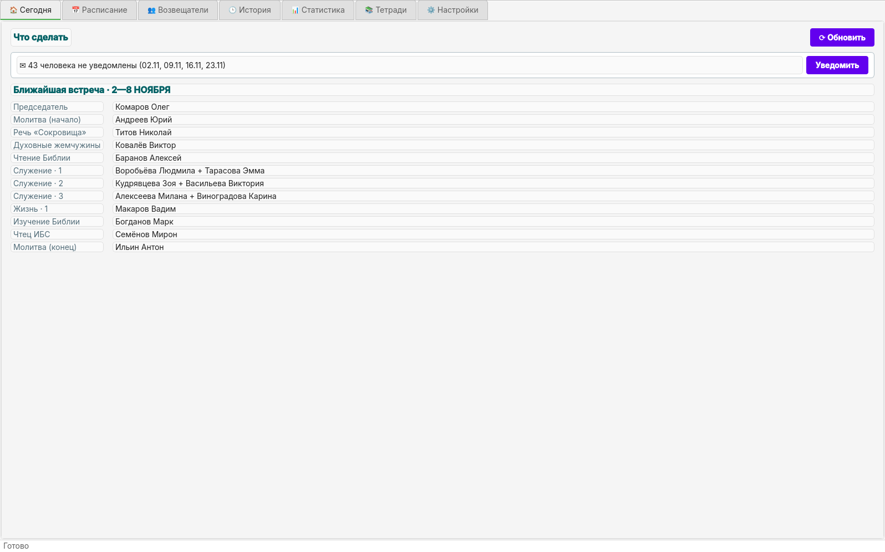
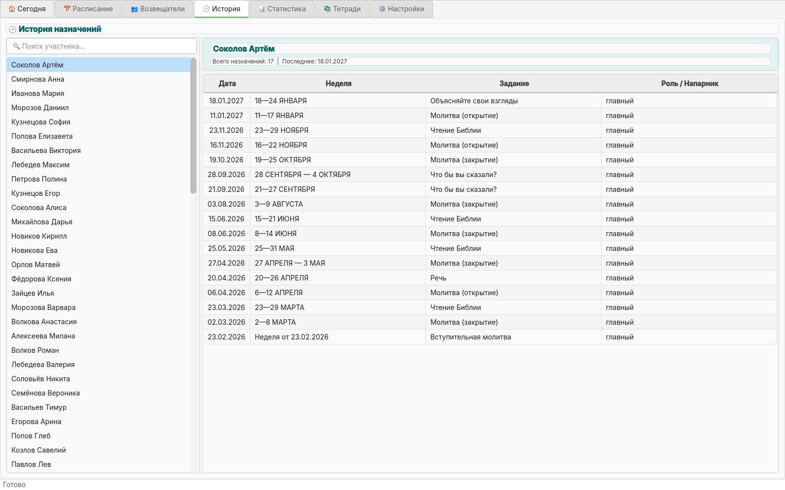
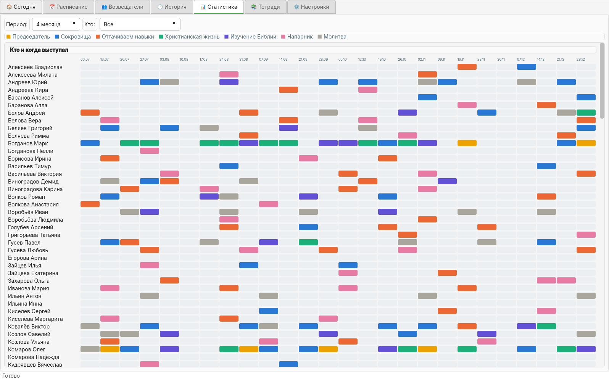

# Руководство пользователя Cerastilo

Cerastilo составляет расписание встреч «Жизнь и служение» на компьютере и Android-планшете.

## Содержание

- 1. Введение и назначение программы
  - 1.1. Общие сведения
  - 1.2. Поддерживаемые платформы (Десктоп и Android-планшеты)
- 2. Обзор интерфейса и навигация
  - 2.1. Вкладки программы
  - 2.2. Навигация по датам (дерево, кнопки «‹», «Сегодня», «›»)
  - 2.3. Переключение между режимом недели и доской месяца
  - 2.4. Темы оформления (Как в системе, Светлая, Тёмная)
- 3. Пульт руководителя встречи («🏠 Сегодня»)
  - 3.0. Первые шаги (пустая база)
  - 3.1. Оперативный список дел («Что сделать»)
  - 3.2. Карточка ближайшей встречи и быстрые действия
- 4. Импорт программы встреч («⚙️ Настройки» → «📚 Рабочие тетради»)
  - 4.1. Загрузка рабочих тетрадей из файлов EPUB
  - 4.2. Добавление шаблонов на будущий год («➕ Будущий год»)
  - 4.3. Назначение особых событий (Вечеря, Конгрессы, Визит районного старейшины)
- 5. Управление списком возвещателей («👥 Возвещатели»)
  - 5.1. Поиск, сортировка и подсветка в списке участников
  - 5.2. Карточка участника
- 6. Составление и ведение расписания («📅 Расписание»)
  - 6.1. Автоматическое распределение недели и месяца («🪄 Авто»)
  - 6.2. Ручной выбор и замена участников (подсказки, фильтры, конфликты)
  - 6.3. Работа с таблицей недели: изменение длительности, времени, сортировка перетаскиванием
  - 6.4. Внеочередные пункты (добавление, редактирование, дублирование, удаление)
  - 6.5. Доска месяца (назначение перетаскиванием и проверка расписания)
  - 6.6. Объявления недели («📢 Объявление»)
  - 6.7. Отмена и повтор действий
- 7. Как программа распределяет задания
  - 7.1. Перерывы между назначениями
  - 7.2. Духовный статус и квалификации ролей
  - 7.3. Правила учебных заданий и подбора напарников (правила пола и членов семьи)
  - 7.4. Особенности программы недели визита районного старейшины
- 8. История и аналитика нагрузки («🕒 История» и «📊 Статистика»)
  - 8.1. История назначений возвещателя
  - 8.2. Тепловая карта («Кто и когда выступал»)
  - 8.3. Графики баланса нагрузки по категориям заданий
- 9. Email-уведомления и контроль ответов
  - 9.1. Настройка параметров почты (SMTP)
  - 9.2. Массовая рассылка уведомлений о заданиях
  - 9.3. Индивидуальные письма: шаблоны, личные примечания, предпросмотр
  - 9.4. Экспорт заданий в календарь (.ics) для отправки в мессенджеры
  - 9.5. Журнал уведомлений и повторная отправка
  - 9.6. Автоматическая проверка ответов участников («Подтвердил» / «Не сможет»)
- 10. Экспорт и печать бланков
  - 10.1. Печать, быстрый экспорт в PDF и TXT
  - 10.2. Экспорт расписания в Word (.docx)
  - 10.3. Бланки S-89 на выбранные недели или на месяц
- 11. Настройки, безопасность и синхронизация («⚙️ Настройки»)
  - 11.1. Параметры собрания (день, время, название)
  - 11.2. Управление модулями программы
  - 11.3. Импорт из NW Scheduler и Excel
  - 11.4. Резервное копирование и восстановление базы данных
  - 11.5. Синхронизация ПК ↔ планшет по Wi-Fi
  - 11.6. Проверка обновлений
- 12. Особенности работы на Android-планшетах
  - 12.1. Сенсорный ввод и жесты прокрутки
  - 12.2. Адаптивная панель инструментов («⋯ Ещё»)

## 1. Введение и назначение программы

### 1.1. Общие сведения

В заголовке окна написано «Cerastilo - Планировщик Встреч».

Что делает программа:

* ведёт базу возвещателей с их квалификациями, семьёй, контактами и периодами отсутствия;
* автоматически распределяет задания по неделям с учётом десятков правил (интервалы отдыха, пол, духовный статус, квалификации, защита несовершеннолетних, ротация ролей);
* даёт заменить или снять назначение вручную и предупреждает о конфликтах;
* импортирует программу встреч из рабочих тетрадей (EPUB) и раскладывает её по неделям;
* рассылает участникам email-уведомления о заданиях и собирает их ответы («Подтверждаю» / «Не смогу»);
* формирует бланки S-89, экспортирует расписание в PDF, TXT и Word, выгружает задания в календарь (.ics);
* показывает историю назначений и аналитику нагрузки;
* синхронизирует данные между компьютером и Android-планшетом по Wi-Fi;
* делает резервные копии базы данных и восстанавливает их.

Программа хранит список возвещателей, расписание, настройки и историю уведомлений на устройстве. APK поставляется без базы: при первом запуске список участников и расписание пусты. Чтобы перенести данные с компьютера, выполните синхронизацию по Wi-Fi (глава 11.5).

При запуске программа:

* применяет сохранённую тему оформления (или системную, если выбрано «Как в системе»);
* подхватывает смену системной темы на лету (если выбрано «Как в системе»);
* выполняет служебные обновления структуры данных (миграции), чтобы база соответствовала текущей версии;
* при критической ошибке запуска показывает окно «Ошибка запуска» с описанием проблемы и завершает работу;
* при любой ошибке во время работы показывает окно с сообщением и, если есть, с контекстом (что именно не удалось сделать) — в заголовке «Ошибка: [контекст]» или просто «Ошибка».

Файл журнала сбоев (`crash.log`) пишется в папку приложения (на компьютере) или в папку данных приложения (на Android) — его можно передать разработчику для разбора.

### 1.2. Поддерживаемые платформы (Десктоп и Android-планшеты)

Компьютер (Windows, Linux, macOS). Полноценная версия со всеми вкладками. Окно открывается развёрнутым на весь экран (кроме macOS, где оно открывается в обычном размере). Минимальный размер окна — 1000×700 точек, поэтому программа рассчитана на обычный монитор или ноутбук. При запуске статусная строка показывает «Готово».

Android-планшет. Используется то же главное окно и те же вкладки, что на компьютере, но с адаптацией под сенсорный экран:

* Листайте списки и таблицы пальцем в любом месте области прокрутки.
* Масштаб интерфейса на планшете — 0,85. Например, на экране 1920×1200 в распоряжении окна примерно 1280 точек по ширине.
* Окно открывается развёрнутым на весь экран.
* Данные хранятся в постоянной папке устройства, отдельной от кода приложения, — обновление приложения не стирает расписание.
* На узком экране меняется панель расписания (глава 12.2).

Синхронизация ПК ↔ планшет. Компьютер и планшет можно синхронизировать по Wi-Fi: на компьютере во вкладке «⚙️ Настройки» есть блок «🔄 Синхронизация ПК ↔ планшет», планшет показывает адрес и код, компьютер подключается к нему; обмен зашифрован, ключ — код с планшета. Подробно — в главе 11.5.

Резервное копирование рекомендуется делать регулярно (особенно перед обновлением приложения или перед массовым распределением месяца) — порядок описан в главе 11.4.

## 2. Обзор интерфейса и навигация

### 2.1. Вкладки программы

Чтобы открыть вкладку, щёлкните по её названию вверху окна. На планшете коснитесь названия.

1. «🏠 Сегодня» — пульт руководителя встречи: список неотложных дел и карточка ближайшей встречи. Подробно — в главе 3.
2. «📅 Расписание». Слева находится дерево дат, справа можно открыть таблицу недели или доску месяца (глава 6).
3. «👥 Возвещатели» — таблица всех участников с поиском, сортировкой и цветовой подсветкой; здесь же открывается карточка участника. Подробно — в главе 5.
4. «🕒 История» — хронологический список всех заданий выбранного возвещателя. Подробно — в главе 8.
5. «📊 Статистика» — аналитика нагрузки: тепловая карта выступлений и графики по категориям заданий. Подробно — в главе 8.
6. «⚙️ Настройки» — импорт рабочих тетрадей (EPUB, глава 4), параметры собрания, тема оформления, модули, миграция данных, резервное копирование, синхронизация и настройки email. Подробно — в главе 11.

Список возвещателей и история обновляются при открытии вкладки.

Внизу окна расположена строка состояния — в ней на короткое время появляются служебные сообщения о выполненных действиях (например, «Длительность пункта обновлена», «Авто-назначение: N заданий»).

### 2.2. Навигация по датам (дерево, кнопки «‹», «Сегодня», «›»)

Выберите неделю в дереве дат слева. Справа откроется её расписание. Чтобы освободить место для таблицы, нажмите кнопку со значком списка. Подсказка кнопки гласит «Показать или скрыть список недель».

Кнопки быстрого перехода. Над таблицей расписания расположены кнопки:

* «‹» — перейти к предыдущей неделе;
* «Сегодня» — вернуться к текущей неделе;
* «›» — перейти к следующей неделе.

С клавиатуры нажмите Alt+← для перехода назад или Alt+→ для перехода вперёд. На доске месяца эти команды и кнопки листают месяцы.

Чтобы добавить пустые недели на следующий год, см. главу 4.2.

Особые события недели. Правый щелчок по неделе в дереве открывает меню выбора типа недели:

* «Обычная неделя» — обычная программа;
* «🍷 Вечеря Господня»;
* «🏟️ Районный конгресс»;
* «🌍 Региональный конгресс»;
* «👔 Посещение районного старейшины (РС)».

Текущий тип отмечен галочкой. Выбранный тип сохраняется; если это открытая сейчас неделя, правая часть экрана сразу обновляется. Тип недели влияет на поведение авто-распределения и отображение (например, на неделе визита РС в шапке появляется соответствующий значок).

Бланки S-89 сразу на месяц можно открыть из дерева дат (глава 10.3).

### 2.3. Переключение между режимом недели и доской месяца

1. Выберите неделю в дереве слева. Справа откроется её таблица с колонками «Раздел», «№», «Назначение», «Начало», «Время», «Участник» и «Напарник» (глава 6).
2. Нажмите **«Месяц»**, чтобы перейти на доску месяца (подробно — глава 6.5).
3. Чтобы вернуться к таблице, выберите неделю в дереве или нажмите кнопку недельного режима.

Объявления под таблицей недели описаны в главе 6.6.

### 2.4. Темы оформления (Как в системе, Светлая, Тёмная)

Тема выбирается во вкладке «⚙️ Настройки», в блоке «🎨 Оформление», в выпадающем списке «Тема»:

* «Как в системе» — программа следует текущей теме операционной системы (KDE, GNOME и т. п.). Если системная тема меняется во время работы, интерфейс сразу перекрашивается;
* «Светлая» — светлое оформление;
* «Тёмная» — тёмное оформление.

Выбор применяется мгновенно ко всем открытым окнам и сохраняется — при следующем запуске программа откроется в той же теме. Если выбрано «Как в системе», программа запоминает именно этот выбор и при запуске определяет тему заново по системе, а не «залипает» на когда-то определённой.

Значения по умолчанию — «Как в системе».

## 3. Пульт руководителя встречи («🏠 Сегодня»)

На первой вкладке «🏠 Сегодня» видны срочные дела и программа ближайшей встречи с ответами участников.

Содержимое вкладки в области прокрутки — при нехватке высоты экрана (например, на планшете) она листается пальцем или колесом мыши.

Нажмите **«⟳ Обновить»** рядом с заголовком «Что сделать», чтобы обновить список дел и карточку встречи. Они также обновляются при открытии вкладки.

Если программа не смогла прочитать данные, появится «Не удалось собрать список дел: …». Карточка встречи при этом скрыта. После устранения причины нажмите **«⟳ Обновить»**.

### 3.0. Первые шаги (пустая база)

Пока база не заполнена, вверху вкладки «🏠 Сегодня» показан список «Первые шаги»: название собрания, день и время → возвещатели → их квалификации → программа встреч (EPUB в «⚙️ Настройки» → «📚 Рабочие тетради») → первая распределённая неделя. Сделанное отмечается ✓, у остального кнопка «Перейти» открывает нужную вкладку. Когда все шаги выполнены, список исчезает.

### 3.1. Оперативный список дел («Что сделать»)

В списке «Что сделать» слева в каждой строке стоят значок и текст, справа находится кнопка действия.

Какие бывают дела и что означает каждый значок:

| Значок | Дело | Что означает | Кнопка действия |
|---|---|---|---|
| ❌ | Отказ | Участник ответил, что не сможет | «Найти замену» |
| ▢ | Пустой пункт | В расписании есть незаполненный пункт | «Заполнить» |
| ⏳ | Не подтвердили | Участники ещё не ответили на уведомление | «Напомнить» |
| ✉ | Не уведомлено | Неделя начинается в ближайшие 7 дней, а кому-то не отправлено письмо (обычно о заданиях сообщают листками — это дело последнее в списке) | «Уведомить» |
| 📚 | Нет программы | Для недели не загружена программа встречи из тетради | «Импорт тетради» |
| 🪄 | Не распределено | В неделе есть задания, которые ещё не распределены | «Открыть месяц» |

Программа выделяет отказы и пустые пункты красным.

Что делает каждая кнопка:

* «Найти замену» (отказ) и «Заполнить» (пустой пункт) — переключают на вкладку «📅 Расписание» и открывают доску месяца первой недели, к которой относится дело. Там вы видите проблемную неделю в общем контексте и назначаете замену или заполняете пустой пункт.
* «Уведомить» (не уведомлено) и «Напомнить» (не подтвердили) — открывают окно массовой отправки уведомлений, в котором уже отмечены только те недели и только те участники, к которым относится это дело. После закрытия окна список дел обновляется: если все письма отправлены, дело исчезает.
* «Импорт тетради» (нет программы) — открывает «⚙️ Настройки» → «📚 Рабочие тетради», где вы загружаете рабочую тетрадь с программой встреч (глава 4).
* «Открыть месяц» (не распределено) — переключает на вкладку «📅 Расписание» и открывает доску месяца, чтобы запустить авто-распределение или назначить вручную.

Поведение списка:

* Если дел нет, вместо списка показывается зелёная галочка и надпись «✓ Всё готово».
* Каждое дело относится к одной или нескольким неделям; кнопка перехода ведёт к первой из них.
* Список строится автоматически при открытии вкладки и по кнопке «⟳ Обновить», отдельно настраивать ничего не нужно.

### 3.2. Карточка ближайшей встречи и быстрые действия

Под списком дел расположена карточка ближайшей встречи. Заголовок карточки — «Ближайшая встреча · [название недели]»; если на этой неделе запланирован визит районного старейшины, к заголовку добавляется пометка «· визит РС».

Слева в карточке указаны пункты программы, справа крупным шрифтом показаны имена. Чтобы прочитать подсказку о статусе ответа, наведите курсор на отметку рядом с именем или удерживайте её пальцем.

Что видно в карточке:

* Если пункт заполнен — перечислены имена (главный участник и, где положено, напарник через «+»), рядом со статусом ответа: подтвердил, не сможет, не подтвердил и т. п.
* Если пункт пуст — вместо имени показан красный прочерк «— пусто», чтобы пустые места сразу бросались в глаза.

Быстрые действия с карточки:

* Карточка сама по себе — это обзор: щелчок по строке ничего не открывает, но по ней видно, кого не хватает и кто ещё не ответил. Чтобы что-то изменить, перейдите в «📅 Расписание» (глава 6) или нажмите соответствующее дело из списка «Что сделать» (раздел 3.1).
* Кнопка «⟳ Обновить» сверху вкладки перечитывает и список дел, и карточку встречи — удобно после того, как вы ответили участникам или внесли правки в расписание в другой вкладке.
* Переход на нужную неделю или месяц из списка дел сразу открывает их на вкладке «📅 Расписание» (см. главу 3.1); возврат на «🏠 Сегодня» перечитает данные автоматически.

Если ближайшей встречи для показа нет, карточка просто не отображается — остаётся только список дел.

## 4. Импорт программы встреч («⚙️ Настройки» → «📚 Рабочие тетради»)

Откройте «📚 Рабочие тетради» в первом разделе вкладки «⚙️ Настройки». Отсюда программа загружает недели и задания в «📅 Расписание».

Если на вкладке «🏠 Сегодня» в списке дел появилось дело «Нет программы» с кнопкой «Импорт тетради», нажатие на неё сразу открывает этот раздел. То же самое касается подготовки будущего года и назначения особых событий — их удобно делать именно здесь.

### 4.1. Загрузка рабочих тетрадей из файлов EPUB

Загрузка тетради выполняется в разделе «📚 Рабочие тетради» вкладки «⚙️ Настройки». В разделе — пояснение: «Выберите файл EPUB с рабочей тетрадью «Наша христианская жизнь и служение». Программа автоматически извлечёт недели и задания.»

1. Откройте «⚙️ Настройки» и выберите слева раздел **«📚 Рабочие тетради»**.
2. Нажмите кнопку **«📁 Выбрать EPUB файл»** и выберите файл рабочей тетради в формате EPUB — файл с расширением `.epub`.
3. Дождитесь окончания импорта. Под кнопкой появятся «🔄 Начинаю импорт...», затем «✅ Импортировано: N недель, M заданий» и «🎉 Импорт завершён! Теперь новые недели доступны в расписании.» Если импорт дополнил шаблоны, созданные кнопкой «➕ Будущий год», появится и строка «📅 Заполнено пустых недель, созданных раньше: K». Пока идёт импорт, можно работать на других вкладках.
4. Откройте вкладку «📅 Расписание» — загруженные недели появятся в дереве дат (Год → Месяц → Неделя).

Что извлекается из тетради:

* Недели с датами — программа сама определяет начало каждой недели и раскладывает их по месяцам и годам.
* Задания каждой недели — с названием пункта, разделом программы (Сокровища из Божьего Слова, Развивайте навыки служения, Наша христианская жизнь и т. д.), номером пункта и источником материала (стихи, тема).
* Чтение Библии для недели — оно отображается в шапке недели на вкладке «📅 Расписание» с пометкой «📚».
* Учебные задания — с главным участником и напарником (если они предусмотрены пунктом).

**Что важно знать**

Если файл повреждён или выбран файл другого типа, под кнопкой появится «❌ Ошибка: …». В окне «Ошибка импорта» программа покажет причину в сообщении «Не удалось импортировать файл: …».

### 4.2. Добавление шаблонов на будущий год («➕ Будущий год»)

Когда программа текущего года заканчивается, нужно заранее подготовить пустые недели на следующий год, чтобы было куда ставить назначения.

Кнопка «➕ Будущий год» находится на вкладке «📅 Расписание» внизу левой панели, под деревом недель.

1. Откройте вкладку **«📅 Расписание»**.
2. Нажмите кнопку **«➕ Будущий год»**.
3. Нажмите **«Да»** в ответ на «Создать пустые недели на [год] год ([количество])? Уже существующие недели не изменятся.» Когда программа закончит, дерево дат обновится. В окне «Готово» появится «[Год] год: добавлено пустых недель — N.»

Как программа выбирает год и количество недель

* Сначала программа ищет первый неполный год после текущего. Например, если из тетради загружены только январь и февраль, программа предложит добавить недели до конца этого же года.
* Если такого года нет — берётся год, следующий за последним имеющимся в расписании.
* Программа добавляет только недостающие недели.

**Что важно знать**

* Кнопка только создаёт пустые недели — пункты программы в них не появляются. Пункты добавляются либо импортом тетради (раздел 4.1), либо вручную внеочередными пунктами (глава 6.4).
* Если вы передумали до нажатия «Да», просто закройте окно подтверждения — ничего не изменится.

### 4.3. Назначение особых событий (Вечеря, Конгрессы, Визит районного старейшины)

Не все недели в году проводятся по обычной программе. Некоторые недели отменяются или идут по особому порядку. Тип недели задаётся в дереве дат вкладки «📅 Расписание».

1. Откройте вкладку **«📅 Расписание»**.
2. В левой панели найдите нужную неделю в дереве (Год → Месяц → Неделя).
3. Нажмите на неделю правой кнопкой мыши (на планшете — долгое касание).
4. Выберите тип в меню. Галочка показывает текущий тип.

Доступные типы недель:

* «Обычная неделя» — стандартная программа встречи.
* «🍷 Вечеря Господня» — неделя Вечери. Обычная встреча на этой неделе не проводится: вместо таблицы назначений показывается заглушка «Вечеря Господня — На этой неделе обычная встреча не проводится».
* «🏟️ Районный конгресс» — встреча отменена в связи с конгрессом; вместо таблицы — заглушка «🏟️ Районный Конгресс — Встреча отменена в связи с конгрессом».
* «🌍 Региональный конгресс» — аналогично, встреча отменена; заглушка «Региональный Конгресс — Встреча отменена в связи с конгрессом».
* «👔 Посещение районного старейшины (РС)». В таблице назначений вместо «Изучение Библии в собрании» стоит «Служебная речь РС». В шапке недели появится метка «👔 Визит РС» с подсказкой «Посещение районного старейшины (РС): Изучение Библии в собрании заменено служебной речью».

**Что важно знать**

* Тип недели сохраняется в базе и сразу применяется к отображению: если это открытая сейчас неделя, правая часть экрана обновляется без перезапуска программы.
* В шапке недели, помимо метки визита РС, показываются: «Назначено X из Y», кнопка «✉ Уведомить оставшихся» (если кому-то на этой неделе ещё не писали; число — в подсказке), счётчики «❌ Не смогут: N», «⏳ Не подтвердили: N» и, если есть накладки, «⚠ Конфликты: N».

Если тип выбран ошибочно:

* Откройте то же меню правым щелчком по неделе и выберите **«Обычная неделя»** — отображение вернётся к стандартной таблице назначений. Ранее сделанные назначения на неделе сохраняются.
* В нижней строке состояния на несколько секунд появляется подтверждение «Тип недели обновлен»; если сохранить тип не удалось, программа покажет окно «Ошибка — Не удалось сохранить тип недели».

## 5. Управление списком возвещателей («👥 Возвещатели»)

На вкладке «👥 Возвещатели» укажите квалификации, родство и периоды отсутствия участников. Программа сразу учитывает эти изменения при составлении расписания.

### 5.1. Поиск, сортировка и подсветка в списке участников

Вверху вкладки «👥 Возвещатели» видны поле поиска, кнопки действий и заголовок «Возвещатели · N», где N означает число участников. Ниже находится таблица.

Колонки таблицы:

| Колонка | Что содержит |
|---|---|
| ФИО | Полное имя участника |
| Пол | «М» — брат, «Ж» — сестра |
| Роль | «Возвещатель», «Помощник» или «Старейшина» |
| Последнее | Дата последнего назначения в формате ДД.ММ.ГГГГ или «—», если заданий ещё не было |
| Всего | Общее количество назначений участника |

Поиск. Поле «🔍 Поиск по имени…» с кнопкой очистки (крестик внутри поля) мгновенно фильтрует таблицу по подстроке в ФИО: скрываются все строки, в имени которых нет введённого текста. Регистр не важен — «иван» найдёт «Иванов». Чтобы вернуть всех, очистите поле крестиком или удалите текст.

Сортировка. Щёлкните по заголовку любого столбца — таблица отсортируется. Повторный щелчок меняет направление (по возрастанию/убыванию). Сортировка работает корректно для дат и чисел:

* «Последнее» — по календарному порядку дат (не по тексту); участники без даты («—») оказываются в начале при сортировке по возрастанию;
* «Всего» — по числу назначений (числовой порядок, а не «14» раньше «2»);
* «ФИО», «Пол», «Роль» — по алфавиту.

По умолчанию таблица отсортирована по ФИО по возрастанию. При каждом обновлении списка сортировка по ФИО применяется заново.

Цветовая индикация и подсказки. Строки подсвечиваются в зависимости от состояния участника:

* Приглушённые (серые) строки — у участника нет ни одной квалификации: он не может быть назначен ни на что и не попадает в авто-распределение. Подсказка при наведении: «Нет ролей — в распределение не попадает».
* Курсив в имени — участник временно недоступен: сегодняшняя дата попадает в его период «Временное исключение из графика» (отпуск, болезнь). Подсказка: «Недоступен до ДД.ММ.ГГГГ».
* Жёлтая выделенная и жирная дата в «Последнее» — у участника есть квалификации, но заданий не было более 60 дней (или не было ни разу). Подсказка: «Есть роли, но ещё не было заданий» или «Есть роли, но давно не было заданий: N дн. назад». Это сигнал для справедливого распределения: такого брата стоит назначить в ближайшее время.
* Роль «Старейшина» отображается жирным шрифтом акцентным цветом, «Помощник» — акцентным цветом без жирности — чтобы статусы хорошо различались.

Цвета пересчитываются при смене темы оформления, поэтому при переключении «Светлая» ↔ «Тёмная» таблица сохраняет читаемость.

Кнопки действий над таблицей:

* «➕ Добавить» — открывает карточку нового участника (раздел 5.2).
* «✏️ Изменить» — активна только при выбранной строке; открывает карточку выбранного участника. То же самое делают двойной щелчок по строке, клавиши Enter или Return.
* «🗑️ Удалить» — активна только при выбранной строке; спрашивает подтверждение: «Вы уверены, что хотите удалить возвещателя [имя]? История его назначений будет сохранена.» После подтверждения участник удаляется из справочника, а история его назначений в базе остаётся. То же делает клавиша Delete.

Контекстное меню. Правый щелчок по строке (долгое касание на планшете) открывает меню «✏️ Изменить» и «🗑️ Удалить» — это те же действия.

Правило выбора строки. Одновременно можно выбрать только одну строку; кнопки «Изменить» и «Удалить» активируются только при наличии выбора.

### 5.2. Карточка участника

Карточка открывается кнопкой «➕ Добавить» или «✏️ Изменить» (а также двойным щелчком по строке, клавишами Enter/Return или через контекстное меню). В заголовке окна — «Добавить возвещателя» или «Редактировать возвещателя». Карточка состоит из трёх вкладок и кнопок «Сохранить» и «Отмена» внизу.

Основные данные и контакты (Email, телефон)

На вкладке «Основное», в группе «Основная информация», заполняются поля:

* «ФИО» — обязательное поле. Если оставить пустым, при сохранении появится предупреждение «Поле 'ФИО' не может быть пустым.» и изменения не сохранятся. Если такое имя уже есть, программа сообщит: «Не удалось добавить возвещателя. Возможно, такое имя уже существует.»
* «Email» — адрес электронной почты участника (подсказка в поле: `example@gmail.com`). Он используется для отправки персональных уведомлений о заданиях (глава 9) и хранится в карточке.
* «Телефон» — номер телефона для справки (подсказка: `+7 (999) 000-00-00`). В рассылке не используется, служит только для учёта.
* «Пол» — «Брат» или «Сестра». От пола зависят допустимые роли: сёстры не назначаются на председательство, молитвы, чтение Библии и другие роли, закреплённые за братьями.
* «Духовный статус» — «Возвещатель», «Помощник» или «Старейшина». Определяет приоритеты и допустимость ответственных ролей (подробно — глава 7.2).

Семья и защита несовершеннолетних

В том же блоке:

* «Семья (Глава)» — выпадающий список глав семей (только братья, кроме самого редактируемого участника). Значение «— Нет семьи / Глава —» означает, что участник ни к чьей семье не привязан (или сам возглавляет семью). Эта связь нужна для двух правил: несовершеннолетний может выступать в паре только со сверстником или с членом своей семьи, а напарник к сестре может быть её родственником-мужчиной (глава 7.3).
* «Несовершеннолетний» — галочка. Включает защитные правила для детей и подростков. Подсказка при наведении поясняет: несовершеннолетний может получать учебные задания только с другим несовершеннолетним (как главный участник или помощник) либо со взрослым членом своей семьи — и в этом случае только как помощник.

Персональный интервал назначений (personal gap)

В поле «Личный интервал» можно задать перерыв между заданиями для конкретного участника. Варианты

* «Авто (по типу служения)» — интервал берётся из общих настроек по духовному статусу (старейшина / помощник / возвещатель). Это значение по умолчанию.
* «Всегда доступен (0 нед.)» — участник может получать задания каждую неделю, как старейшина, независимо от его статуса.
* «1 неделя», «2 недели», «3 недели», «4 недели», «5 недель», «6 недель», «8 недель», «10 недель», «12 недель» — жёсткий персональный интервал: «не чаще раза в N недель». Например, если брат просит назначать его реже из-за слабого здоровья, поставьте 6 недель.

Персональный интервал учитывается авто-распределением наравне с общим.

Временное отсутствие (отпуск, больничный)

Если человек уезжает в отпуск, командировку или временно не может выполнять задания по болезни, его не нужно удалять из базы и не нужно снимать квалификации. Для этого на вкладке «Основное» есть группа «Временное исключение из графика» с галочкой активности:

1. Откройте карточку участника.
2. Установите галочку у группы «Временное исключение из графика».
3. Укажите первый день отсутствия в поле «С:», последний в поле «По:». В обоих полях есть календарь.
4. Нажмите **«Сохранить»**.

Если дата встречи попадает в период отсутствия, программа исключает участника из автораспределения на эту неделю. При ручном выборе она предупредит о конфликте (глава 6.2). Во время отсутствия имя в списке выделено курсивом. Подсказка у имени гласит «Недоступен до ДД.ММ.ГГГГ».

Если снять галочку и сохранить — период отсутствия очищается.

Замены одним окном. Если после сохранения карточки у участника остались задания на неделях, когда его не будет (отпуск или исключённые недели «Сменного графика»), программа сразу покажет их списком — «Задания на время отсутствия» — и предложит:

* «Снять и подобрать замену» — участник снимается с этих заданий, а освободившиеся места заполняет «Авто» (как на доске месяца: остальные назначения не меняются). Затем показывается, кто встал на каждое место; если замены не нашлось, пункт остаётся пустым.
* «Только снять» — места освобождаются, замену вы выберете сами (например, на доске месяца).
* «Оставить как есть» — ничего не меняется; на доске месяца такие задания подсвечены красным «нужна замена».

Отсутствия списком. Кнопка «🏖 Отсутствия» над списком возвещателей открывает таблицу всех, у кого задан отпуск: участник, «С», «По». Можно добавить несколько строк сразу («➕ Добавить») или удалить строку 🗑 — отпуск снимется. После «Сохранить» программа одним списком покажет задания всех, кого не будет, и предложит снять их и подобрать замены (как выше).

Сменный график и генерация исключений по шаблону

Вкладка «Сменный график» предназначена для людей с гибким или сменным графиком работы (например, сутки через трое, работа по неделям), а также для фиксации разовых пропусков. В отличие от сплошного диапазона отпуска, здесь исключаются конкретные недели, а не период целиком.

Слева расположен список «Исключенные недели (понедельники):» — даты начала недель (понедельники), на которые участника нельзя ставить. Снизу — кнопка «🗑️ Удалить выбранные» (работает с выделенными строками; можно выделить несколько).

Справа — два способа добавить недели в список.

Способ 1. Диапазон дат. Группа «Недоступен (отпуск, болезнь)» содержит поля «с» и «по» (оба с календарём) и кнопку «➕ Добавить»:

1. Выберите дату начала в поле «с».
2. Выберите дату окончания в поле «по». По умолчанию «по» подставляется равным «с» (одна неделя).
3. Нажмите **«➕ Добавить»**.
4. Программа найдёт понедельник недели, в которую попадает дата «с», и будет добавлять понедельники каждую неделю, пока дата не превысит «по». Если дата «по» раньше «с», программа сама поменяет их местами. Уже имеющиеся в списке недели не дублируются. Если ничего нового не добавлено, появится сообщение «Эти недели уже есть в списке.»

Этот способ удобен для отпуска, болезни, командировки на несколько недель подряд.

Способ 2. Автоматическая генерация по шаблону. Группа «Добавить по шаблону (сменный график)»:

1. В поле «Начало:» укажите дату начала шаблона (любой день первой недели).
2. В поле «Периодичность:» выберите интервал: «Каждую неделю», «Через неделю (раз в 2 нед.)», «Раз в 3 недели», «Раз в 4 недели», «Раз в 5 недель», «Раз в 6 недель». По умолчанию стоит «Через неделю (раз в 2 нед.)».
3. В поле «Количество недель:» укажите, сколько недель сгенерировать (от 1 до 52; по умолчанию 10).
4. Нажмите кнопку **«⚙️ Сгенерировать шаблон»**.

Первая отметка приходится на понедельник недели, в которую попадает дата «Начало». Дальше программа отмечает недели с шагом от 1 до 6 недель, в зависимости от выбранной периодичности. Уже отмеченные недели она пропускает. Вы увидите «Сгенерировано и добавлено в список N недель.» Если новых дат нет, появится «Все сгенерированные недели уже присутствуют в списке.»

Удаление ошибочно добавленных недель. Выделите одну или несколько строк в списке слева (удерживая Ctrl или Shift) и нажмите **«🗑️ Удалить выбранные»**.

Как исключения учитываются при распределении: при авто-распределении все недели из списка исключаются — участник не будет назначен ни на какую роль в эти недели. При ручной попытке назначить его на такую неделю программа покажет конфликт.

Все изменения в списке исключённых недель сохраняются вместе с карточкой по кнопке «Сохранить»; при нажатии «Отмена» изменения не сохраняются.

Квалификации к пунктам встречи собрания

Вкладка «Квалификации», группа «Квалификации (доступные задания)», содержит галочки, определяющие, на какие пункты программы участник может быть назначен. Если галочка не стоит, система никогда не предложит его на эту роль.

Доступные квалификации:

* «Председатель» — ведение встречи.
* «Молитва» — молитвы на встрече.
* «Сокровища (10 мин.)» — вступительная часть «Сокровищ из Божьего Слова».
* «Духовные жемчужины (10 мин.)» — пункт «Духовные жемчужины».
* «Чтение Библии (4 мин.)» — чтение Библии.
* «Учебные задания» — главный участник учебного задания (разговор, повторное посещение, изучение Библии в служении).
* «Речь» — речь в части «Оттачиваем навыки служения».
* «Напарник» — помощник в учебных заданиях.
* «Часть ХЖС» — часть «Христианская жизнь и служение».
* «Изуч. Библии — Ведущий» — ведущий изучения Библии в собрании.
* «Изуч. Библии — Чтец» — чтец изучения Библии в собрании.

Квалификации показываются попарно (по две в ряд). Участник без единой квалификации приглушается в таблице списка и в авто-распределение не попадает (раздел 5.1).

Сохранение карточки. Кнопка «Сохранить» проверяет обязательное поле ФИО и записывает все данные: имя, email, телефон, пол, статус, семью, личный интервал, флаг несовершеннолетнего, период временного отсутствия, квалификации и список исключённых недель. Если сохранение не удалось (например, при попытке обновить участника), появится окно «Ошибка — Не удалось обновить возвещателя.» Кнопка «Отмена» закрывает карточку без сохранения изменений.

После сохранения карточки таблица списка обновляется. Если редактировался существующий участник, таблица прокручивается к его строке и выделяет её — удобно, когда вы правили карточку в длинном списке.

## 6. Составление и ведение расписания («📅 Расписание»)

На вкладке «📅 Расписание» слева находится дерево дат «Год → Месяц → Неделя». Справа открывается таблица недели или доска месяца (глава 2.3).

Несохранённые изменения. Если в карточке что-то изменили и нажали «Отмена», Esc или крестик, программа спросит: «Сохранить», «Не сохранять» или «Отмена» (вернуться к карточке).

Нет квалификаций. Пока не отмечена ни одна квалификация, на вкладке «Основное» видна подсказка «⚠ Не отмечено ни одной квалификации — участник не попадёт в распределение» со ссылкой на вкладку квалификаций, а сама вкладка называется «⚠ Квалификации».

### 6.1. Автоматическое распределение недели и месяца («🪄 Авто»)

Автораспределение заполняет пустые пункты и подбирает недостающих напарников. Ручные назначения и замены сохраняются. Для недели и месяца действуют одни и те же правила (глава 7).

**На одну неделю**

1. Выберите неделю в дереве слева. Справа откроется её таблица.
2. Нажмите **«🪄 Авто-распределение»** на панели. На узком экране кнопка называется **«🪄 Авто»**.
3. В окне «Авто-распределение» вы увидите «Заполнить пустые пункты недели автоматически? Уже назначенные останутся на своих местах.» Нажмите **«Да»**. Если хотите распределить всю неделю заново, сначала нажмите **«🗑 Очистить»**.
4. Распределение идёт в фоне. Вы увидите «✅ Распределено: N назначений» или «ℹ️ Все задания уже заполнены», если новых назначений нет. В строке состояния появится «Авто-назначение: N заданий».

**Как программа выбирает участников**

Для каждого пункта программа проверяет квалификацию, пол, духовный статус и нужен ли напарник. Например, для вступительной речи сначала рассматривает старейшин, затем помощников.

Программа пропускает тех, кто уже занят на этой неделе или отсутствует из-за отпуска, больничного («Временное исключение из графика») либо сменного графика. Она учитывает общий перерыв, перерыв для помощников и личный интервал. В учебных заданиях чередует роли основного участника и напарника. При выборе учитывает, кто дольше не выступал.

**На весь месяц**

1. Откройте **«Месяц»** и нажмите **«🪄 Авто-распределение»** (**«🪄 Авто»** на узком экране). Программа найдёт полностью пустые недели и недели, где освободилось хотя бы одно место, например после отказа или отпуска. Недели конгресса и Вечери она пропустит.
2. В окне «Авто-распределение месяца» проверьте список в сообщении «Заполнить пустые пункты на неделях (N): [даты]? Уже назначенные останутся на своих местах.» Нажмите **«Да»**.
3. Программа сохранит копию базы для отмены. Если это не удастся, например из-за нехватки места или прав, вы увидите «Не удалось сохранить снимок базы, распределение отменено: …».
4. Пока программа работает, доска и кнопки «🪄 Авто» и «↶» недоступны. Когда она закончит, вы увидите «✅ Распределено недель: N, назначений: M».
5. Если программа остановится с сообщением «Распределено недель: N, дальше ошибка: …», назначения в уже обработанных неделях сохранятся. Чтобы отменить их, нажмите **«↶»** (глава 6.7).

### 6.2. Ручной выбор и замена участников (подсказки, фильтры, конфликты)

Ручной выбор в таблице недели.

1. Нажмите на ячейку **«Участник»** (или **«Напарник»**) нужной строки. Если ячейка пуста, сразу откроется окно выбора. Если участник уже назначен, откроется меню действий (то же, что по правому щелчку) — выберите в нём **«👤 Выбрать / заменить…»**.
2. Откроется окно «Выбор участника» («Выбор напарника» — для напарника) со списком подходящих кандидатов.
3. В списке для каждого кандидата показана подсказка: «N за полгода · X нед. назад (дата)» или «не выступал», а также дополнительные пометки:
   * «недоступен на этой неделе (отпуск, график)» — исключён по отпуску или сменному графику;
   * «уже занят на этой неделе» — уже назначен на другой пункт;
   * «старейшина: учебное задание обычно не даётся» — для учебных пунктов (см. ниже);
   * «в паре N раз(а), посл. ДД.ММ.ГГГГ» — для напарника: сколько раз он уже был в паре с этим главным участником и когда в последний раз.
4. Цветная точка рядом с именем означает давность: зелёная — «давно не выступал или ещё не выступал» (8+ недель), оранжевая — «выступал меньше 4 недель назад», точка «вторичного» цвета — «уже занят на этой неделе».
5. Кандидаты отсортированы по принципу справедливости:
   * сначала свободные на этой неделе, среди них — кто дольше не выступал (новые — первыми);
   * затем занятые на этой неделе;
   * старейшины, отмеченные для учебного задания, — в самом конце.
6. Выберите кандидата и подтвердите выбор. Ячейка обновится, таблица перерисуется.

Кого предлагает окно выбора. Список фильтруется по тем же правилам, что и при авто-распределении:

* по полу — если пункт «только братья», сестёр в списке нет; для роли напарника при главном участнике-сестре допускается либо сестра, либо член семьи мужского пола — но только для тех пунктов, где это разрешено правилами (см. главу 7.3);
* по квалификации — если для пункта требуется определённая квалификация, в списке только те, у кого она есть;
* по допустимому духовному статусу — например, для ответственных пунктов только старейшины (для напарника — статус не проверяется);
* исключён сам главный участник из списка напарников.

Конфликт при ручном назначении. Если вы выбираете участника с конфликтом (уже занят на этой неделе, в отпуске, без квалификации и т. п.), программа показывает предупреждение с причиной. Если вы всё равно подтвердите назначение, оно будет зафиксировано, а строка подсветится фоном конфликта.

Старейшина на учебном задании. Если вы ставите старейшину на учебное задание (главным участником или напарником), появится окно «Старейшина на учебном задании» с текстом: «[Имя] — старейшина. Учебные задания старейшинам обычно не дают (допустимо в маленьких собраниях). Всё равно назначить?» Нажмите **«Да»**, если хотите назначить.

Замена и снятие участника. В ячейке назначенного участника меню действий (щелчок, правый щелчок или долгое касание) содержит:

* «👤 Выбрать / заменить…» — открыть окно выбора кандидата для замены;
* «✅ Подтвердил» / «❌ Не сможет» — вручную зафиксировать статус ответа участника на уведомление;
* «🗑 Очистить» — быстро снять участника с задания без открытия окна выбора;
* «✉️ Написать / отправить email...» — открыть предпросмотр письма этому участнику (глава 9.3);
* «📋 Открыть журнал уведомлений» — история отправки писем (глава 9.5).

Ручной выбор на доске месяца — правый щелчок по клетке (или двойной щелчок — обычное окно выбора). Подробно — раздел 6.5.

### 6.3. Работа с таблицей недели: изменение длительности, времени, сортировка перетаскиванием

Таблица недели состоит из колонок «Раздел», «№», «Назначение», «Начало», «Время», «Участник», «Напарник».

Шапка недели. Над таблицей расположена одна строка:

* Название недели (заголовок).
* «· 📚 [стихи]» — чтение Библии на неделе.
* Метка «👔 Визит РС» — на неделе визита районного старейшины (подсказка: «Изучение Библии в собрании заменено служебной речью»).
* «Назначено X из Y» — заполненность; зелёный, если все пункты заполнены, иначе — предупреждающий.
* «✉ Уведомить оставшихся» — появляется, если назначенным на этой неделе ещё не отправляли письмо; открывает окно рассылки только этим участникам. Это не предупреждение: о заданиях обычно сообщают листками на встрече, письмо — по случаю.
* «❌ Не смогут: N» — ответившие «не смогу» (подсказка со списком имён).
* «⏳ Не подтвердили: N» — уведомлены, но ответа ещё нет (подсказка: «Ответы из почты: "Уведомить" ▾ → "Проверить ответы"»).
* «⚠ Конфликты: N» — назначено больше одного раза за неделю.

Время начала. Рассчитывается автоматически от настройки «Время начала встречи» в «⚙️ Настройки» (глава 11.1). У чтеца изучения Библии в собрании время начала пустое — он читает вместе с ведущим, своего времени у него нет.

Изменение длительности. В колонке «Время» стоит поле с числом минут и подписью «мин» (если длительность не задана, показано «—»):

1. Установите новое количество минут (от 0 до 180) стрелками или введите с клавиатуры.
2. Нажмите `Enter` или переведите фокус с поля — изменение сохранится, в строке состояния появится «Длительность пункта обновлена».
3. Если сохранить не удалось, появится окно «Ошибка — Не удалось изменить длительность пункта», и таблица перечитается.

Назначение и замена участников и напарников. См. раздел 6.2.

Строки с конфликтами. Строка, где участник или напарник уже назначен на этой неделе, подсвечивается фоном конфликта (первые четыре колонки), а у пункта в подсказке — «Конфликт: участник уже назначен в эту неделю». Чтец изучения Библии в собрании и обычный ведущий не считаются конфликтом, если они вместе ведут этот пункт.

Порядок строк (перетаскивание). Порядок пунктов можно менять: перетащите строку за вертикальный заголовок — таблица запомнит новый порядок. В строке состояния — «Порядок пунктов сохранён». Если сохранить не удалось — «Ошибка — Не удалось сохранить порядок пунктов», таблица вернётся к прежнему виду.

Клавиатура и мышь:

* Enter / Return — если выделена ячейка «Участник» или «Напарник», открыть окно выбора; если выделен внеочередной пункт — открыть его редактирование.
* Delete — удалить выбранный внеочередной пункт (с подтверждением).
* F2 — редактировать выбранный внеочередной пункт.
* Правый щелчок по внеочередному пункту — контекстное меню (см. главу 6.4).

Очистка всей недели. Кнопка «🗑 Очистить» на панели (не в режиме месяца) спрашивает: «Вы уверены, что хотите удалить ВСЕ назначения на эту неделю? Это действие нельзя отменить.» После подтверждения все назначения недели снимаются, в строке состояния — «Назначения удалены», уведомление «🗑️ Назначения очищены». Несмотря на предупреждение на кнопке, до очистки программа записывает состояние недели, поэтому кнопка «↶» (Undo) недели может вернуть назначения обратно.

### 6.4. Внеочередные пункты (добавление, редактирование, дублирование, удаление)

Внеочередной пункт — это добавленный вручную пункт программы сверх обычного расписания (например, объявление, дополнительная речь, специальная часть).

Добавление.

1. На панели недели нажмите кнопку **«➕ Пункт»** (в режиме месяца она скрыта).
2. Если неделя не выбрана, появится предупреждение «Внимание — Сначала выберите неделю».
3. В открывшемся окне укажите название, раздел, длительность и, при желании, участника.
4. Нажмите **«Добавить»**. Пункт вставляется в выбранный раздел, его номер продолжает нумерацию раздела. Появляется уведомление «➕ Пункт добавлен в расписание».

Редактирование.

* Правый щелчок по строке → «Изменить».
* Или выделите строку и нажмите F2.
* Или Enter/Return, когда выделен внеочередной пункт.
* В окне редактирования измените поля и подтвердите. Уведомление «✏️ Пункт обновлён». Если что-то пошло не так — окно «Ошибка редактирования».

Дублирование.

1. Щёлкните правой кнопкой мыши по внеочередному пункту. Откроется меню.
2. Выберите **«Дублировать»**. Программа скопирует все поля пункта и покажет «📋 Пункт продублирован».

Удаление.

1. Выберите **«Удалить»** в контекстном меню строки. С клавиатуры выделите строку и нажмите Delete.
2. Нажмите **«Да»** в ответ на «Удалить этот внеочередной пункт из расписания?» Появится «🗑️ Пункт удалён».

Ограничения: контекстное меню «Изменить/Дублировать/Удалить», клавиши F2/Delete и Enter/Return для редактирования работают только для внеочередных пунктов. К обычным пунктам программы эти действия не применяются.

Все действия с внеочередными пунктами записываются в историю отмены (глава 6.7).

### 6.5. Доска месяца (назначение перетаскиванием и проверка расписания)

Нажмите **«Месяц»**, чтобы открыть доску. Каждая колонка соответствует неделе, каждая строка — пункту программы.

Заголовки недель (колонки). На каждом заголовке — дата недели; на неделе визита РС добавляется строка «Визит РС»; под датой — сводка уведомлений: «❌ N» (не смогут) и «⏳ N» (ждут ответа). Сколько человек ещё без письма, не показывается: о заданиях обычно сообщают листками на встрече. Щелчок по заголовку открывает эту неделю в обычном режиме.

Сводка над доской. Строка с цветными точками показывает:

* «Назначено X из Y»;
* «Пустых: N»;
* «Дважды за неделю: N» — назначен один и тот же человек дважды;
* «Подряд две недели: N» — одна и та же роль две недели подряд;
* «В отпуске, нужна замена: N» (если назначенный участник оказался в отпуске);
* «Не смогут: N» (если есть ответившие «не смогу»);
* «Ждут ответа: N» — уведомлены, ответа нет;
* «Старейшины на учебных: N» (только если есть) — допустимо, но стоит видеть.

Под сводкой есть пояснения к цветам и значкам. Зелёная точка означает «давно не выступал или новый» (8+ недель). Оранжевая означает «меньше 4 нед. назад». Рядом показаны метки «⏳ ждём ответа», «✅ подтвердил» и «❌ не сможет / 🏖 в отпуске».

Клетки.

* Участники показаны коротким именем, рядом — давность в неделях («8 н.», «нов.» для новых) и, если есть, значок статуса уведомления (⏳ ждёт ответа, ✅ подтвердил, ❌ не сможет, ⚠✉ ошибка отправки).
* Старейшинам точка давности не ставится — они заняты почти каждую неделю, это норма.
* Клетки с проблемами выделены фоном:
  * «— пусто» — пункт не заполнен (красный фон);
  * «2× подряд» — та же роль, что и на прошлой неделе (жёлтая рамка);
  * «⚠ дважды за неделю» — назначен дважды (красный фон);
  * «⚠ старейшина на учебном» — допустимо, но с предупреждением (жёлтая рамка);
  * «❌ не сможет — нужна замена» — участник отказался (красный фон);
  * «🏖 в отпуске — нужна замена» — назначенный участник в отпуске на этой неделе (красный фон).
* Клетки с ответом участника подсвечиваются цветом уведомления: «ждём ответа» — один фон, «подтвердил» — другой.
* При наведении на клетку (долгое касание на планшете) — подсказка с полным именем участника, давностью последнего задания и статусом ответа.
* Особые недели (Вечеря, конгресс) показаны объединённой колонкой «[Название] встречи нет» и не распределяются.

Панель кандидатов справа. Щёлкните по клетке — справа появятся подходящие кандидаты на этот пункт с теми же подсказками, что и в окне выбора (давность, «уже занят», «недоступен» и т. д.). Сверху — кнопки «🔍 Проверить месяц» (см. ниже) и «✉ Уведомить эту неделю» (в заголовке — конкретная дата); она отправляет письма тем, кому на этой неделе ещё не писали; если уведомлены уже все, открывается окно со всеми участниками недели для повторного письма.

Проверка месяца перед печатью. Кнопка «🔍 Проверить месяц» открывает окно со списком всего, что стоит поправить: пустые пункты, кого не будет на встрече (отпуск, исключённая неделя), кто назначен дважды за неделю или две недели подряд, старейшина на учебном задании, кто не подходит пункту по полу, квалификации или статусу (например, после ручного назначения), кто ответил «не смогу». Строки идут по неделям. Выберите строку — клетка выделится на доске, справа появятся её кандидаты. Окно можно не закрывать: поправьте и нажмите **«Обновить»**.

Клавиатура на доске. Стрелки — переход по клеткам, Enter — выбрать участника для клетки, Delete — снять назначенного (с подтверждением). В меню клетки (правый щелчок) есть «⏳ Напомнить ждущим ответа» — повторное письмо только тем, кто на этой неделе не ответил на уведомление (пункт появляется, только когда такие есть).

Поменять двух людей местами. Выберите клетку и нажмите **«⇄ Поменять местами»** на панели справа (или в меню клетки **«⇄ Поменять [имя] местами…»**), затем щёлкните вторую клетку — на этой же или другой неделе (с клавиатуры — стрелки и Enter). Программа спросит подтверждение и предупредит, если кто-то не подходит новому пункту по полу, квалификации или статусу. Пока выбирается вторая клетка, кнопка называется «✕ Отменить обмен»; отмена — она же или Esc.

Назначение на доске.

* Двойной щелчок по кандидату в правой панели — назначить в выбранную клетку.
* Перетаскивание кандидата из панели на любую клетку — назначить в неё. Если пункт не подходит по полу/квалификации, появится окно «Не подходит» с пояснением: «[Имя] не подходит для пункта «[название]» (пол или квалификация). Выберите эту клетку — справа будут её кандидаты.»
* Двойной щелчок по клетке — обычное окно выбора участника.
* Правый щелчок по клетке — меню:
  * «Выбрать участника…»;
  * «Выбрать напарника…» (для пунктов, где напарник положен);
  * «❌ [Имя] не сможет — найти замену…» (для участников, ответивших «не смогу»; для участника в отпуске — «🏖 [Имя] в отпуске — найти замену…»): вы выбираете нового, затем программа спрашивает «Отправить уведомление: [Имя]?» и при согласии сразу шлёт письмо замене;
  * «Очистить» — снять участника (и напарника, если назначен);
  * «✉ Уведомить эту неделю»;
  * «Открыть неделю» — переключиться в обычный режим недели.

После назначения выбранная клетка остаётся выделенной. Список кандидатов обновляется.

Как заполнить свободные места на доске автоматически — глава 6.1.

«🧾 Листок выдан». Когда раздали бумажные листки с заданиями, отметьте это на доске месяца: правый щелчок по клетке → «🧾 Листок выдан» (повторный выбор снимает отметку) или «🧾 Листки недели выданы — отметить все (N)» для всей недели сразу. В клетке появляется 🧾, в заголовке недели — счётчик «🧾 выдано/всего». Если на пункт поставили другого участника или напарника, отметка снимается сама: новому человеку нужен свой листок. Отметка переносится при синхронизации с планшетом.

### 6.6. Объявления недели («📢 Объявление»)

Под таблицей недели расположен блок «📢 Объявление». По умолчанию он занимает несколько строк и раскрывается кнопкой «Развернуть» (та же кнопка затем показывает «Свернуть»). В нём ведётся текст объявлений для этой недели.

Модуль объявлений можно отключить в настройках (вкладка «⚙️ Настройки», блок «🧩 Модули», глава 11.2) — тогда блок «Объявления» под таблицей не появляется. Включается так же — галочкой.

### 6.7. Отмена и повтор действий

Отмена и возврат в режиме недели. Работают кнопки «↶» (отменить) и «↷» (повторить) на панели расписания, а также клавиатура:

* Ctrl+Z — отменить последнее изменение;
* Ctrl+Shift+Z или Ctrl+Y — повторить отменённое.

Отменяются: назначение и замена участника, снятие участника, изменение длительности, добавление/редактирование/дублирование/удаление внеочередного пункта, очистка недели, изменение порядка строк, авто-распределение недели. История хранит последние 30 изменений; каждое новое действие очищает список «повторить».

Кнопки отмены и повтора неактивны, когда отменять/повторять нечего.

Отмена правок на доске месяца. В режиме «Месяц» кнопки «↶», «↷» и Ctrl+Z / Ctrl+Y сначала отменяют и повторяют ваши правки на доске — по одной: назначение (двойной щелчок, перетаскивание, окно выбора), очистку клетки, обмен местами. Подсказка у «↶»: «Отменить последнюю правку на доске (Ctrl+Z)». История доски хранит 30 последних правок и очищается при переходе на другой месяц.

Когда правок на доске отменять больше нечего, кнопка «↶» может вернуть базу к состоянию перед последним автораспределением месяца. Все более поздние изменения пропадут. Если доступна копия базы, подсказка к кнопке гласит «Отменить распределение месяца (снимок от ЧЧ:ММ)». Если отменять нечего, вы увидите «Нечего отменять».

1. Нажмите **«↶»**. Программа спросит «Вернуть расписание к состоянию на ЧЧ:ММ, до авто-распределения месяца? Все изменения, сделанные после этого, тоже пропадут.»
2. Нажмите **«Да»**. Доска и открытая неделя обновятся, история отмен для недели очистится. Появится уведомление «↶ Распределение месяца отменено».

Порядок запуска автораспределения месяца описан в главе 6.1.

## 7. Как программа распределяет задания

Программа учитывает указания для встречи (S-38), когда распределяет задания автоматически или предлагает кандидатов для ручного выбора. При конфликте она показывает причину.

### 7.1. Перерывы между назначениями

Перерыв между заданиями зависит от статуса участника и настроек его карточки.

Общий интервал. Задаётся во вкладке «⚙️ Настройки», в блоке «Настройки собрания», в поле «Минимальный перерыв между заданиями:» — от 1 до 4 недель (по умолчанию 2). Он действует на обычных возвещателей.

Интервал для служебных помощников. В том же блоке — поле «Перерыв для служебных помощников:» (от 1 до 4 недель). Оно переопределяет общий перерыв для братьев со статусом «Помощник». Подсказка при наведении: «Отдельные братья могут иметь свой интервал (в карточке участника)».

Персональный интервал. В карточке участника (вкладка «👥 Возвещатели» → «✏️ Изменить» → вкладка «Основное», поле «Личный интервал») — см. главу 5.2. Варианты: «Авто (по типу служения)», «Всегда доступен (0 нед.)», «1 неделя», «2 недели», «3 недели», «4 недели», «5 недель», «6 недель», «8 недель», «10 недель», «12 недель». Персональный интервал имеет приоритет над общим и над интервалом для помощников.

Приоритет при выборе. Если у участника интервал «Всегда доступен (0 нед.)» (или он старейшина — у старейшин интервал нулевой по умолчанию), он может получать задания каждую неделю. При этом защита от повтора на одну и ту же роль подряд всё равно действует (см. ниже).

Среди подходящих кандидатов чаще получает задание тот, кто давно не выступал и выступал реже других. Если кандидатов не хватает, программа может сократить перерыв для основной роли. Порядок кандидатов при ручном выборе описан в главе 6.2.

### 7.2. Духовный статус и квалификации ролей

Квалификации. Каждый пункт программы требует определённой квалификации (галочки во вкладке «Квалификации» карточки участника, глава 5.2). Если нужной галочки нет — система никогда не предложит участника на этот пункт: ни в авто-распределении, ни в окне выбора. Например, если у брата не отмечено «Чтение Библии», он не появится в списке кандидатов на чтение.

Пол. Для пунктов, помеченных в настройках как «только братья» (например, речь в «Оттачиваем навыки», вступительная речь, духовные жемчужины, председатель, молитва, чтение Библии), сестёр в списке кандидатов нет. Для учебных заданий («Учебное задание» в настройках пунктов) пол главного участника не ограничен — сестра может быть главным участником. Для напарника в ученическом задании правила пола и семьи действуют так же, как описано в разделе 7.3: напарник — того же пола с главным участником либо член его семьи там, где это разрешено.

Духовный статус. Для ответственных пунктов программа ограничивает круг кандидатов по статусу:

* Только старейшины — председатель встречи, ведущий изучения Библии в собрании, пункт «Местные потребности» (в разделе «Христианская жизнь»).
* Старейшины или служебные помощники:
  * «Вступительная речь» и «Духовные жемчужины» (позиции 1 и 2 раздела «Сокровища»);
  * все пункты раздела «Христианская жизнь»;
  * «Что бы вы сказали» и «(N мин.) Обсуждение» — пункты с участием аудитории.

  При авто-распределении предпочтение отдаётся старейшинам, а при отсутствии свободных старейшин — помощникам. Обычные возвещатели на эти пункты не назначаются.

  «Вступительную речь» служебный помощник ведёт два раза в месяц — обычно на 2-й и 4-й неделе (если там некого поставить — на соседних), остальные недели — старейшины.

Пункты «Что бы вы сказали» и «Обсуждение» ведёт один брат, старейшина или служебный помощник. Напарник для них не нужен. На «Обсуждение» не распространяются ограничения для учебных заданий.

Речь и учебное задание на одной позиции. Позиция 4 в разделе «Оттачиваем навыки» в настройках записана как «Речь (только братья)», но если фактический текст пункта — ученическое задание, программа переключает правила: пол не ограничивается, появляется напарник, требуется квалификация «Учебные задания».

Речи по обязанности. В некоторых неделях тетрадь отдаёт пункт не учащемуся, а брату с определённой обязанностью: первая строка пункта начинается словами «(N мин.) Речь председателя программы», «Речь ответственного за служение», «Речь секретаря» или «Речь координатора совета старейшин». Программа узнаёт такие пункты при импорте тетради (повторный импорт переразмечает уже загруженные недели):

* «Речь председателя программы» всегда получает председатель этой недели — сразу, как только он назначен. Если председателя недели сменить, речь перейдёт к новому председателю автоматически.
* Речи ответственного за служение, секретаря и координатора получает брат, выбранный в «⚙️ Настройки» → «👥 Обязанности в собрании» (глава 11.1): сразу при импорте тетради, а на уже загруженных неделях — при «🪄 Авто» (назначенного вручную «Авто» не заменяет). Если там никто не выбран, пункт распределяется среди старейшин как обычно.* В окне выбора участника нужный брат стоит первым, с подсказкой «председатель этой недели» (или названием обязанности).
* Такие речи не считаются в истории справедливости: из-за них брат не уходит в конец очереди на другие пункты. Бланк S-89 для них не делается (глава 10.3).

Старейшина на учебном задании. Старейшины не исключены из учебных заданий жёстко (допустимо в маленьких собраниях), но при ручном выборе старейшины на такой пункт программа спросит подтверждение: «[Имя] — старейшина. Учебные задания старейшинам обычно не дают (допустимо в маленьких собраниях). Всё равно назначить?». Кандидаты-старейшины в окне выбора помечены подсказкой «старейшина: учебное задание обычно не даётся» и находятся в конце списка. Авто-распределение старейшин на учебные задания не ставит, а напарником в учебном задании старейшину не предлагает вовсе.

### 7.3. Правила учебных заданий и подбора напарников (правила пола и членов семьи)

Что считается учебным заданием. Пункты раздела «Оттачиваем навыки» (кроме обсуждений) и «Чтение Библии» в разделе «Сокровища». На них действуют правила напарника и предупреждение про старейшин.

Напарник — обязательная квалификация. В окне выбора напарника показываются только те, у кого в карточке отмечена галочка «Напарник». Главный участник из списка напарников исключён.

Правила пола напарника (соответствуют S-38, абз. 7–11):

* «Начинайте разговор» и «Объясняйте свои взгляды» — напарник может быть одного пола с главным участником или членом его семьи (в том числе другого пола).
* «Развивайте интерес» и «Подготавливайте учеников» (прежние названия «Повторное посещение» и «Изучение Библии») — напарник строго того же пола. Родственник другого пола не допускается, даже если это член семьи.

Если главный участник — сестра, напарником может быть другая сестра или — только в «Начинайте разговор» / «Объясняйте свои взгляды» — член её семьи мужского пола. Посторонний брат в напарники к сестре не предлагается.

Что считается одной семьёй. Если у участника в карточке поле «Семья (Глава)» указывает на главу семьи, он считается членом этой семьи; сам глава — тоже член своей семьи. Два человека считаются родственниками, если у них общий глава семьи (или один из них — глава другого).

Подсказка о прошлых парах. Для напарника в окне выбора видна пометка «в паре N раз(а), посл. ДД.ММ.ГГГГ» — чтобы одни и те же пары не повторялись. Аналогично для главного участника, если напарник уже назначен.

Подсказки о давности. Рядом с каждым кандидатом показано количество заданий за полгода и когда было последнее («N за полгода · X нед. назад (дата)» или «не выступал»), а цветная точка означает «давно не выступал (8+ недель)», «выступал меньше 4 недель назад» или «уже занят на этой неделе» (точка вторичного цвета — не обязательно серая).

Несовершеннолетние участники. Если в карточке отмечена галочка «Несовершеннолетний», действуют защитные правила:

* несовершеннолетний может быть главным участником или помощником в паре с другим несовершеннолетним;
* если он в паре со взрослым, этот взрослый должен быть членом его семьи, и несовершеннолетний в такой паре может быть только помощником (взрослый посторонний человек в пару к ребёнку не допускается).

Защита от повтора. Тот же пункт программы человеку не дают две недели подряд. У тех, кто освобождён от общего интервала (старейшины и «Всегда доступен (0 нед.)»), на одном и том же пункте выдерживается не меньше 4 недель. Программа отдаёт приоритет чередованию: если в прошлый раз участник был главным, в следующий раз система предпочтёт его как напарника, и наоборот. Кто может быть только напарником (в карточке отмечено «Напарник», но нет «Учебные задания»), чередоваться не может — поэтому он остаётся в очереди напарников и после того, как уже был напарником, и получает задания наравне с остальными. Случаи «подряд» и «дважды за неделю» на доске месяца помечены (`2× подряд`, `⚠ дважды за неделю`), а конфликты подсвечиваются в таблице недели.

Накладки за неделю. Один человек не может быть назначен на два разных пункта одной встречи. Исключения: напарник к члену семьи (главный участник и его родственник в одной паре); чтец и ведущий изучения Библии в собрании; тот, у кого на неделе только молитва или чтение Библии, может получить ещё и учебное задание. На доске месяца это отражается как `⚠ дважды за неделю`.

### 7.4. Особенности программы недели визита районного старейшины

Неделя визита районного старейшины (РС) отмечается в дереве дат: правый щелчок по неделе → «👔 Посещение районного старейшины (РС)» (подробно — глава 4.3).

Как отображается:

* в шапке недели — метка «👔 Визит РС» с подсказкой «Изучение Библии в собрании заменено служебной речью»;
* на доске месяца — в заголовке колонки добавляется строка «Визит РС» (без эмодзи);
* при открытии недели программа подставляет в расписание «Служебную речь РС» вместо пункта «Изучение Библии в собрании».

Как работает распределение:

* В отличие от недель Вечери и конгрессов, неделя визита РС распределяется по обычным правилам — авто-распределение, ручной выбор и напарники работают как всегда. Меняется только один пункт (вместо Изучения Библии — Служебная речь).
* На неделях Вечери, районного и регионального конгрессов встреча не проводится; таблица назначений заменена заглушкой с текстом «На этой неделе обычная встреча не проводится» (Вечеря) или «Встреча отменена в связи с конгрессом» (конгрессы). На таких неделях вместо шапки со счётчиками показывается заглушка; назначать на них нельзя.

Неделю визита РС можно заполнить отдельно или вместе с другими неделями месяца (глава 6.1).

Счётчики уведомлений в шапке недели. На обычных неделях и на неделе визита РС в шапке показываются счётчики «Назначено X из Y», кнопка «✉ Уведомить оставшихся», «❌ Не смогут: N», «⏳ Не подтвердили: N» и, если есть накладки, «⚠ Конфликты: N» — они помогают видеть готовность недели к проведению. На неделях Вечери и конгрессов шапки со счётчиками нет — вместо неё заглушка.

## 8. История и аналитика нагрузки («🕒 История» и «📊 Статистика»)

Эти две вкладки помогают соблюдать принцип справедливости и видеть нагрузку каждого участника: сколько заданий он получил, какие и когда были последние. Используйте их, когда нужно решить, кого назначить в первую очередь, или когда брат просит показать его историю.

### 8.1. История назначений возвещателя

Вкладка «🕒 История» (заголовок внутри — «🕒 История назначений») показывает все задания выбранного участника по датам.

Левая панель — список возвещателей.

* Вверху — поле поиска «🔍 Поиск участника...»: фильтрует список по подстроке в имени, регистр не важен. Очистите поле — вернутся все.
* Ниже — список всех возвещателей. Щёлкните по имени (или используйте клавиши со стрелками) — справа откроется история этого участника.
* При открытии вкладки выбранным остаётся тот участник, который был выбран в прошлый раз; фильтр поиска тоже сохраняется. При первом открытии выбирается первый участник из списка.
* Если в списке никого не выбрано, справа отображается подсказка «Выберите участника слева».

Правая панель — история.

* Плашка с именем и статистикой. Показывает имя выбранного участника и под ним: «Всего назначений: X  |  Последнее: ДД.ММ.ГГГГ». Если заданий ещё не было, вместо даты пишется «никогда».
* Таблица истории с колонками:

  | Колонка | Что содержит |
  |---|---|
  | Дата | ДД.ММ.ГГГГ, по центру |
  | Неделя | Название недели |
  | Задание | Название пункта программы |
  | Роль / Напарник | Роль участника |

* Строки идут в порядке, в котором их возвращает история участника (без дополнительной сортировки в этой вкладке).
* При переключении на вкладку «🕒 История» список и история обновляются автоматически — если вы только что поменяли назначения в «📅 Расписание», здесь уже будут свежие данные.

Как пользоваться:

1. Откройте вкладку **«🕒 История»**.
2. Найдите участника в списке (при необходимости — через поле поиска).
3. Щёлкните по имени — справа появится его статистика и полная история.
4. Чтобы переключиться на другого участника, щёлкните по другому имени слева (предыдущая история заменится).

### 8.2. Тепловая карта («Кто и когда выступал»)

Вкладка «📊 Статистика» показывает нагрузку всего собрания. Сверху — фильтры, ниже — легенда и два раздела. Первый из них — «Кто и когда выступал» (тепловая карта).

Фильтры (сверху вкладки):

* «Период:» — выпадающий список: «3 месяца», «4 месяца» (по умолчанию), «6 месяцев», «12 месяцев». Определяет, за какой период назад показывать данные.
* «Кто:» — выпадающий список групп участников (набор задаётся программой; без фильтра — все участники).

Любое изменение в списках сразу перерисовывает обе диаграммы. Окно данных охватывает от выбранного периода назад до 8 недель вперёд — так видно и уже распределённые будущие недели. Период назад считается как число месяцев × 30,5 дней.

Легенда. Под фильтрами — цветные квадратики с названиями категорий заданий: «Председатель», «Сокровища», «Оттачиваем навыки», «Христианская жизнь», «Изучение Библии», «Напарник», «Молитва». Цвет каждой категории постоянен и используется на обеих диаграммах. Легенда перекрашивается при смене темы оформления.

Тепловая карта.

* Строки — участники (по одному в строке).
* Столбцы — недели выбранного периода.
* Клетка — если у участника в эту неделю есть задания, клетка окрашена цветом категории задания (по легенде). Если в неделе было несколько заданий разных категорий, клетка делится на горизонтальные полоски — по одной на каждую категорию.
* Пустая клетка (светлый фон) — в эту неделю участник не выступал.
* Подписи недель — сверху, в формате ДД.ММ. Если столбцов много, подписи идут через один, через два или через четыре, чтобы не слипаться; при большом количестве недель клетки тоже становятся уже.

Подсказки. При наведении курсора (на планшете — долгое касание) на клетку появляется всплывающая подсказка в две строки: «[Имя]», под ним «ДД.ММ.ГГГГ: [категории заданий]» или «ДД.ММ.ГГГГ: нет заданий». Так можно быстро уточнить, что именно делал участник в конкретную неделю.

Сортировка. Тепловая карта не пересортировывает строки по нагрузке — порядок берётся из данных, которые ей передаёт программа.

### 8.3. Графики баланса нагрузки по категориям заданий

Второй раздел вкладки «📊 Статистика» — «Нагрузка по участникам» (полосы нагрузки). Он показывает, сколько заданий у каждого и из чего они состоят.

Как читать.

* Строки — участники; отсортированы по убыванию общего числа заданий (у кого больше — сверху). При равенстве — по имени.
* Полоса слева направо состоит из цветных сегментов, по одному на каждую категорию заданий (те же цвета, что в легенде). Длина сегмента пропорциональна числу заданий этой категории у участника.
* Длина всей полосы масштабируется относительно самого нагруженного участника в выбранном периоде — у него полоса самая длинная.
* Цифра справа от полосы — общее количество заданий участника за выбранный период.
* Левая колонка — имя участника; если оно длинное, сокращается многоточием.

Подсказки. При наведении курсора на цветной сегмент появляется всплывающая подсказка в две строки: «[Имя]», под ним «[Категория]: N» — точное число заданий этой категории у участника.

Фильтры и период — те же, что и у тепловой карты: изменение «Период:» или «Кто:» одновременно обновляет обе диаграммы, поэтому оба раздела всегда показывают одну и ту же выборку участников и один и тот же промежуток времени.

Прокрутка. Обе диаграммы находятся в области прокрутки — если участников много и они не помещаются по высоте, прокрутите вкладку колесом мыши или пальцем (на планшете). При смене темы оформления диаграммы перекрашиваются автоматически, читаемость сохраняется и на светлой, и на тёмной теме.

## 9. Email-уведомления и контроль ответов

Программа умеет рассылать участникам персональные письма о заданиях и собирать их ответы. Каждому назначенному уходит письмо со списком его пунктов; ответ «Подтверждаю» / «Не смогу» из почты программа подхватывает и отмечает в расписании. Всё это работает при условии, что в карточках указан email и настроен почтовый сервер (SMTP).

### 9.1. Настройка параметров почты (SMTP)

Всё настраивается во вкладке «⚙️ Настройки», в блоке «📧 Email-уведомления» (в области прокрутки).

1. Откройте вкладку **«⚙️ Настройки»** и прокрутите до блока **«📧 Email-уведомления»**. В описании — пояснение: для Gmail нужно включить 2FA и создать «Пароль приложения».
2. Заполните поля:

   | Поле | Что вводить | Пример |
   |---|---|---|
   | «Имя отправителя:» | Имя, которое увидит получатель | «Иван Петров» |
   | «Email (логин SMTP):» | Адрес вашей почты | `name@gmail.com` |
   | «Пароль приложения:» | Пароль приложения, не обычный пароль от почты (поле скрывает символы) | Пароль из Google-аккаунта |
   | «SMTP-сервер:» | Адрес почтового сервера | `smtp.gmail.com` |
   | «SMTP-порт:» | Порт сервера | `465` |

3. Нажмите **«💾 Сохранить настройки email»** — все поля сохранятся, появится «Успех — Настройки email сохранены!».
4. Проверьте соединение кнопкой «🔌 Проверить соединение». Она сначала сохраняет текущие поля (ещё раз), затем пробует подключиться к серверу с этими настройками:
   * при успехе — «✅ Соединение» с сообщением от сервера;
   * при ошибке — «❌ Ошибка» с описанием причины (неверный логин/пароль, нет связи и т. п.).
5. Чтобы загрузить адреса сразу у всех участников, используйте кнопку «📋 Импорт email из Excel» (подсказка при наведении: «Импортировать email и телефоны из «Список возвещателей.xlsx»»). Выберите файл `.xlsx`/`.xls` — программа найдёт совпадения по именам и подставит email и телефон в карточки. По завершении показывается отчёт: «✅ Обновлено участников: N», «⚠️  Без email в файле: N», «❓ Не найдены в БД: N», «❓ Нет в файле: N». Если импорт не удался — «Ошибка — Не удалось импортировать: …».

Пока SMTP-логин пуст, кнопка «📨 Отправить сейчас» недоступна. Подсказка к ней — «Настройте email в Настройки → Email-уведомления». Кнопка «🔌 Проверить соединение» проверяет подключение к серверу без отправки письма.

Программа хранит пароль SMTP в отдельном файле рядом с базой. Если восстановили резервную копию на другом устройстве, введите пароль заново (глава 11.4).

Где ещё настраивается почта в программе. Здесь же (в «⚙️ Настройки») настраиваются темы оформления, модули, резервное копирование и синхронизация — см. главу 11.

### 9.2. Массовая рассылка уведомлений о заданиях

Массовая рассылка вызывается из вкладки «📅 Расписание» кнопкой «📨 Уведомить» на панели. Кроме того, к рассылке ведут дела «✉ Не уведомлено» и «⏳ Не подтвердили» на пульте «🏠 Сегодня» (глава 3.1) и кнопка «✉ Уведомить оставшихся» в шапке недели.

1. Нажмите **«📨 Уведомить»**. Откроется окно «Выберите недели для уведомлений» — список недель (по месяцам и годам) с возможностью отметить нужные; одна неделя отмечена по умолчанию (текущая).
2. Отметьте одну или несколько недель и нажмите **«Далее →»**.
3. Откроется окно «📨 Уведомить участников»: список назначенных участников с галочками, статусом отправки и email. Кнопка отправки в этом окне запускает фоновую рассылку — с подтверждением «Отправить письма N выбранным участникам?».
4. Во время отправки показывается прогресс: «Отправка N/M: Имя…» и полоса прогресса. Окно в это время не закрывается: при попытке закрыть появится окно «Идёт отправка» с текстом «Письма ещё отправляются — дождитесь окончания.»
5. По завершении:
   * если ошибок нет — «✅ Рассылка завершена» со сводкой;
   * если были ошибки — «⚠️ Рассылка завершена с ошибками» со сводкой (сколько отправлено, сколько пропущено, сколько с ошибкой).
   Статусы в списке обновляются.

Что учитывается:

* Письмо формируется на каждую отмеченную неделю и только на назначенные задания — если у участника на эту неделю назначений нет, письмо ему не уходит.
* Если у участника не указан email, отправка для него пропускается (в сводке это видно отдельно).
* Повторная отправка возможна: в журнале уведомлений (раздел 9.5) есть кнопка «🔁 Повторить» для каждой записи.
* В учебном пункте каждый узнаёт, с кем он. Если в пункте двое, учащийся видит в письме имя помощника, а помощник — имя учащегося, с учётом пола, как в S-38: «Начинайте разговор (3 мин.) — помощница: [имя]» и «Начинайте разговор (3 мин.) (помощник) — учащаяся: [имя]». Если напарник ещё не назначен, строка пишется без второго имени. То же — в индивидуальном письме (9.3) и письме с заданиями на месяц.

Во время рассылки можно переключаться между вкладками. В журнале появятся тема, дата и время каждого письма, результат отправки и текст ошибки, если она возникла.

Уведомить только «оставшихся». Кнопка «Уведомить оставшихся» в шапке недели (появляется, когда кому-то на этой неделе ещё не писали) открывает то же окно, но заранее отмечены только те, кому письмо на эту неделю ещё не ушло успешно. Так удобно добивать рассылку после добавления новых участников.

Уведомить одну неделю с доски месяца. На доске месяца справа есть кнопка «✉ Уведомить эту неделю» (в заголовке — конкретная дата, например «✉ Уведомить неделю 15.05»). Она отправляет письма только тем на этой неделе, кому ещё не писали. Если уведомлены уже все — открывается окно со всеми участниками недели, чтобы можно было отправить повторное письмо.

Уведомить весь месяц. В меню клетки доски месяца (правый щелчок) — «✉ Уведомить месяц (кому ещё не писали)»: письма всем, кому на неделях этого месяца ещё не писали.

Задания на месяц — письмо каждому. В меню клетки доски месяца — «📅 Задания на месяц — письмо каждому…»: открывается окно рассылки, где отмечены все назначенные на месяц (уже уведомлённые тоже). Каждый получит одно письмо со всеми своими заданиями месяца, временем и файлом календаря .ics; тема — «Ваши задания на [месяц]» (свою тему для человека можно задать в окне, как обычно). Удобно, если кто-то просит присылать задания заранее, а не только листком.

### 9.3. Индивидуальные письма: шаблоны, личные примечания, предпросмотр

Индивидуальное письмо открывается для конкретного участника.

Как открыть:

* правый щелчок по кнопке с именем участника в таблице недели → «✉️ Написать / отправить email...» (в контекстном меню ячейки участника);
* с доски месяца — тот же пункт в контекстном меню ячейки участника, если он там есть;
* в окне массовой рассылки — кнопка редактирования письма конкретному участнику (в зависимости от реализации окна).

Окно письма.

* Заголовок окна: «✉️ Отправка уведомления — [Имя]» (если доступна кнопка «📨 Отправить сейчас») или «✏️ Настройка письма — [Имя]» (если только настройка).
* Верхняя панель: получатель («Получатель: Имя | Email: адрес»); если email не указан — «не указан».
* Недели в письмо. Если у участника есть назначения на несколько ближайших недель (до 4-х: текущая и будущие), над редактором появляется ряд «Какие недели войдут в письмо:» с галочками по неделям. По умолчанию отмечена только первая (текущая/ближайшая). В письмо и в историю уведомлений идут только отмеченные недели. Если неделя одна — вместо галочек подсказка: «📅 В письмо войдут задания из текущей недели» (или «В письмо войдут задания из N недель с назначениями для этого участника», если их несколько).
* Тема письма. Поле «Тема письма:» с предзаполненным значением «Ваши задания на встрече собрания». Можно изменить.
* Режим текста. Два переключателя:
  * «Стандартный шаблон + примечание» (по умолчанию) — под письмом стандартного шаблона добавляется ваш текст;
  * «Полностью свой текст письма» — весь текст письма пишете сами.
* Личное примечание. В режиме «Стандартный шаблон + примечание» — поле «Личное примечание к письму:» с подсказкой в поле. Например: «Брат Андрей, пожалуйста, обрати внимание, что у тебя также микрофон 1...».
* Полный текст. В режиме «Полностью свой текст письма» — поле «Полный текст письма:» с подсказкой «Введите произвольный текст сообщения...».
* Предпросмотр. Справа — «👁️ Предпросмотр (как увидит получатель):»; он обновляется автоматически через 0,2 секунды после того, как вы перестали набирать. Если на выбранные недели у получателя нет заданий — показывается надпись «Предпросмотр пуст: для получателя нет заданий на выбранные недели.» При ошибке — сообщение «Не удалось построить предпросмотр: …».

Кнопки внизу окна:

* «↺ Сбросить к стандартному» — с подтверждением «Сбросить тему и текст письма к стандартному шаблону?»: тема возвращается к стандартной, примечание и свой текст очищаются, включается «Стандартный шаблон + примечание».
* «📅 Календарь (.ics)» — сохранить файл календаря с заданиями на отмеченные недели (раздел 9.4).
* «📨 Отправить сейчас» — отправить письмо этому участнику немедленно. Кнопка неактивна, если у участника не указан email (подсказка «У участника не указан email») или не настроен SMTP (подсказка «Настройте email в Настройки → Email-уведомления»). Во время отправки кнопка показывает «⏳ Отправка...».
* «💾 Применить изменения» (если окно открыто в режиме настройки, без немедленной отправки) — сохраняет выбранные тему/примечание/текст; эти данные будут использованы при последующей рассылке.
* «Закрыть» / «Отмена» — закрыть окно.

**Что важно знать** После нажатия «📨 Отправить сейчас»:

1. Если email нет — предупреждение «Ошибка — У участника не указан email-адрес!» и отправка не начинается.
2. Если не отмечено ни одной недели — «Ошибка — Отметьте хотя бы одну неделю.».
3. Отправка идёт в фоне; по завершении:
   * успех — «Успешно — Уведомление успешно отправлено для: [Имя] ([email])»;
   * ошибка — «Ошибка отправки — Не удалось отправить уведомление для [Имя]: …».
4. Пока идёт отправка, окно не закрывается крестиком/Esc — программа показывает окно «Идёт отправка» с текстом «Письма ещё отправляются — дождитесь окончания.»
5. После отправки ячейки недели обновляются — значки статуса уведомления (⏳, ✅, ❌, ⚠) в таблице и на доске обновляются.

### 9.4. Экспорт заданий в календарь (.ics) для отправки в мессенджеры

Файл календаря `.ics` можно переслать участнику без почты — например, в мессенджере. Открыв файл, человек получит задания в календаре своего телефона.

1. Откройте окно письма участнику (раздел 9.3).
2. Отметьте недели, задания которых должны попасть в файл (или оставьте одну, отмеченную по умолчанию).
3. Нажмите **«📅 Календарь (.ics)»** (подсказка при наведении: «Сохранить файл календаря с заданиями на отмеченные недели — например, чтобы переслать участнику без почты»).
4. Выберите, куда сохранить файл. Программа предложит имя вида «Задания [Имя].ics».
5. По сохранении — сообщение «Календарь — Файл календаря сохранён. Его можно переслать участнику — задания добавятся в календарь телефона.»

Что внутри:

* Если на выбранные недели у участника нет заданий — появится «Календарь — На выбранные недели заданий нет.», и файл не создаётся.
* Если вы отменили выбор файла — ничего не происходит.
* Расширение `.ics` подставляется автоматически, если вы не указали его сами.
* Файл содержит те же задания, что прикладываются к письму, — их можно открыть в календаре на телефоне или компьютере.

### 9.5. Журнал уведомлений и повторная отправка

Журнал показывает все отправленные (и неудавшиеся) письма.

Как открыть:

* кнопка или пункт меню «📋 Журнал уведомлений» на панели «📨 Уведомить» на вкладке «📅 Расписание»;
* из контекстного меню ячейки участника — «📋 Открыть журнал уведомлений» (в этом случае журнал открывается с фильтром по этому участнику).

Окно называется «📋 Журнал отправки уведомлений».

Фильтры сверху:

* «🔍 Поиск по имени, email или теме...» — строка поиска с кнопкой очистки; ищет по имени участника, email, названию недели, теме письма и тексту ошибки. Регистр не важен.
* «Неделя:» — выпадающий список со всеми неделями, по которым есть записи, плюс «Все недели».
* «Статус:» — «Все статусы», «✉️ Успешно», «⚠️ Ошибка».
* «✕ Показать всех участников» — если журнал был открыт с фильтром по участнику; снимает фильтр.
* «🔄 Обновить» — перечитать данные.

Под фильтрами — строка с указанием: «Фильтрация по участнику: [Имя]» (если открыт с фильтром по участнику).

Таблица журнала (колонки):

| Колонка | Что содержит |
|---|---|
| Дата / Время | Когда была отправка (ДД.ММ.ГГГГ ЧЧ:ММ) |
| Участник | Имя получателя |
| Email | Адрес получателя |
| Неделя | Название недели, к которой относится письмо |
| Статус | «✉️ Отправлено» (зелёным) или «⚠️ Ошибка» (красным) |
| Ошибка / Тема | При ошибке — текст ошибки (красным, с подсказкой), иначе — тема письма |
| Действие | Кнопка «🔁 Повторить» для каждой записи |

Сводка внизу: «Показано: N (из M)  |  ✉️ Успешно: X  |  ⚠️ Ошибок: Y» — обновляется при каждой фильтрации.

Повторная отправка.

1. Нажмите **«🔁 Повторить»** в нужной строке.
2. Подтвердите: «Отправить email-уведомление участнику [Имя] заново?» → «Да».
3. Отправка идёт в фоне. По завершении:
   * успех — «Успех — Уведомление для [Имя] успешно отправлено!»;
   * у участника не указан email — «Email не указан — У участника [Имя] не указан email в карточке возвещателя.»;
   * ошибка отправки — «Ошибка отправки — Не удалось отправить уведомление для [Имя].» с текстом последней ошибки из журнала;
   * у участника нет назначений на эту неделю — «Нет назначений — У участника [Имя] нет назначенных заданий на эту неделю в расписании.».
4. Журнал обновляется — новая попытка появляется в списке отдельной записью.

В журнале хранится до 1000 последних записей.

### 9.6. Автоматическая проверка ответов участников («Подтвердил» / «Не сможет»)

Когда участники получают письмо о заданиях, они могут ответить на него. Программа умеет читать эти ответы из почты и расставлять отметки в расписании.

Как запустить проверку ответов.

1. Откройте вкладку **«📅 Расписание»**.
2. На панели «📨 Уведомить» выберите пункт **«📥 Проверить ответы»** (подсказка в шапке недели напоминает: «Ответы из почты: „Уведомить“ ▾ → „Проверить ответы“»).
3. Проверка идёт в фоне — можно продолжать работу.
4. По завершении:
   * успех — уведомление «Новых ответов: N»; если были непонятные письма — «Новых ответов: N, непонятных: M — посмотрите в почте»;
   * ошибка — «Ответы на уведомления — Не удалось прочитать почту: [причина]» (например, если SMTP не настроен).

Что программа распознаёт.

* Входящие ответы на отправленные письма: «Подтверждаю» и «Не смогу».
* Ответы записываются к участнику и неделе, по которой было письмо.
* В таблице недели и на доске месяца появляются отметки:
  * ✅ — участник подтвердил;
  * ❌ — участник ответил «не смогу»;
  * ⏳ — уведомлён, ответа ещё нет;
  * ⚠✉ — при отправке была ошибка.

Счётчики в шапке недели и на доске месяца пересчитываются автоматически:

* «❌ Не смогут: N» — ответившие «не смогу» (подсказка со списком имён);
* «⏳ Не подтвердили: N» — уведомлённые, но не ответившие (подсказка со списком имён).

На доске месяца в заголовке колонки недели — та же сводка: «❌ N» и «⏳ N».

Ручной статус ответа. Если участник сообщил об отказе или подтверждении не по почте (например, лично или по телефону), статус можно проставить вручную:

1. Щёлкните правой кнопкой мыши по ячейке участника в таблице недели.
2. Выберите **«✅ Подтвердил»** или **«❌ Не сможет»**.
3. Статус сохранится, значок в ячейке и счётчики обновятся.

Замена отказавшегося. На доске месяца у участника, ответившего «не сможет», в контекстном меню клетки появляется пункт «❌ [Имя] не сможет — найти замену…»:

1. Выберите этот пункт — откроется обычное окно выбора участника.
2. Назначьте нового.
3. Программа спросит: «Отправить уведомление: [Имя]?» — при согласии замена сразу получит письмо.

Распознанные ответы обновляют счётчики в шапке недели, на доске месяца и в списке «Что сделать» («⏳ Не подтвердили»). Если программа не смогла разобрать письмо, в отчёте появится «непонятных: M — посмотрите в почте».

## 10. Экспорт и печать бланков

Виды экспорта доступны на панели инструментов вкладки «📅 Расписание» (рядом с навигацией по датам и кнопкой «🪄 Авто-распределение»). Если выгрузка выполняется долго, она идёт в фоне: можно переключаться между вкладками, по завершении появится сообщение об успехе или об ошибке.

У всех видов экспорта — общий выбор недель: открывается окно «Выбор недель для экспорта» со списком всех недель по месяцам и годам; текущая открытая неделя отмечена по умолчанию. Отметьте одну или несколько недель и нажмите кнопку нужного формата (или кнопку подтверждения) — программа запросит имя и место для файла. Если ни одна неделя не отмечена, появится предупреждение «Внимание — Выберите хотя бы одну неделю!».

### 10.1. Печать, быстрый экспорт в PDF и TXT

Для печати на компьютере нажмите **«🖨️ Печать»** или Ctrl+P. Отметьте недели. В системном окне выберите принтер и нажмите **«Печать»**. На планшете сохраните PDF для печати.

1. Нажмите **«📕 PDF»** или **«📝 TXT»** на панели «📅 Расписание». Если окно узкое, см. главу 12.2. Откроется окно «Выбор недель для экспорта».
2. Отметьте одну или несколько недель.
3. Нажмите **«📕 PDF»** или **«📝 Текст (TXT)»**. В окне будет только кнопка того формата, который вы выбрали.
4. Укажите имя файла и папку в окне сохранения.
5. Нажмите **«Сохранить»**. Программа покажет сообщение «Файл сохранен!» в окне «Успех» или сообщит, где сохранён файл.

В имени файла для PDF, TXT и Word программа указывает месяц и год выбранных недель, название встречи и дату выгрузки. Например, «Декабрь 2026 Встреча «Христианская жизнь и служение» 13.11.2026.pdf». Если выбраны недели двух месяцев, имя начнётся с «Ноябрь–Декабрь 2026 …». На стыке лет оно начнётся с «Декабрь 2026–Январь 2027 …». Если программа не смогла определить даты недель, в имени будут только название встречи и дата выгрузки.

В PDF, Word и печати действует один макет по образцу S-140. На листе A4 помещаются две недели. Слева стоят номер и название пункта, справа идут имена без подписей «Учащийся:» и «Помощник:». Имена участника и напарника обычно помещаются в одну строку. Программа подбирает ширину колонки по самому длинному имени на листе (от 6 до 10,4 см). Размер шрифта названий пунктов составляет 11 pt, имён — 12 pt. Для заголовков разделов программа использует 10,5 pt.

В окне сохранения программа предлагает фильтр «PDF документ (*.pdf)» или «Текстовый файл (*.txt)». Если сохранить файл не удастся, например из-за прав доступа к папке, программа покажет ошибку.

### 10.2. Экспорт расписания в Word (.docx)

Экспорт в Word запускается пунктом «📄 Word (DOCX)…» в меню «⋯ Ещё» на панели расписания.

1. Нажмите **«⋯ Ещё»** → **«📄 Word (DOCX)…»** — откроется окно выбора недель.
2. Отметьте недели.
3. Нажмите **«📄 Word (DOCX)»**.
4. В диалоге сохранения проверьте имя (по умолчанию — как у PDF, например «Декабрь 2026 Встреча «Христианская жизнь и служение» 13.11.2026.docx», см. раздел 10.1) и место, нажмите **«Сохранить»**.
5. По завершении — «Успех — Файл сохранен!».

В окне сохранения программа предлагает фильтр «Word (*.docx)» и подставляет расширение .docx.

Чем отличается от PDF/TXT. Word-файл — обычный документ `.docx`, его можно открыть и поправить в текстовом редакторе, удобно, если нужно что-то дописать перед печатью. PDF и TXT — «как есть», только для печати или отправки.

### 10.3. Бланки S-89 на выбранные недели или на месяц

Для каких пунктов делаются бланки. S-89 — бланк учащегося, поэтому он формируется только для учебных заданий. Не попадают в файл пункты, которые ведут старейшины и служебные помощники: речи по обязанности («Речь председателя программы», речи ответственного за служение, секретаря, координатора — глава 7.2), «Что бы вы сказали?» и обсуждения в разделе «Оттачиваем навыки».

Генерация по неделям.

1. Откройте окно выбора недель для S-89 (меню «⋯ Ещё» на панели расписания → «🎟️ Советы S-89…»).
2. Откроется окно «Советы S-89 — выбор недель». Отметьте нужные недели (можно несколько).
3. Нажмите **«🎟️ Сформировать S-89»**.
4. В диалоге сохранения проверьте имя файла (по умолчанию «S-89_ДД.ММ-ДД.ММ.docx» — от начала первой до конца последней выбранной недели) и место, нажмите **«Сохранить»**.
5. По завершении — «Успех — S-89 сформирован!».

Генерация сразу на весь месяц.

1. Щёлкните правой кнопкой мыши по месяцу в дереве дат на вкладке «📅 Расписание».
2. Выберите **«🎟️ Советы S-89 за [месяц]…»**. Откроется окно сохранения. В файл войдут все недели месяца.
3. Сохраните файл. В окне «Успех» появится «S-89 сформирован!».

Имя файла по умолчанию:

* для генерации по неделям — «S-89_ДД.ММ-ДД.ММ.docx», где даты — начало первой и конец последней выбранной недели (например, «S-89_01.05-28.05.docx»);
* если даты недель не определились — просто «S-89.docx».

**Что важно знать**

* Выгрузка выполняется в фоне; можно продолжать работу в других вкладках.
* Формат — только *«Word (*.docx)»*: окно сохранения предлагает этот фильтр, расширение подставляется автоматически.
* Контекстное меню месяца доступно только для месяцев, в которых есть недели. Если щёлкнуть по году или пустому месяцу — меню не появится.

Что важно помнить:

* Повторная генерация за те же недели создаст новый файл; старый файл не перезаписывается, если вы укажете другое имя.

## 11. Настройки, безопасность и синхронизация («⚙️ Настройки»)

Слева на вкладке — оглавление разделов (собрание, оформление, модули, перенос данных, резервные копии, синхронизация, почта): щелчок по разделу прокручивает страницу к нему.

Вкладка «⚙️ Настройки» адаптирует программу под ваше собрание: здесь задаются день и время встречи, интервалы отдыха, тема оформления, включаются и отключаются модули, импортируется история, делаются резервные копии и настраивается синхронизация с планшетом.

Содержимое вкладки — в области прокрутки: если блоков не видно целиком (например, на планшете), прокрутите вкладку колесом мыши или пальцем.

### 11.1. Параметры собрания (день, время, название)

На вкладке «⚙️ Настройки», в самом верху, — блок «Настройки собрания».

Поля блока:

| Поле | Что вводить | Пример |
|---|---|---|
| «Название собрания:» | Название вашего собрания | «Центральное» |
| «День встречи:» | День недели, когда проходит встреча | «Четверг» |
| «Время начала встречи:» | Время начала встречи | «18:30» |
| «Минимальный перерыв между заданиями:» | Сколько недель отдыхает обычный возвещатель после задания — от 1 до 4 недель | «2 недели» |
| «Перерыв для служебных помощников:» | Сколько недель отдыхает служебный помощник — от 1 до 4 недель | «2 недели» |

1. Заполните поля.
2. Нажмите кнопку **«💾 Сохранить параметры»** под блоком.
3. Появится «Успех — Настройки успешно сохранены!» — значения записываются в настройки программы.

**Что важно знать**

* «Время начала встречи» — от него считается время начала каждого пункта в таблице недели (колонка «Начало», глава 6.3). Изменили время — при следующем открытии недели времена пересчитаются.
* «Минимальный перерыв» и «Перерыв для служебных помощников» — это те самые интервалы из главы 7.1. При авто-распределении и в окне выбора кандидатов учитываются именно эти значения; персональный интервал в карточке участника (глава 5.2) имеет приоритет.
* «Название собрания» и «День встречи» — справочные, отображаются в интерфейсе и в печатных формах.

Поля сохраняются не сразу при вводе, а по кнопке — если вы закроете программу без сохранения, введённые значения не запишутся. Открытые сейчас вкладки не обновляются мгновенно: новые значения (например, время начала встречи или интервалы) подхватываются при следующем открытии недели или чтении настроек.

Блок «👥 Обязанности в собрании» — под «Настройками собрания», сохраняется той же кнопкой «💾 Сохранить параметры». Здесь три списка: «Координатор совета старейшин», «Секретарь» и «Ответственный за служение»; в каждом — братья-старейшины и вариант «— не выбран —». Если в рабочей тетради встретится, например, «Речь ответственного за служение», этот пункт сразу при импорте получит выбранного здесь брата; «🪄 Авто» тоже ставит его на такие пустые пункты, а в окне ручного выбора он стоит первым (подробнее — глава 7.2). Выберите братьев до импорта тетради, иначе уже загруженные недели заполнятся только при «Авто» или вручную. «Речь председателя программы» здесь не настраивается: её всегда получает председатель недели.

### 11.2. Управление модулями программы

В блоке «🧩 Модули» перечислены дополнительные возможности программы. Каждый модуль можно включить или отключить независимо от других, поставив или сняв галочку рядом с названием.

1. Найдите блок «🧩 Модули» на вкладке «⚙️ Настройки».
2. Снимите галочку у ненужного модуля — он сразу отключается (отдельного сохранения не требуется).
3. Поставьте галочку обратно — модуль включается.

Что даёт отключение. Например, если отключить модуль «Объявления», на вкладке «📅 Расписание» под таблицей недели не будет блока «Объявления» (глава 6.6). Включается он так же — галочкой.

Программа запоминает состояние модулей при следующем запуске.

### 11.3. Импорт из NW Scheduler и Excel

Здесь два разных импорта — история назначений из программы NW Scheduler и контакты участников из Excel.

Импорт истории из NW Scheduler. Расположен в блоке «💾 Миграция данных», кнопка «🕒 Импортировать историю из NW Scheduler». Под кнопкой — пояснение: «Импорт истории прошлых назначений из CSV-файла NW Scheduler.»

1. Нажмите кнопку **«🕒 Импортировать историю из NW Scheduler»**.
2. В окне выбора файла укажите CSV-файл, выгруженный из NW Scheduler (фильтр *«CSV Files (*.csv)»*).
3. Дождитесь окончания импорта. По завершении — окно «Успех» с отчётом:
   * «Добавлено недель: N»;
   * «Импортировано заданий: M»;
   * «⚠️ Пропущено (не найдены в базе): K» — задания, которые не удалось привязать к участникам (например, их нет в базе программы).
4. Если импорт не удался — «Ошибка — Не удалось выполнить импорт: …» с причиной.

Импорт связывает задания с существующими участниками по именам. Если программа не находит участника, она учитывает его в числе «Пропущено».

Импорт email и телефонов из Excel. Находится в блоке «📧 Email-уведомления» (это часть настройки почты, но по смыслу — тоже миграция контактов). Кнопка «📋 Импорт email из Excel», подсказка: «Импортировать email и телефоны из «Список возвещателей.xlsx»».

1. Нажмите **«📋 Импорт email из Excel»**.
2. Выберите файл Excel (фильтр *«Excel Files (*.xlsx *.xls)»*).
3. По завершении — окно «Успех» с отчётом:
   * «✅ Обновлено участников: N»;
   * «⚠️  Без email в файле: N»;
   * «❓ Не найдены в БД: N» — имена из файла, которых нет в программе;
   * «❓ Нет в файле: N» — участники программы, которых нет в файле.
4. Если импорт не удался — «Ошибка — Не удалось импортировать: …».

Программа сверяет имена в Excel с именами в карточках. У найденных участников она заменяет email и телефон значениями из файла.

### 11.4. Резервное копирование и восстановление базы данных

Блок «🛡️ Безопасность данных» на вкладке «⚙️ Настройки» — здесь две кнопки рядом: «📦 Создать бэкап» и «📂 Восстановить».

Создание резервной копии.

1. Нажмите **«📦 Создать бэкап»**.
2. В окне сохранения проверьте имя (по умолчанию «NHJS_Backup_ГГГГ-ММ-ДД_ЧЧ-ММ.zip») и выберите место — например, внешний диск или папку облачного хранилища.
3. Нажмите **«Сохранить»**. По завершении — «Успех — Резервная копия создана: [путь]».
4. Если не удалось — «Ошибка — Не удалось создать бэкап: …» с причиной.

ZIP-архив содержит список участников, расписание, настройки и историю уведомлений. Пароль SMTP хранится в отдельном файле рядом с базой и в архив не попадает. После восстановления копии на другом устройстве введите пароль заново (глава 9.1).

Восстановление из копии.

1. Нажмите **«📂 Восстановить»**.
2. Если готовы заменить текущие данные, нажмите **«Да»** в ответ на «Восстановление заменит ТЕКУЩУЮ базу данных. Вы уверены?» Чтобы отменить, нажмите **«Нет»**.
3. Выберите файл резервной копии (фильтр «ZIP Files (*.zip)»). После восстановления в окне «Успех» появится «База данных успешно восстановлена! Перезагрузите программу для применения изменений.»
4. Закройте и снова откройте программу, чтобы увидеть восстановленные данные.

Если восстановить базу не удалось, программа сохранит текущие данные и покажет «Не удалось восстановить: …» в окне «Ошибка».

Важно:

* Восстановление полностью заменяет текущую базу — все правки, сделанные после создания копии, пропадут. Восстановление используйте либо для переноса базы на другой компьютер, либо для возврата к сохранённой версии при сбое.
* Создавайте резервную копию регулярно (например, раз в месяц) и перед обновлением программы. Храните копии на внешнем носителе или в облаке — так безопаснее.
* Перед массовым авто-распределением месяца дополнительный снимок базы программа делает сама (глава 6.1); при желании после удачного распределения сделайте и обычный бэкап.
* Отдельно можно сделать снимок перед синхронизацией (см. главу 11.5), так как она заменяет базу планшета объединённой.

### 11.5. Синхронизация ПК ↔ планшет по Wi-Fi

Синхронизация объединяет расписания с компьютера и планшета. Например, она переносит на компьютер правки, которые вы внесли на планшете в дороге.

Что нужно. Компьютер и планшет должны быть в одной сети Wi-Fi.

Шаг 1. На планшете — открыть окно синхронизации.

1. Откройте **«⚙️ Настройки»** на планшете.
2. Нажмите **«🔄 Синхронизировать с ПК»** в блоке «🔄 Синхронизация ПК ↔ планшет». Подпись блока гласит «Показать адрес и код для ПК: ПК заберёт расписание, объединит и вернёт (по Wi-Fi).» В окне «Синхронизация с ПК» появятся адрес (например, `192.168.1.20`), код (например, `ABCD-EFGH-JKMN`) и статус «Ожидание ПК…». Оставьте это окно открытым.

Шаг 2. На компьютере — подключиться к планшету.

1. Откройте **«⚙️ Настройки»** на компьютере.
2. Нажмите **«🔄 Синхронизация с планшетом»** в блоке «🔄 Синхронизация ПК ↔ планшет». Подпись блока гласит «Забрать расписание с планшета, объединить с этим и вернуть на планшет (по Wi-Fi).»
3. Введите адрес и код с экрана планшета в поля «Адрес планшета:» и «Код:». Код можно вводить с дефисами или без. После первой удачной синхронизации компьютер запоминает код и подставляет его сам.
4. Нажмите **«🔄 Синхронизировать»** или Enter. Появится статус «Забираю базу с планшета и объединяю…».

Шаг 3. Завершение.

* На компьютере в окне «Готово» появится «Синхронизация с планшетом завершена.» Открытые вкладки обновятся автоматически.
* На планшете в окне «Готово» появится «Синхронизация завершена. Приложение закроется — откройте его снова, чтобы увидеть объединённое расписание.» Когда программа закроется, откройте её снова.

**Что важно знать**

* Настраивать брандмауэр компьютера для синхронизации не нужно.
* Если планшет показывает «Синхронизация уже запущена…», закройте другое окно синхронизации и попробуйте снова.
* Обмен зашифрован (TLS 1.3). Код служит ключом шифрования и по сети не передаётся, поэтому подсмотреть или подменить данные в сети не получится.
* Планшет помнит код, пока вы не нажмёте **«Новый код»** в окне синхронизации. После смены кода введите новый код на компьютере один раз.
* Пять неверных кодов подряд останавливают синхронизацию — закройте окно на планшете и откройте заново.
* Синхронизироваться могут только устройства с версией 0.1.1 и новее. Если компьютер пишет «На планшете старая версия Cerastilo», обновите программу на обоих устройствах.
* Адрес планшета компьютер запоминает и подставляет в следующий раз.
* Перед синхронизацией программа сохраняет копию базы на обоих устройствах. На компьютере остаются 5 последних таких копий.
* Если компьютер объединил базы, а планшет её не получил (оборвался Wi-Fi), компьютер скажет об этом — просто повторите синхронизацию, это безопасно.
* Пока идёт обмен, окно на компьютере не закрывается.
* Если вместо адреса на планшете написано «не определён — проверьте Wi-Fi», планшет не подключён к сети.

Синхронизация заменяет базу планшета объединённой копией с правками с обоих устройств. Если хотите сохранить текущее состояние каждого устройства отдельно, сделайте резервную копию на каждом из них (раздел 11.4).

### 11.6. Проверка обновлений

На вкладке «⚙️ Настройки» в блоке «⬆️ Обновления» показана установленная версия программы.

1. Нажмите «Проверить обновления». Программа спросит у GitHub, вышла ли новая версия.
2. Если новая версия вышла, появится ссылка «Скачать» на страницу релиза. Программа сама ничего не устанавливает: новую версию скачивают и ставят вручную.

Галочка «Проверять автоматически при запуске (не чаще раза в день)» включает проверку в фоне при запуске — не чаще одного раза в сутки. Если вышла новая версия, появится окно со ссылкой. Если интернета нет, автопроверка молчит.

Галочка запоминается на этом устройстве и не синхронизируется. В пакете AUR автопроверка по умолчанию выключена (обновления приходят через AUR), её можно включить.

На планшете обновление APK ставится поверх только с той же подписью. Отправляется только запрос к GitHub; никакие данные собрания не отправляются.

## 12. Особенности работы на Android-планшетах

### 12.1. Сенсорный ввод и жесты прокрутки

Прокрутка пальцем. Во всех списках, таблицах и областях с полосами прокрутки работает прокрутка касанием — не нужно попадать по ползунку. Это относится к:

* дереву дат на вкладке «📅 Расписание»;
* таблице расписания недели;
* доске месяца;
* таблице «👥 Возвещатели» и списку участников на вкладке «🕒 История»;
* области прокрутки на вкладках «📊 Статистика», «⚙️ Настройки» и «🏠 Сегодня»;
* окнам-диалогам со списками (выбор участника, уведомления и т. п.).

Касание вместо мыши. Везде, где на компьютере вы бы щёлкнули мышью, на планшете — касание:

* выбрать неделю в дереве — касание по неделе;
* открыть окно выбора участника — касание по ячейке участника;
* правый щелчок (контекстное меню) — долгое касание по строке или ячейке. Так вызываются меню «Изменить / Дублировать / Удалить» для внеочередного пункта, «✉️ Написать / отправить email...» и «✅ Подтвердил / ❌ Не сможет» для участника, а также меню типа недели в дереве;
* перетаскивание строки (сортировка перетаскиванием) — перетаскивание пальцем за вертикальный заголовок строки.

Масштаб интерфейса. Android увеличивает элементы по плотности экрана; на планшете 1920×1200 окну достаётся примерно 1280 точек по ширине. Чтобы всё помещалось, программа уменьшает масштаб интерфейса до коэффициента 0,85 — элементы становятся чуть меньше, зато кнопки и колонки влезают.

Окно открывается на весь экран. После запуска планшетная версия открывает главное окно развёрнутым, чтобы использовать максимум площади.

На планшете действуют те же правила распределения (глава 7), предупреждения о конфликтах (глава 6.2) и отметки ответов (глава 9.6).

### 12.2. Адаптивная панель инструментов («⋯ Ещё»)

На узком экране кнопка «🪄 Авто-распределение» сокращается до «🪄 Авто». Чтобы выгрузить расписание на таком экране, откройте **«⋯ Ещё»**. Выберите **«📕 PDF…»** или **«📝 TXT…»**. На компьютере в этом же меню доступна команда «🖨️ Печать…». Когда на панели снова хватает места, отдельные кнопки возвращаются. Как выбрать недели и сохранить файл — глава 10.1.

В режиме «Месяц» кнопки «➕ Пункт» и «🗑 Очистить» скрыты. Об отмене и повторе действий — глава 6.7. Подсказки на панели меняются вместе с режимом. Например, у кнопки «‹» в режиме недели подсказка «Предыдущая неделя (Alt+←)», а в режиме месяца — «Предыдущий месяц (Alt+←)». На планшете листайте недели и месяцы кнопками «‹» и «›».

Откройте меню **«📨 Уведомить»** стрелкой рядом с кнопкой. В нём есть пункты «📋 Журнал уведомлений» и «📥 Проверить ответы».

Вкладки «🏠 Сегодня», «⚙️ Настройки» и «📊 Статистика» можно листать пальцем (глава 12.1). О синхронизации с компьютером — глава 11.5.
